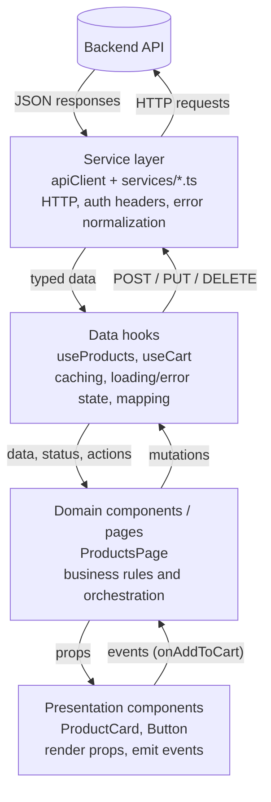
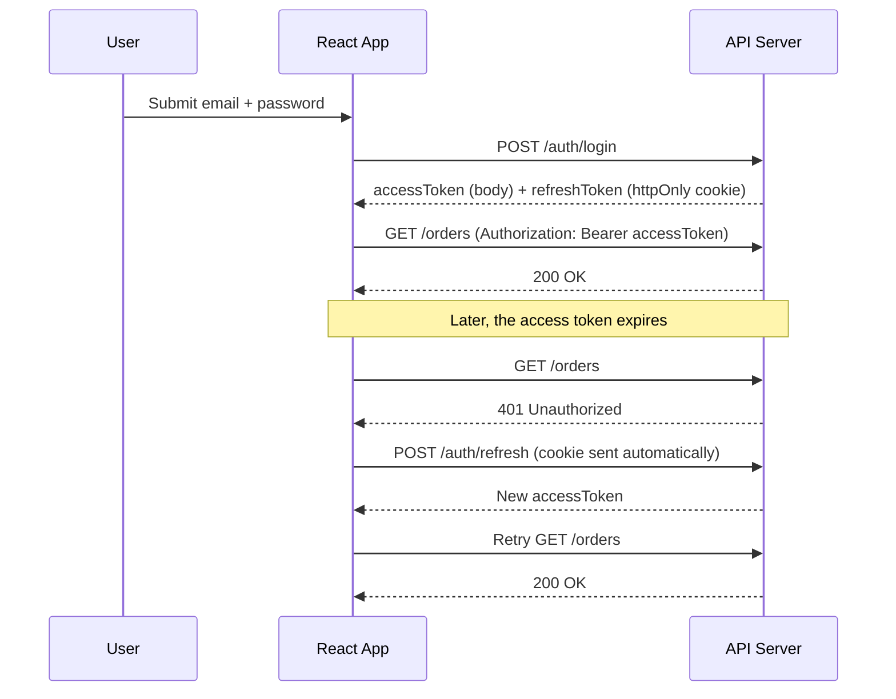

# React quickstart - Essential notes by Renato Lins  


React was initially created by Jordan Walke, a software engineer at Facebook (now Meta), and released as an open-source project in 2013. React's purpose is to enable efficient and dynamic user interface (UI) development for web applications by leveraging a component-based architecture and a virtual DOM. With its declarative syntax and unidirectional data flow, React has become one of the most popular JavaScript libraries for building fast, scalable, and maintainable front-end applications. Since its release, React has evolved to power modern web development, being widely adopted by developers and major companies worldwide. In October 2025, Meta announced that React would move to the React Foundation, an independent foundation hosted by the Linux Foundation.

These notes target **React 19** and modern tooling (Vite, TypeScript, and a linter). Short side notes mention tools and APIs that were common in the past, so you can recognize them when you find them in other material.

**How to use this guide**

- Sections 1–15 cover the fundamentals using plain JavaScript (`.jsx` files), so you can focus on React itself.
- Section 16 introduces TypeScript, and from there on examples use TypeScript (`.tsx` files), as most professional projects do.
- Examples are small and self-contained. The easiest way to try them is inside a Vite project (section 4).

## Table of contents 

- [1. Considerations about React](#1-considerations-about-react)
- [2. React Architecture and Ecosystem Overview](#2-react-architecture-and-ecosystem-overview)
- [3. Essential JavaScript Knowledge Before Coding with React](#3-essential-javascript-knowledge-before-coding-with-react)
- [4. Getting Started with React + Vite](#4-getting-started-with-react--vite)
- [5. Components in React](#5-components-in-react)
- [6. Styling Components: Valid Options and Examples](#6-styling-components-valid-options-and-examples)
- [7. Styling Components with Tailwind CSS](#7-styling-components-with-tailwind-css)
- [8. Local State and the `useState` Hook](#8-local-state-and-the-usestate-hook)
- [9. Side Effects and the `useEffect` Hook](#9-side-effects-and-the-useeffect-hook)
- [10. Understanding Lifecycle in React](#10-understanding-lifecycle-in-react)
- [11. Essential React Concepts: Destructuring, Keys, Props Drilling, and Lifting State](#11-essential-react-concepts-destructuring-keys-props-drilling-and-lifting-state)
- [12. State Management with Context API and Related Hooks](#12-state-management-with-context-api-and-related-hooks)
- [13. Direct DOM Manipulations with the `useRef` Hook](#13-direct-dom-manipulations-with-the-useref-hook)
- [14. Optimization Hooks: `useMemo` and `useCallback`](#14-optimization-hooks-usememo-and-usecallback)
- [15. Components: Composition, Presentation and Best Practices](#15-components-composition-presentation-and-best-practices)
- [16. React + TypeScript](#16-react--typescript)
- [17. Functional vs. Class Components](#17-functional-vs-class-components)
- [18. Fetching Data in React](#18-fetching-data-in-react)
- [19. Handling Forms Natively](#19-handling-forms-natively)
- [20. Handling Forms with React Hook Form](#20-handling-forms-with-react-hook-form)
- [21. Routing with React Router](#21-routing-with-react-router)
- [22. Managing Complex Requests and Race Conditions](#22-managing-complex-requests-and-race-conditions)
- [23. Custom Hooks](#23-custom-hooks)
- [24. Compound Components](#24-compound-components)
- [25. Higher-Order Components (HOCs)](#25-higher-order-components-hocs)
- [26. Render Props Pattern](#26-render-props-pattern)
- [27. Data Fetching and Caching with SWR](#27-data-fetching-and-caching-with-swr)
- [28. Managing the Flow of Data](#28-managing-the-flow-of-data)
- [29. Consuming GraphQL Data](#29-consuming-graphql-data)
- [30. Testing Components](#30-testing-components)
- [31. Headless Components and shadcn/ui](#31-headless-components-and-shadcnui)
- [32. Performance and Optimizations](#32-performance-and-optimizations)
- [33. Authentication and Authorization (JWT + Interceptors)](#33-authentication-and-authorization-jwt--interceptors)
- [34. Security Considerations](#34-security-considerations)
- [BONUS: General Best Practices for Professionals](#bonus-general-best-practices-for-professionals)
- [Further Resources](#further-resources)

---

### 1. Considerations about React  

Learning React can significantly enhance your front-end development skills and career opportunities in the tech industry. Its widespread adoption, active community, and integration with modern tools make React a highly sought-after skill for building web and mobile applications. Mastering React opens doors to opportunities in UI/UX development, single-page applications (SPAs), mobile app development (via React Native), and server-side rendering (SSR). React's simplicity, flexibility, and ecosystem position it as a cornerstone for developers in the ever-evolving front-end landscape.

**Key Features of React:**

__Component-Based Architecture__: React allows developers to break UIs into modular, reusable components. Each component manages its logic and presentation, making codebases more maintainable and scalable.

__Virtual DOM__: React uses a virtual DOM to optimize UI updates. Changes are first made in a lightweight virtual representation of the DOM, and React calculates the minimal set of updates needed to reflect changes in the actual DOM, improving performance.

__Declarative Syntax__: React provides a declarative way to build UIs. Developers describe what the UI should look like, and React takes care of updating the DOM based on state changes, reducing complexity.

__Unidirectional Data Flow__: React enforces a unidirectional data flow, where data flows from parent components to child components. This makes state management predictable and debugging easier.

**Things to Consider Before Choosing React:**

- **React is a library, not a full framework.** It handles the view layer. Routing, data fetching, forms, and global state come from other libraries, or from a framework built on React (such as Next.js or React Router's framework mode). This flexibility is powerful, but it means you make (and maintain) more architectural decisions.
- **The ecosystem moves fast.** Recommended patterns and tools evolve quickly. Prefer the official docs at [react.dev](https://react.dev) and check the date of any tutorial you follow.
- **Client-side rendering has trade-offs.** A plain React single-page application must download and run JavaScript before content appears, which affects first-load performance and SEO. For content-heavy or SEO-critical sites, consider a framework with server rendering, or a content-first tool such as Astro.
- **Learn JavaScript first.** Many of the problems beginners face in React are really JavaScript problems (references, closures, async code, immutability). Section 3 covers the essentials.
- **Know what modern React offers.** React 18 introduced concurrent rendering (`useTransition`, `useDeferredValue`, automatic batching). React 19 added Actions and form hooks (`useActionState`, `useOptimistic`, `useFormStatus`), the `use` API, `ref` as a regular prop, and stable Server Components for frameworks. The **React Compiler** (stable since 2025) can memoize components automatically.

---

### 2. React Architecture and Ecosystem Overview  

Understanding React’s core architecture and its ecosystem is essential for building efficient and scalable applications. React’s architecture focuses on the foundational concepts and tools that power the library, while its ecosystem includes additional tools and libraries that enhance development. So we can consider:

**Core Architecture:**

__Components__: Components are the building blocks of React applications. They can be functional or class-based and encapsulate both UI and logic. Components can accept input via props and manage internal state.  

__State and Props__:  
- __State__: State represents data or variables that may change over time and trigger UI updates. Components use state to manage dynamic content.  
- __Props__: Props (properties) allow data to be passed from parent components to child components, enabling dynamic and reusable components.  

__Virtual DOM__: React minimizes direct manipulation of the real DOM by using a virtual DOM. Changes are made to this lightweight representation first, and React determines the minimal set of updates needed to sync it with the real DOM.  

__Reconciliation__: React’s reconciliation algorithm efficiently compares the previous and new virtual DOM trees, ensuring that only necessary updates are applied to the real DOM.  

__Hooks__: Introduced in React 16.8, hooks let function components use state, side effects, and other React features without classes. Key hooks include:  
- `useState` / `useReducer`: Manage local state.  
- `useEffect`: Synchronizes a component with external systems (APIs, subscriptions, timers, the DOM).  
- `useContext`: Reads values shared through Context without prop drilling.  
- `useRef`: Holds mutable values and references to DOM elements.  
- `useMemo` / `useCallback`: Memoize values and functions.  
- React 19 additions: `use`, `useActionState`, `useOptimistic`, and `useFormStatus` (from `react-dom`).  

__React Lifecycle__: React components have lifecycle phases: mounting, updating, and unmounting. Class components use lifecycle methods like `componentDidMount`, while functional components achieve the same functionality with hooks like `useEffect`.  

__JSX__: JSX allows developers to write HTML-like syntax within JavaScript. Build tools (Babel, SWC, esbuild) compile it into plain JavaScript function calls (`jsx()` from `react/jsx-runtime`). In the past, JSX was compiled into `React.createElement` calls.  

__React Fiber__: React Fiber, introduced in React 16, optimizes rendering by breaking work into smaller incremental units, enabling better task prioritization and smoother UI updates. It is the foundation of the concurrent rendering features added in React 18.  

__Context API__: Provides a built-in solution for sharing state across components without prop drilling, improving code readability and maintainability.  

__React DOM__: React DOM handles rendering React components in the browser, bridging the virtual DOM and the real DOM for efficient updates and rendering.  

__Server Components__: Components that run only on the server (at build time or per request) and send their rendered output to the browser instead of their JavaScript. They require framework support (for example, the Next.js App Router), so they are outside the scope of this Vite-based guide, but they are worth knowing about.  

**React Ecosystem:**

__React Router__: A library for managing navigation and routing in React applications, enabling seamless single-page application (SPA) behavior and dynamic content loading. It can also work as a full-stack framework ("framework mode").  

__React Native__: Extends React to mobile development, allowing cross-platform mobile apps for iOS and Android using JavaScript and React’s component-based architecture. **Expo** is the recommended way to start a React Native project.  

__State Management__: Libraries like Redux Toolkit, Zustand, or Jotai complement React’s built-in state to manage complex client state more effectively. (Recoil was another option in the past, so you may see it mentioned in older material.)  

__Server State and Data Fetching__: TanStack Query, SWR, and Apollo Client (for GraphQL) handle caching, deduplication, background refreshes, and loading/error states for data that lives on a server.  

__Next.js__: A framework for server-side rendering (SSR) and static site generation (SSG), providing features like file-based routing, API routes, React Server Components, and performance optimizations for scalable applications.  

__Styling__: Tailwind CSS, CSS Modules, Sass, and CSS-in-JS libraries such as Styled Components and Emotion (see sections 6 and 7).  

__Component Libraries__: Headless libraries such as Radix UI and React Aria, copy-in collections such as shadcn/ui, and complete design systems such as MUI and Mantine (see section 31).  

__Forms__: React Hook Form, often combined with Zod for schema validation (see section 20).  

__Tooling__: Vite is the most common build tool for client-side React apps today (in the past, most projects were built with Webpack). TypeScript, a linter that enforces the Rules of Hooks (ESLint with `eslint-plugin-react-hooks`, or the faster oxlint used by current Vite templates), and Prettier are standard companions, and React DevTools helps you inspect components and profile performance.  

__Testing__: Vitest or Jest together with React Testing Library for unit and integration tests, and Playwright or Cypress for end-to-end tests (see section 30).  

---

### 3. Essential JavaScript Knowledge Before Coding with React  

React is a JavaScript library designed to solve common problems in building user interfaces, such as efficiently updating the DOM and managing state. Since React is built on top of JavaScript, having a solid understanding of the language's fundamentals is essential to use React effectively. Knowing the basics of JavaScript will help you better grasp React's concepts and enable you to write clean, maintainable code. Below are key JavaScript concepts you should master before diving into React.

**1. Data Types**

```javascript
let age = 42;                    // Number
let name = "John";               // String
let isAllowed = true;            // Boolean
let items = [1, 2, 3];           // Array (a special kind of object)
let someData = { key: "value" }; // Object
let someValue = null;            // Null
let myVar;                       // Undefined
```

**2. Arrow Functions**

```javascript
// Arrow Function
const add = (a, b) => a + b;  
console.log(add(2, 3)); // 5  
```

**3. Template Strings**

```javascript
const name = "John";
console.log(`Hello, ${name}!`); // Hello, John!
```

**4. Essential Array Methods**  

- **`map`**:  

```javascript
const numbers = [1, 2, 3];
const doubled = numbers.map(n => n * 2);
console.log(doubled); // [2, 4, 6]
```

- **`filter`**:

```javascript
const numbers = [1, 2, 3, 4];
const evens = numbers.filter(n => n % 2 === 0);
console.log(evens); // [2, 4]
```

- **`find`**:

```javascript
const numbers = [1, 2, 3];
const found = numbers.find(n => n > 2);
console.log(found); // 3
```

- **`forEach`**:

```javascript
[1, 2, 3].forEach(n => console.log(n));
// 1
// 2
// 3
```

- **`reduce`**:

```javascript
const prices = [10, 20, 30];
const total = prices.reduce((sum, price) => sum + price, 0);
console.log(total); // 60
```

In React, `map` is used constantly to turn arrays of data into lists of elements, and `filter`/`reduce` to derive values from state.

**5. Destructuring and Spread/Rest Operators**  

- **Destructuring**:

```javascript
const person = { name: "Alice", age: 25 };
const { name, age } = person;
console.log(name, age); // Alice 25

const [first, second] = [1, 2, 3];
console.log(first, second); // 1 2
```

- **Spread Operator**:

```javascript
const arr1 = [1, 2];
const arr2 = [...arr1, 3, 4];
console.log(arr2); // [1, 2, 3, 4]
```

- **Rest Operator**:

```javascript
const [first, ...rest] = [1, 2, 3, 4];
console.log(rest); // [2, 3, 4]
```

**6. Classes and Objects**  

```javascript
class Person {
  constructor(name, age) {
    this.name = name;
    this.age = age;
  }

  greet() {
    console.log(`Hello, my name is ${this.name}.`);
  }
}

const john = new Person("John", 30);
john.greet(); // Hello, my name is John.
```

In the past, React components were often written as classes, so it's useful to recognize this syntax (see sections 10 and 17).

**7. Modules and Imports**  

- **Exporting**:  

```javascript
// math.js
export const add = (a, b) => a + b;        // named export
export default function multiply(a, b) {   // default export (one per file)
  return a * b;
}
```

- **Importing**:  

```javascript
import multiply, { add } from './math.js';
console.log(add(2, 3));      // 5
console.log(multiply(2, 3)); // 6
```

**8. Promises + Async/Await**  

- **Promises**:  

```javascript
const fetchData = () => {
  return new Promise((resolve) => setTimeout(() => resolve("Data loaded"), 1000));
};

fetchData().then(result => console.log(result)); // Data loaded
```

- **Async/Await**:  

```javascript
const fetchData = async () => {
  try {
    const result = await new Promise(resolve => setTimeout(() => resolve("Data loaded"), 1000));
    console.log(result);
  } catch (error) {
    console.error("Something went wrong:", error);
  }
};

fetchData(); // Data loaded
```

**9. Immutability**  

- **Immutable Array Update**:  

```javascript
const numbers = [1, 2, 3];
// Add a new item
const newNumbers = [...numbers, 4]; 
console.log(newNumbers); // [1, 2, 3, 4]
```

- **Immutable Object Update**:  

```javascript
const person = { name: "Alice", age: 25 };
// Update age
const updatedPerson = { ...person, age: 26 };
console.log(updatedPerson); // { name: "Alice", age: 26 }
```

React decides whether to re-render by comparing references, so state must be replaced with new arrays and objects instead of being mutated (see section 8).

**10. Conditional Expressions**

JSX only accepts expressions, so these operators replace `if` statements inside markup:

```javascript
const isLoggedIn = true;
const user = { profile: { name: "Alice" } };
const settings = { theme: null };

// Ternary operator: choose between two values
const label = isLoggedIn ? "Logout" : "Login";

// Logical AND: returns the second value only if the first is truthy
const greeting = isLoggedIn && "Welcome back!";

// Optional chaining: safely access nested properties
console.log(user.profile?.name);   // "Alice"
console.log(user.address?.street); // undefined (no error)

// Nullish coalescing: fallback only for null or undefined
const theme = settings.theme ?? "light"; // "light"
```

> [!WARNING]
> Be careful with `&&` and numbers in JSX: `{items.length && <List />}` renders `0` when the array is empty. Use `{items.length > 0 && <List />}` instead.

**11. Closures**

```javascript
function createCounter() {
  let count = 0;
  return () => {
    count += 1;
    return count;
  };
}

const counter = createCounter();
console.log(counter()); // 1
console.log(counter()); // 2
```

A closure is a function that remembers the variables of the scope where it was created. Every event handler and effect in a React component is a closure over the props and state of the render that created it. This explains the "stale value" bugs you may meet with hooks, such as a timer that always sees the initial state (see sections 8 and 9).

---

### 4. Getting Started with React + Vite  

Starting with React can seem overwhelming due to the variety of tools and frameworks available today. However, the key is to begin with a simple setup that focuses on React's core concepts without introducing unnecessary complexity. Frameworks like **Next.js** or **React Router** (framework mode) offer powerful features such as server-side rendering (SSR), static site generation (SSG), and file-based routing, and the official React docs recommend them for production applications. However, they introduce many concepts that are not core to React, and this added complexity can overwhelm beginners who are still learning the basics.  

**Vite – An Easy Way to Start**

A modern and lightweight alternative is **Vite**. Vite provides a very fast development experience, optimized build times, and an easy setup process. It’s a great tool to start with React while maintaining flexibility, and it is also widely used in production for client-side applications.  

> [!NOTE]
> In the past, React projects were commonly created with **Create React App (CRA)**, so you may see it in older tutorials.

**Step-by-Step: Setting Up React with Vite**  

1. **Install Node.js**  

Install a current LTS version of Node.js (check the [Vite docs](https://vite.dev/guide/) for the minimum supported version). Check your installation by running:  

```bash
node -v
npm -v
```

2. **Create a New React Project with Vite**  

Run the following commands in your terminal:  

```bash
npm create vite@latest my-react-app -- --template react
cd my-react-app
npm install
```

The extra `--` passes the `--template` flag through npm to the Vite scaffolding tool. If you prefer, run `npm create vite@latest` without arguments and follow the prompts: if you are just starting to use React, you can simply choose **React** and **JavaScript**.

__NOTE:__ While TypeScript is highly recommended for many benefits, this guide will initially focus on React with JavaScript. Later in this tutorial (section 16), we will consider TypeScript as well, using the `react-ts` template.

3. **Start the Development Server**  

Run the project locally:  

```bash
npm run dev
```

This will start a development server, and you can access your React app at `http://localhost:5173` (the terminal shows the exact URL). You'll be presented with a sample application, which you can clean, adapt, enhance, etc. Typically, developers begin with a 'cleanup' phase, where they remove everything unnecessary before starting to code.

**Understanding the Project Structure**

```plaintext
my-react-app/
├── index.html          # The single HTML page; it loads src/main.jsx
├── package.json        # Scripts and dependencies
├── vite.config.js      # Vite configuration (plugins, aliases, server options)
├── .oxlintrc.json      # Linting rules (oxlint), including the Rules of Hooks
├── public/             # Static files served as-is
└── src/
    ├── main.jsx        # Entry point: mounts React into the #root element
    ├── App.jsx         # Root component
    ├── App.css
    ├── index.css
    └── assets/         # Images and other files imported from code
```

The entry point, `src/main.jsx`, looks like this:

```jsx
import { StrictMode } from "react";
import { createRoot } from "react-dom/client";
import "./index.css";
import App from "./App.jsx";

createRoot(document.getElementById("root")).render(
  <StrictMode>
    <App />
  </StrictMode>
);
```

- **`createRoot`** connects React to a real DOM element (`<div id="root">` in `index.html`).
- **`StrictMode`** is a development-only helper. It intentionally renders components twice and runs effects twice (mount → cleanup → mount) to reveal bugs such as missing cleanups. Seeing logs twice in development is expected. Production builds are not affected.

**Writing Your First React Component**  

Inside `src/App.jsx`, replace the content with the following:  

```jsx
function App() {
  return (
    <div>
      <h1>Hello, React!</h1>
      <p>Let's start building awesome apps.</p>
    </div>
  );
}

export default App;
```

Save the file and see the changes automatically reflected in your browser. This is the power of **Hot Module Replacement (HMR)** provided by Vite: edits are applied without a full page reload, preserving component state whenever possible.

**Useful Scripts**

| Command           | What it does                                              |
|-------------------|-----------------------------------------------------------|
| `npm run dev`     | Starts the development server with HMR                    |
| `npm run build`   | Creates an optimized production build in the `dist/` folder |
| `npm run preview` | Serves the production build locally for a final check    |
| `npm run lint`    | Runs the linter (oxlint in the Vite templates; many projects use ESLint) |

---

### 5. Components in React

Components are the building blocks of a React application. They define the structure, logic, and appearance of the user interface. React allows you to create components using both **class-based** and **functional** approaches. Below, we cover the essentials of components in React, including props, JSX rules, conditional rendering, and event handling. Styling options are covered in sections 6 and 7.

> [!NOTE]
> Examples in this guide import only what they use, such as `import { useState } from "react"`. In the past, every file that used JSX also needed `import React from "react"`, so you'll see that line in older examples.

**Props (short for properties)**

Props are how data is passed from parent components to child components. They allow components to be dynamic and reusable by accepting input data. For example:

```jsx
function Greeting(props) {
  return <h1>Hello, {props.name}!</h1>;
}

function App() {
  return <Greeting name="John" />;
}
```

In the above example, the `Greeting` component receives a prop called `name` and renders it within the `<h1>` tag. The value for `name` is passed from the parent component (`App`).

Props are **read-only**, meaning they cannot be modified by the child component. They are passed down from the parent and are used for customization.

Component names must start with a **capital letter** (`Greeting`, not `greeting`). React treats lowercase tags such as `<div>` as HTML elements and capitalized tags as components.

**Class Components**  

Class components were the traditional way to define components before React introduced hooks. They extend from `Component` and have lifecycle methods. Example:

```jsx
import { Component } from "react";

class Greeting extends Component {
  render() {
    return <h1>Hello, {this.props.name}!</h1>;
  }
}

class App extends Component {
  render() {
    return <Greeting name="John" />;
  }
}
```

**Functional Components**  

Functional components are now the preferred method for creating components, especially with the introduction of **hooks**. They are simpler and more concise than class components. Example:

```jsx
function Greeting(props) {
  return <h1>Hello, {props.name}!</h1>;
}

function App() {
  return <Greeting name="John" />;
}
```

Functional components are easier to work with and often result in cleaner code, especially with the use of hooks like `useState` and `useEffect`. Section 17 compares both approaches in detail.

**JSX Rules**

JSX looks like HTML, but it follows a few rules of its own:

- A component must return a **single root element**. Use a Fragment (`<>...</>`) to group elements without adding an extra DOM node.
- All tags must be **closed**, including self-closing ones (``, `<input />`, `<br />`).
- Use `className` instead of `class`, and `htmlFor` instead of `for`.
- Attributes are written in **camelCase** (`onClick`, `tabIndex`, `maxLength`), except `aria-*` and `data-*` attributes.
- Curly braces `{}` accept any JavaScript **expression** (values, function calls, ternaries), but not statements such as `if` or `for`.

```jsx
function Profile() {
  return (
    <>
      
      <label htmlFor="bio">Bio</label>
      <textarea id="bio" maxLength={200} />
    </>
  );
}
```

**Interpolation**

Interpolation is a way to embed variables or expressions inside JSX. You can use curly braces `{}` to interpolate JavaScript expressions inside the JSX. For example:

```jsx
function Greeting(props) {
  const greeting = "Hello";
  return <h1>{greeting}, {props.name}!</h1>;
}
```

Here, `greeting` and `props.name` are embedded within the JSX.

**Conditional Rendering**

Use regular JavaScript to decide what to render: early returns, the ternary operator, and `&&`.

```jsx
function Status({ isOnline, unreadCount }) {
  if (isOnline === undefined) return null; // returning null renders nothing

  return (
    <div>
      <p>{isOnline ? "Online" : "Offline"}</p>
      {unreadCount > 0 && <p>You have {unreadCount} unread messages</p>}
    </div>
  );
}
```

**Rendering Lists**

Use `map` to turn an array into elements. Each element needs a unique `key` (see section 11):

```jsx
function FruitList() {
  const fruits = [
    { id: 1, name: "Apple" },
    { id: 2, name: "Banana" },
  ];

  return (
    <ul>
      {fruits.map((fruit) => (
        <li key={fruit.id}>{fruit.name}</li>
      ))}
    </ul>
  );
}
```

**Event Handling**

In React, events such as clicks, form submissions, and input changes are handled with **event handlers**. The syntax is similar to regular JavaScript, but React uses a **camelCase** naming convention for event names. Example of a click event:

```jsx
function Button() {
  const handleClick = () => {
    alert("Button clicked!");
  };

  return <button onClick={handleClick}>Click me</button>;
}
```

Here, `onClick` is a React event handler that is triggered when the button is clicked. The event handler `handleClick` is defined as a function that displays an alert when called.

**Passing Arguments and Using the Event Object**

Pass a function to the event prop, don't call it. To pass arguments, wrap the call in an arrow function. Handlers receive an event object, which you can use to prevent the browser's default behavior:

```jsx
function TodoActions({ id, onDelete }) {
  const handleSubmit = (event) => {
    event.preventDefault(); // stops the browser from reloading the page
    console.log("Form submitted");
  };

  return (
    <form onSubmit={handleSubmit}>
      {/* Correct: the arrow function runs onDelete(id) only when clicked */}
      <button type="button" onClick={() => onDelete(id)}>Delete</button>

      {/* Wrong: onDelete(id) would run immediately, on every render */}
      {/* <button onClick={onDelete(id)}>Delete</button> */}

      <button type="submit">Save</button>
    </form>
  );
}
```

---

### 6. Styling Components: Valid Options and Examples

React components can be styled in several ways, depending on your preferences and the needs of the project. Below are some common styling approaches:

**1. Traditional .css Files**  

We can use regular `.css` files to style React components. This is the traditional way of adding styles, and the styles are global unless scoped with class names. Example:

```css
/* styles.css */
.button {
  background-color: blue;
  color: white;
}
```

```jsx
import './styles.css';

function Button() {
  return <button className="button">Click me</button>;
}
```

Because the styles are global, class names from different components can collide. Naming conventions such as BEM (`.card__title--active`) reduce that risk.

**2. Inline Styles**  

The `style` prop accepts a JavaScript object with camelCase property names:

```jsx
function Alert({ isError }) {
  const style = {
    padding: "12px 16px",
    backgroundColor: isError ? "#fde2e2" : "#e2f5e9",
    borderRadius: 8, // numbers are treated as pixels
  };

  return <div style={style}>Something happened</div>;
}
```

Inline styles are handy for truly dynamic values (for example, a computed width or position), but they do not support pseudo-classes (`:hover`), media queries, or animations, and they mix presentation with markup.

**3. Sass**  

Sass is a popular CSS preprocessor that extends CSS with variables, nesting, and other features. Vite supports `.scss` files as soon as the Sass compiler is installed (`npm install -D sass`). Example:

```scss
/* styles.scss */
$button-color: blue;

.button {
  background-color: $button-color;
  color: white;
}
```

```jsx
import './styles.scss';

function Button() {
  return <button className="button">Click me</button>;
}
```

Sass can also be combined with CSS Modules by naming the file `Button.module.scss`.

**4. CSS Modules**  

CSS Modules are a way to scope your CSS to individual components. This prevents class name conflicts across components. Vite supports them out of the box: any file ending in `.module.css` is scoped, and its class names are turned into unique identifiers at build time. Example:

```css
/* Button.module.css */
.button {
  background-color: blue;
  color: white;
}
```

```jsx
// Button.jsx
import styles from './Button.module.css';

function Button() {
  return <button className={styles.button}>Click me</button>;
}
```

**5. Styled Components**  

Styled Components is a popular library that lets you write CSS directly within JavaScript. It uses tagged template literals to define styles. Example:

```jsx
import styled from 'styled-components';

const Button = styled.button`
  background-color: blue;
  color: white;
`;

function App() {
  return <Button>Click me</Button>;
}
```

> [!NOTE]
> Runtime CSS-in-JS libraries generate styles in the browser while the app runs. This adds some overhead, and they can't be used inside React Server Components. Zero-runtime alternatives such as vanilla-extract or Panda CSS keep a similar authoring style but generate the CSS at build time.

**6. JSS (JavaScript Style Sheets)**  

JSS is another approach to write CSS directly in JavaScript. It allows for dynamic styling based on props or state. Example:

```jsx
import { createUseStyles } from 'react-jss';

const useStyles = createUseStyles({
  button: {
    backgroundColor: 'blue',
    color: 'white',
  },
});

function Button() {
  const classes = useStyles();
  return <button className={classes.button}>Click me</button>;
}
```

JSS was especially popular in the past (MUI used it for styling before version 5).

**Choosing a Styling Approach**

| Approach                  | Scoping                       | Dynamic styles             | Runtime cost       | Good fit for                                  |
|---------------------------|-------------------------------|----------------------------|--------------------|-----------------------------------------------|
| Global CSS                | Global (naming conventions)   | By toggling classes        | None               | Small apps, resets, and base styles           |
| Inline styles             | Single element                | Excellent                  | Minimal            | One-off computed values                       |
| Sass                      | Global (or modules)           | By toggling classes        | None (build time)  | Teams that like variables, mixins, nesting    |
| CSS Modules               | Component                     | Classes and CSS variables  | None               | Most apps; a safe default                     |
| Tailwind CSS              | Utility classes               | Conditional classes        | None               | Fast iteration and consistent design systems  |
| Styled Components / JSS   | Component                     | Excellent (via props)      | Runtime            | Prop-driven styles and theming in JavaScript  |

Considerations:

- Pick one primary approach per project. Mixing several makes styles harder to find and override.
- CSS custom properties (`--brand-color`) work with every approach and are a simple way to implement themes such as dark mode.
- Small helpers like [`clsx`](https://github.com/lukeed/clsx) make conditional class names readable: `clsx("button", isActive && "button--active")`.

---

### 7. Styling Components with Tailwind CSS

**Tailwind CSS** is a utility-first CSS framework that provides a collection of pre-defined classes you can apply directly in your JSX to style elements. This approach has gained significant popularity, especially in modern React applications, due to its efficiency, simplicity, and flexibility. Tailwind simplifies the CSS writing process and streamlines the development workflow, which is why it has become widely adopted.

**Advantages of Tailwind CSS:**

1. **Efficiency**: Tailwind allows you to apply styles directly in your JSX through utility classes. This reduces the need to switch between HTML and CSS files and eliminates the need to write custom CSS for many common design patterns. With utility classes, you can quickly style elements and make layout adjustments on the fly.

2. **Consistency**: By using predefined utility classes, you can ensure a consistent design system across your application. Tailwind provides a set of design utilities (e.g., `bg-blue-500`, `text-white`, `p-2`, `rounded-lg`) that make it easier to maintain visual consistency throughout the project.

3. **No CSS Specificity Issues**: Traditional CSS often leads to problems with specificity when styling components. Since Tailwind uses atomic classes with predefined styles, you don’t have to worry about overriding styles or dealing with CSS specificity conflicts.

4. **Highly Customizable**: While Tailwind comes with a default set of utility classes, it is highly customizable. You extend or modify the default theme (colors, spacing, fonts, breakpoints) directly in CSS with the `@theme` directive. In the past, Tailwind was configured through a `tailwind.config.js` file.

5. **Responsive Design**: Tailwind comes with built-in responsive design utilities. You can add classes like `sm:`, `md:`, and `lg:` to style elements differently on various screen sizes. This makes it easy to create a fully responsive layout without writing custom media queries.

6. **Small Production CSS**: Tailwind scans your source files and generates only the classes you actually use.

**Setting Up Tailwind in a React Project with Vite:**

Tailwind v4 provides a dedicated Vite plugin, so the setup takes three steps:

1. Install the packages:

```bash
npm install tailwindcss @tailwindcss/vite
```

2. Add the plugin to `vite.config.js`:

```js
import { defineConfig } from "vite";
import react from "@vitejs/plugin-react";
import tailwindcss from "@tailwindcss/vite";

export default defineConfig({
  plugins: [react(), tailwindcss()],
});
```

3. Replace the content of `src/index.css` with a single import (the Vite template already imports this file in `main.jsx`):

```css
@import "tailwindcss";
```

For details and troubleshooting, see the official guide: [Installing Tailwind CSS with Vite](https://tailwindcss.com/docs/installation/using-vite).

**Using Tailwind in Your Components**:

Let’s walk through creating a button component with Tailwind. To keep things organized, we’ll start by structuring the project into separate folders. Specifically, we’ll create a folder for our components and then add a file for the button component.

```
/src
  /components
    Button.jsx
```

To define the button component in `Button.jsx`, we can do something like this:

```jsx
function Button() {
  return (
    <button className="bg-blue-500 text-white py-2 px-4 font-bold hover:bg-blue-600 transition-colors duration-200 ease-in-out">
      Click me
    </button>
  );
}

export default Button;
```

In this example:

- **`bg-blue-500`**: Sets the initial background color of the button to a blue shade.
- **`text-white`**: Makes the text color white.
- **`py-2 px-4`**: Adds padding to the button: `py-2` for vertical padding and `px-4` for horizontal padding.
- **`font-bold`**: Makes the text bold.
- **`hover:bg-blue-600`**: Changes the background color to a slightly darker blue when the button is hovered over.
- **`transition-colors`**: Smoothly transitions the background color on hover.
- **`duration-200`**: Sets the transition duration to 200 milliseconds.
- **`ease-in-out`**: Applies an easing effect for a smoother transition, both at the beginning and end.

Next, in the `App.jsx` file, import and use the `Button` component you just created.

```jsx
import Button from './components/Button'; // Importing the Button component

function App() {
  return (
    <div className="App p-10">
      <Button />
    </div>
  );
}

export default App;
```

The result will be:


**Customizing the Theme**

Design tokens defined with `@theme` become utility classes automatically:

```css
/* src/index.css */
@import "tailwindcss";

@theme {
  --color-brand-500: #2563eb;
  --color-brand-600: #1d4ed8;
  --font-display: "Inter", sans-serif;
}
```

Classes such as `bg-brand-500`, `hover:bg-brand-600`, and `font-display` are now available.

**Making the Button Reusable**

Real components accept variants and extra classes. A lookup object keeps class names complete, and `clsx` (`npm install clsx`) combines them:

```jsx
import clsx from "clsx";

const variants = {
  primary: "bg-blue-500 text-white hover:bg-blue-600",
  secondary: "bg-gray-200 text-gray-900 hover:bg-gray-300",
};

function Button({ variant = "primary", className, children, ...props }) {
  return (
    <button
      className={clsx(
        "py-2 px-4 font-bold transition-colors duration-200 ease-in-out",
        variants[variant],
        className
      )}
      {...props}
    >
      {children}
    </button>
  );
}

export default Button;

// Usage: <Button variant="secondary" onClick={handleCancel}>Cancel</Button>
```

When classes passed from outside may conflict with the defaults (for example, two different padding classes), [`tailwind-merge`](https://github.com/dcastil/tailwind-merge) resolves the override. shadcn/ui combines both libraries in a `cn()` helper (section 31).

**Considerations When Using Tailwind**

- **Never build class names dynamically**, as in `` `bg-${color}-500` ``. Tailwind finds classes by scanning your files for complete class names, so partial strings are not generated. Use a lookup object, as in the example above.
- **Long class lists are a signal to extract a component**, not to hide the classes with `@apply` everywhere.
- **Tailwind styles elements but does not add behavior or accessibility.** Keep semantic HTML and add focus styles (`focus-visible:ring-2`), so keyboard users can see where they are.

---

### 8. Local State and the `useState` Hook

In React, **local/component state** refers to data that is specific to a component and controls how that component behaves or appears. This state is managed within the component itself and can be changed over time in response to user interactions, API responses, or other events. React provides the `useState` hook to manage this local state in functional components. The `useState` hook is used to define and update local state within a component. It takes an initial state as an argument and returns an array with two elements:

1. **State variable**: The current value of the state.
2. **State setter function**: A function that updates the state.

Syntax:

```js
const [state, setState] = useState(initialState);
```

- `state`: The current value of the state.
- `setState`: The function to update the state.
- `initialState`: The value that the state should have initially (can be any data type, such as a number, string, array, or object).

**Example 1: Basic Usage**

In this example, we create a counter that increments every time the button is clicked.

```jsx
import { useState } from 'react';

function Counter() {
  // Declare a state variable 'count' initialized to 0
  const [count, setCount] = useState(0);

  // Function to increment the count
  const increment = () => {
    setCount(count + 1); // Update the state by adding 1 to the current count
  };

  return (
    <div>
      <p>Count: {count}</p>
      <button onClick={increment}>Increment</button>
    </div>
  );
}

export default Counter;
```

- **`useState(0)`**: Initializes the `count` state variable with the value `0`.
- **`setCount(count + 1)`**: Updates the `count` state when the button is clicked, triggering a re-render of the component with the new state value.

**Example 2: Using State with Other Data Types (String)**

You can also use `useState` to manage other types of data, such as strings.

```jsx
import { useState } from 'react';

function Greeting() {
  const [name, setName] = useState('John');

  const changeName = () => {
    setName('Jane'); // Update state with a new name
  };

  return (
    <div>
      <p>Hello, {name}!</p>
      <button onClick={changeName}>Change Name</button>
    </div>
  );
}

export default Greeting;
```

In this case:
- **`useState('John')`** initializes the `name` state with the string `"John"`.
- **`setName('Jane')`** updates the `name` state when the button is clicked, causing the component to re-render with the new name.

**Example 3: Using State with Objects**

React state can hold complex data types, such as objects. When dealing with objects, we need to spread the previous state to avoid overwriting existing properties, because the setter **replaces** the value instead of merging it.

```jsx
import { useState } from 'react';

function UserProfile() {
  const [user, setUser] = useState({ name: 'John', age: 30 });

  const updateAge = () => {
    setUser(prevState => ({
      ...prevState, // Spread the previous state
      age: prevState.age + 1, // Update the age property
    }));
  };

  return (
    <div>
      <p>Name: {user.name}</p>
      <p>Age: {user.age}</p>
      <button onClick={updateAge}>Increase Age</button>
    </div>
  );
}

export default UserProfile;
```

In this example:
- **`useState({ name: 'John', age: 30 })`** initializes the state with an object.
- **`setUser(prevState => ({ ...prevState, age: prevState.age + 1 }))`** updates the `age` property of the `user` object without losing the `name` property.

**Example 4: Using State with Arrays**

Adding, updating, and removing items always creates a new array:

```jsx
import { useState } from 'react';

function TodoList() {
  const [todos, setTodos] = useState([
    { id: 1, text: 'Learn React', done: false },
  ]);

  const addTodo = (text) => {
    setTodos((prev) => [...prev, { id: crypto.randomUUID(), text, done: false }]);
  };

  const toggleTodo = (id) => {
    setTodos((prev) =>
      prev.map((todo) => (todo.id === id ? { ...todo, done: !todo.done } : todo))
    );
  };

  const removeTodo = (id) => {
    setTodos((prev) => prev.filter((todo) => todo.id !== id));
  };

  return (
    <div>
      <button onClick={() => addTodo('New task')}>Add</button>
      <ul>
        {todos.map((todo) => (
          <li key={todo.id}>
            <label>
              <input type="checkbox" checked={todo.done} onChange={() => toggleTodo(todo.id)} />
              {todo.text}
            </label>
            <button onClick={() => removeTodo(todo.id)}>Remove</button>
          </li>
        ))}
      </ul>
    </div>
  );
}

export default TodoList;
```

**Important Considerations About State**

1. **State updates are scheduled, not immediate.** The new value is available on the next render:

```jsx
const handleClick = () => {
  setCount(count + 1);
  console.log(count); // still the old value
};
```

2. **Use an updater function when the next state depends on the previous one.** Each updater receives the latest pending value:

```jsx
const addThreeWrong = () => {
  // All three calls read the same `count`, so it only increases by 1
  setCount(count + 1);
  setCount(count + 1);
  setCount(count + 1);
};

const addThreeRight = () => {
  // Each updater receives the result of the previous one, so it increases by 3
  setCount((c) => c + 1);
  setCount((c) => c + 1);
  setCount((c) => c + 1);
};
```

3. **Never mutate state directly.** React compares references. If you mutate the existing object, React sees the same reference and may skip the re-render:

```jsx
// Wrong: mutates the current object
user.age = 31;
setUser(user);

// Right: creates a new object
setUser({ ...user, age: 31 });
```

4. **Use lazy initialization for expensive initial values.** Passing a function means it runs only on the first render:

```jsx
const [todos, setTodos] = useState(() => JSON.parse(localStorage.getItem('todos')) ?? []);
```

5. **Don't store values you can calculate.** Derived values can drift out of sync with the state they come from.

Avoid (`fullName` must be updated manually every time a name changes):

```jsx
const [fullName, setFullName] = useState('');
```

Prefer (compute it during render):

```jsx
const fullName = `${firstName} ${lastName}`;
```

6. **Updates are batched.** Since React 18, several state updates made in the same event (including inside promises and timeouts) produce a single re-render.

---

### 9. Side Effects and the `useEffect` Hook

In React, **side effects** refer to any operations or actions that interact with the outside world, such as fetching data from an API, updating the DOM directly, setting up subscriptions, or timers. These actions are not directly related to the component's render process, but they can affect the component's behavior. React provides the `useEffect` hook to handle side effects efficiently.

The `useEffect` hook runs after the component renders and can be used to trigger things like data fetching, subscriptions, or directly manipulating the DOM. It accepts two arguments: a function that contains the side effect logic and an optional dependency array.

```jsx
import { useEffect, useState } from 'react';

function ExampleComponent() {
  const [data, setData] = useState(null);

  // Side effect to fetch data
  useEffect(() => {
    fetch('https://jsonplaceholder.typicode.com/todos/1')
      .then(response => response.json())
      .then(result => setData(result))
      .catch(error => console.log('Error fetching data', error));
  }, []); // Empty array means the effect runs only once after the initial render

  return <pre>{data ? JSON.stringify(data, null, 2) : 'Loading...'}</pre>;
}
```

Objects can't be rendered directly in JSX, which is why the example converts the result to a string with `JSON.stringify`.

**Dependency Arrays and Controlling Re-renders**

The **dependency array** controls when the effect should run. If the array is empty (`[]`), the effect will only run once when the component mounts. If we pass specific state or props in the dependency array, the effect will only run when those values change.

So we can have situations like this:

```jsx
useEffect(() => {
  console.log('Effect ran on mount');
}, []); // This will only run the effect once, when the component first renders.
```

Or like this:

```jsx
useEffect(() => {
  console.log('Effect ran because count or name changed:', count, name);
}, [count, name]); // Runs when either 'count' or 'name' changes
```

If we include multiple dependencies in the array, the effect will run whenever any of the values in the array change.

> [!NOTE]
> In development, `StrictMode` runs every effect twice on mount (run → cleanup → run). This is intentional: if running an effect twice causes a problem, the effect is missing a cleanup function (section 10).

**Fetching data with async/await**

Fetching data is one of the most common side effects in React. The `useEffect` hook is ideal for triggering an API call when a component mounts, and we can use the `async/await` syntax for handling asynchronous operations more cleanly. Here’s an example closer to what a real-world React application might do:

```jsx
import { useState, useEffect } from 'react';

function FetchDataExample() {
  const [data, setData] = useState([]);
  const [loading, setLoading] = useState(true);
  const [error, setError] = useState(null);

  useEffect(() => {
    const fetchData = async () => {
      try {
        const response = await fetch('https://jsonplaceholder.typicode.com/users');
        if (!response.ok) {
          throw new Error(`Request failed with status ${response.status}`);
        }
        const result = await response.json();
        setData(result);
      } catch (error) {
        setError(error.message);
      } finally {
        setLoading(false);
      }
    };
    fetchData();
  }, []); // Empty dependency array means it runs once on mount

  if (loading) return <p>Loading...</p>;
  if (error) return <p>Error: {error}</p>;

  return (
    <ul>
      {data.map(item => <li key={item.id}>{item.name}</li>)}
    </ul>
  );
}
```

In this example, `useEffect` calls the `fetchData` function when the component mounts. The `loading` state helps to display a loading message while the data is being fetched, and the `error` state lets us show a message if something goes wrong. Note that `fetch` only rejects on network failures, so we check `response.ok` to treat HTTP errors (such as 404 or 500) as failures too.

**Why the Effect Function Can't Be `async`**

`useEffect` expects its callback to return either nothing or a cleanup function. An `async` function always returns a Promise, so instead of `useEffect(async () => ...)`, define the async function inside the effect and call it, as shown above.

**Common Pitfalls**

- **Missing dependencies cause stale values.** If the effect uses a prop or state value that isn't in the array, it keeps seeing the old value. The "exhaustive deps" lint rule catches this: `react-hooks/exhaustive-deps` in ESLint, or `react/exhaustive-deps` in oxlint. Current Vite templates enable only the Rules of Hooks by default, so turn this rule on too, and fix the code instead of silencing the warning.
- **Objects, arrays, and functions created during render change on every render.** Using them as dependencies can cause infinite loops:

```jsx
// Infinite loop: `options` is a new object on every render
const options = { page: 1 };
useEffect(() => {
  fetchItems(options).then(setItems);
}, [options]);

// Fix: depend on primitive values (or create the object inside the effect)
const page = 1;
useEffect(() => {
  fetchItems({ page }).then(setItems);
}, [page]);
```

- **Fast-changing dependencies can cause race conditions.** If a request for an old value finishes after a newer one, it can overwrite fresh data. Section 22 shows how to cancel stale requests.

**You Might Not Need an Effect**

Effects are an escape hatch for synchronizing with systems outside React. Many effects found in real codebases are unnecessary:

- **Transforming data for display** → calculate it during render (with `useMemo` if it is expensive).
- **Responding to a user action** (click, submit) → do it in the event handler.
- **Resetting state when a prop changes** → give the component a different `key`.
- **Fetching data in larger apps** → use a data library (SWR or TanStack Query, section 27) or a router loader (section 21).

Avoid (an extra render, and duplicated state that can get out of sync):

```jsx
const [visibleTodos, setVisibleTodos] = useState([]);
useEffect(() => {
  setVisibleTodos(todos.filter((todo) => !todo.done));
}, [todos]);
```

Prefer (derive the value during render):

```jsx
const visibleTodos = todos.filter((todo) => !todo.done);
```

The official article [You Might Not Need an Effect](https://react.dev/learn/you-might-not-need-an-effect) covers many more cases.

---

### 10. Understanding Lifecycle in React

In React, understanding the **lifecycle** of components is crucial as it defines how and when code is executed during the component's existence. The component lifecycle differs between **class components** and **functional components** due to syntax, performance optimizations, and features like hooks. The main React's **lifecycle states** are:

- **Mounting**: In **class components**, `componentDidMount` runs after the first render. In **functional components**, use `useEffect` with `[]`.  
- **Updating**: Triggered by state/prop changes. Class components use `componentDidUpdate`, while functional components use `useEffect` with dependencies.  
- **Unmounting**: Class components use `componentWillUnmount`, while functional components rely on a cleanup function in `useEffect`.  

Side note: in the past, class components also used methods such as `componentWillMount`, `componentWillReceiveProps`, and `componentWillUpdate`, so you may find them in older code.

Within an application, our implementations could be as such:

**1. Class components**

With class components, we use named lifecycle methods for the specific stage we want to capture:

```jsx
import { Component } from "react";

class Example extends Component {
  componentDidMount() {
    console.log("Component mounted: Perform side effects here!");
  }

  componentDidUpdate() {
    console.log("Component updated: Respond to prop or state changes!");
  }

  componentWillUnmount() {
    console.log("Component will unmount: Cleanup here!");
  }

  render() {
    return <div>Hello, Class Component!</div>;
  }
}
```

**2. Functional components**

Functional components can achieve the same behavior as class components using the `useEffect` hook. The lifecycle methods in class components map to specific usages of `useEffect`:

   - `componentDidMount` → **useEffect** with an empty dependency array.  
   - `componentDidUpdate` → **useEffect** with dependencies specified.  
   - `componentWillUnmount` → **Cleanup function** inside `useEffect`.

When discussing the lifecycle of functional components, it's important to also consider the **cleanup function**. In React, a cleanup function is an optional yet essential feature within the `useEffect` hook. React calls this function before the component unmounts or when the dependencies of the effect change, preventing memory leaks and ensuring proper resource management. Cleanup is useful for canceling timers, aborting API requests, or unsubscribing from event listeners. Without it, lingering side effects can lead to unintended behavior. React executes the cleanup function before re-running the effect or removing the component from the DOM, maintaining optimal performance and stability. Practical Example:  
  
```jsx
import { useState, useEffect } from "react";

function TimerComponent() {
  const [seconds, setSeconds] = useState(0);

  useEffect(() => {
    const timer = setInterval(() => {
      setSeconds((prev) => prev + 1); // updater function avoids a stale `seconds` value
    }, 1000);

    // Cleanup function: clear the interval when unmounting
    return () => {
      clearInterval(timer);
      console.log("Timer cleaned up");
    };
  }, []); // Runs only on mount

  return <div>Seconds passed: {seconds}</div>;
}
```

In this case, we can encapsulate the concept of the lifecycle within functional components like this:

```jsx
useEffect(() => {
  // Runs once on mount
}, []); // empty dependency array

useEffect(() => {
  // Runs on mount + whenever `dependency` changes
}, [dependency]); // specify a single dependency

useEffect(() => {
  // Runs on mount + when `dep1` OR `dep2` change
}, [dep1, dep2]); // multiple dependencies

useEffect(() => {
  // Runs on every render (mount and update)
}); // no dependency array

useEffect(() => {
  // Runs on mount and whenever `dependency` changes
  return () => {
    // Cleanup runs before the effect re-runs and when the component unmounts
  };
}, [dependency]);
```

**Lifecycle Equivalents at a Glance**

| Class component                                  | Function component                                                   |
|--------------------------------------------------|----------------------------------------------------------------------|
| `constructor` (initial state)                    | `useState(initialValue)`                                             |
| `componentDidMount`                              | `useEffect(fn, [])`                                                  |
| `componentDidUpdate`                             | `useEffect(fn, [deps])`                                              |
| `componentWillUnmount`                           | Cleanup function returned from `useEffect`                           |
| `shouldComponentUpdate`                          | `memo` (section 14)                                                  |
| `componentDidCatch` / `getDerivedStateFromError` | No hook equivalent: error boundaries are written as classes (section 17) |

**Shifting the Mental Model**

With hooks, it helps to think less about lifecycle moments ("do this on mount") and more about **synchronization** ("keep this subscription in sync with this `roomId`"). Each effect should handle one concern, with its own setup and cleanup. Split unrelated logic into separate effects instead of grouping it by timing.

**Render, Commit, and Effects**

Each update goes through three steps: React **renders** (calls your components to calculate the new UI), **commits** (applies the changes to the DOM), and then runs **effects** after the browser paints. If you need to measure the DOM and update it before the user sees anything (to avoid a visual flicker), `useLayoutEffect` runs synchronously after the commit and before paint. Use it sparingly, because it blocks painting.

---

### 11. Essential React Concepts: Destructuring, Keys, Props Drilling, and Lifting State

**1. Destructuring**

Destructuring simplifies the process of extracting properties from objects or arrays, making your code cleaner and more readable. In React, it is commonly used to access props or state. Example:

```jsx
function UserCard({ name, age }) {
  return (
    <div>
      <h2>{name}</h2>
      <p>Age: {age}</p>
    </div>
  );
}
```

This is equivalent to:  
```jsx
function UserCard(props) {
  const { name, age } = props;
  return (
    <div>
      <h2>{name}</h2>
      <p>Age: {age}</p>
    </div>
  );
}
```

Destructuring also lets you set **default values** and collect the remaining props with the rest operator:

```jsx
function Button({ label, variant = "primary", ...rest }) {
  // `rest` contains every other prop (onClick, disabled, type, ...)
  return (
    <button className={`btn btn-${variant}`} {...rest}>
      {label}
    </button>
  );
}
```

Benefits:  

- Reduces repetitive `props.propertyName`.  
- Makes the code concise and focused.
- Documents, at a glance, which props a component expects.

---

**2. Unique Keys for Lists**

When rendering lists in React, each element must have a unique `key` prop. Keys help React efficiently identify changes, additions, and removals in a list. They enable React to update the DOM efficiently and prevent unintended behavior by maintaining component identity. Example:

```jsx
function ItemList({ items }) {
  return (
    <ul>
      {items.map((item) => (
        <li key={item.id}>{item.name}</li>
      ))}
    </ul>
  );
}
```

Rules for keys:

- Keys must be **unique among siblings** (not globally) and **stable** between renders. IDs from your data are ideal.
- **Avoid using indices as keys** when items can be reordered, inserted, or removed: React would associate state (such as an input's value) with the wrong item. Indices are acceptable for static lists that never change order.
- **Never generate keys during render** (`key={Math.random()}` or `key={crypto.randomUUID()}`): every render creates new keys, so React recreates every item. Generate IDs when the data is created instead.
- Changing a component's `key` on purpose **resets its state**, which is a useful trick: `<ProfileForm key={userId} />` starts fresh whenever `userId` changes.

**3. Props Drilling**

Props drilling occurs when data is passed through multiple layers of components, even when only the deepest child uses the data. This is common in React apps but can lead to unnecessary complexity. Example:

```jsx
function Grandparent() {
  const message = "Hello, React!";
  return <Parent message={message} />;
}

function Parent({ message }) {
  return <Child message={message} />;
}

function Child({ message }) {
  return <div>{message}</div>;
}
```

Issues with Props Drilling:

- Increases coupling between components.  
- Makes components harder to maintain.

Solutions, from simplest to most powerful:

1. **Composition**: pass the child component itself through `children`, so intermediate components don't need to know about the data.
2. **Context**: share values with a whole subtree (section 12).
3. **A state management library** (Zustand, Redux Toolkit) for complex, frequently changing global state.

```jsx
function Grandparent() {
  const message = "Hello, React!";
  // Parent no longer receives (or needs to know about) `message`
  return (
    <Parent>
      <Child message={message} />
    </Parent>
  );
}

function Parent({ children }) {
  return <section className="parent">{children}</section>;
}
```

**4. Lifting State Up Between Components**

In React, shared state should reside in the closest common ancestor of the components that need it. This practice, called **lifting state up**, prevents duplication and ensures consistent data. Example:

```jsx
import { useState } from "react";

function Parent() {
  const [count, setCount] = useState(0);

  const handleIncrement = () => setCount((c) => c + 1);

  return (
    <div>
      <Child count={count} onIncrement={handleIncrement} />
    </div>
  );
}

function Child({ count, onIncrement }) {
  return (
    <div>
      <p>Count: {count}</p>
      <button onClick={onIncrement}>Increment</button>
    </div>
  );
}
```

In this example:  

- The `Parent` component manages the state (`count`).  
- The `Child` component displays and updates the state using props (`count` and `onIncrement`).

Benefits of Lifting State:  

- Eliminates redundant state.  
- Ensures a single source of truth.

A common naming convention: callback **props** start with `on` (`onIncrement`, `onSelect`), and the **functions** that handle them start with `handle` (`handleIncrement`, `handleSelect`).

---

### 12. State Management with Context API and Related Hooks  

The **Context API** is a powerful feature in React for managing and sharing state across components without prop drilling. When combined with hooks like `useContext` and `useReducer`, it enables a clean and scalable approach to state management. Below is a practical example, structured with proper file separation to maintain a clear separation of concerns.

**File Structure for Separation**  

```plaintext
src/
├── components/
│   └── ThemeToggler.jsx
├── context/
│   ├── ThemeContext.js
│   ├── ThemeProvider.jsx
│   └── themeReducer.js
├── App.jsx
└── main.jsx
```

**Step 1: Create the Reducer**  

The reducer defines how the state should change based on actions. It is a pure function: it receives the current state and an action, and returns the next state.

**File: `context/themeReducer.js`**  

```javascript
export const themeReducer = (state, action) => {
  switch (action.type) {
    case "SET_LIGHT":
      return { ...state, theme: "light" };
    case "SET_DARK":
      return { ...state, theme: "dark" };
    default:
      throw new Error(`Unhandled action type: ${action.type}`);
  }
};
```

**Step 2: Create the Context and a Custom Hook to Consume It**  

The custom hook gives components a single, safe way to read the context, with a clear error if the provider is missing.

**File: `context/ThemeContext.js`**  

```javascript
import { createContext, useContext } from "react";

export const ThemeContext = createContext(null);

export function useTheme() {
  const context = useContext(ThemeContext);
  if (!context) {
    throw new Error("useTheme must be used within a ThemeProvider");
  }
  return context;
}
```

**Step 3: Create the Provider**  

In this example, the `ThemeProvider` will provide state and the dispatch function to all components in the tree.  

**File: `context/ThemeProvider.jsx`**  

```jsx
import { useMemo, useReducer } from "react";
import { ThemeContext } from "./ThemeContext";
import { themeReducer } from "./themeReducer";

export function ThemeProvider({ children }) {
  const [state, dispatch] = useReducer(themeReducer, { theme: "light" });

  // Memoizing the value means consumers re-render only when `state` changes
  const value = useMemo(() => ({ state, dispatch }), [state]);

  return <ThemeContext value={value}>{children}</ThemeContext>;
}
```

> [!NOTE]
> The context itself is rendered as the provider (`<ThemeContext value={...}>`). In the past, providers were written as `<ThemeContext.Provider value={...}>`, so you'll see that form in many examples.

Keeping the provider (a component) and the hook (not a component) in separate files also keeps Vite's Fast Refresh working, since it only preserves state for files that export components exclusively.

**Step 4: Create a Component to Consume the Context**  

This component uses the `useTheme` hook to access and interact with the global theme state.  

**File: `components/ThemeToggler.jsx`**  

```jsx
import { useTheme } from "../context/ThemeContext";

const ThemeToggler = () => {
  const { state, dispatch } = useTheme();

  return (
    <div>
      <p>Current Theme: {state.theme}</p>
      <button onClick={() => dispatch({ type: "SET_LIGHT" })}>Light Mode</button>
      <button onClick={() => dispatch({ type: "SET_DARK" })}>Dark Mode</button>
    </div>
  );
};

export default ThemeToggler;
```

**Step 5: Use the Component in the App**  

**File: `App.jsx`**  

```jsx
import ThemeToggler from "./components/ThemeToggler";

const App = () => (
  <div>
    <h1>Theme Manager</h1>
    <ThemeToggler />
  </div>
);

export default App;
```

**Step 6: Wrap the Application with the Provider**  

Ensure that the `ThemeProvider` is at the root of your component tree, so the context is accessible throughout the application.

**File: `main.jsx`**  

```jsx
import { StrictMode } from "react";
import { createRoot } from "react-dom/client";
import App from "./App";
import { ThemeProvider } from "./context/ThemeProvider";

createRoot(document.getElementById("root")).render(
  <StrictMode>
    <ThemeProvider>
      <App />
    </ThemeProvider>
  </StrictMode>
);
```

> [!NOTE]
> In the past, apps were mounted with `ReactDOM.render(<App />, document.getElementById("root"))`, so you may see that call in older tutorials.

**Key Concepts**  

1. **`createContext` (ThemeContext):**  
   - Creates the context object.  
   - The provider uses it to expose state and actions.  
   
2. **`useReducer` (themeReducer):**  
   - Manages state updates in a predictable and centralized manner.  
   - Enables easy addition of new actions without modifying individual components.  

3. **`useContext` (inside `useTheme`):**  
   - Consumes context to access global state and dispatch actions.  

**When to Choose `useReducer` Over `useState`**

- Several related values change together (for example, `status`, `data`, and `error`).
- The next state depends on non-trivial logic that you want to keep out of the components.
- You want to unit test state transitions: a reducer is a pure function, so it can be tested without rendering anything.

**Benefits of Separation using Context API**  

- **Scalability:** Each responsibility is isolated in its own file, making the codebase easier to scale.  
- **Maintainability:** Reducers, providers, and components can be updated or replaced independently.  
- **Reusability:** Other contexts can follow this same structure, keeping the project organized.  

**Considerations and Limitations of Context**

- **Every consumer re-renders when the context value changes.** Split contexts by concern (`ThemeContext`, `AuthContext`) instead of creating one giant "app context", and memoize the value as shown above.
- **Context is a way to pass data, not a state manager.** For large, frequently updated global state, libraries such as Zustand, Redux Toolkit, or Jotai let components subscribe only to the slice they need.
- **Server data (API responses) is usually better handled by a data-fetching library** such as SWR or TanStack Query than by context (section 27).
- **Don't reach for context too early.** For two or three levels, props and composition are simpler and more explicit.
- **React 19's `use(ThemeContext)`** reads a context like `useContext`, but it can also be called inside conditions and loops.

---

### 13. Direct DOM Manipulations with the `useRef` Hook  

React's declarative approach minimizes the need for direct DOM manipulations. However, certain **edge cases** require direct access to DOM elements. Examples include focusing an input field, measuring an element's dimensions, or working with third-party libraries that rely on DOM elements. The `useRef` hook provides a safe and controlled way to handle these situations.  

**What is `useRef`?**

`useRef` is a React hook that creates a mutable object with a `.current` property. This object persists across renders without causing re-renders when updated. It is particularly useful in scenarios where React's declarative model cannot fully handle the requirements.

**Characteristics of `useRef`**  

1. **DOM References**: Use `useRef` to directly interact with DOM elements through the `.current` property.  
2. **Persistent Across Renders**: Values in a `useRef` object do not reset between renders, unlike local variables.  
3. **No Trigger for Re-Renders**: Updates to `.current` do not cause the component to re-render.  

Below, we will check some edge case examples where `useRef` can be used.  

**Example 1: Managing Input Focus**  

A common edge case for `useRef` is managing focus, such as automatically focusing an input field when a page loads or when triggered by a user action.  

```jsx
import { useRef } from "react";

const FocusInput = () => {
  const inputRef = useRef(null);

  const handleFocus = () => {
    inputRef.current.focus(); // Directly focuses the input element
  };

  return (
    <div>
      <input ref={inputRef} type="text" placeholder="Click the button to focus me" />
      <button onClick={handleFocus}>Focus Input</button>
    </div>
  );
};

export default FocusInput;
```

**Why is this an edge case:** This situation arises only when you need to manage focus programmatically, something that React doesn’t handle natively in its declarative model.  

**Example 2: Measuring an Element's Dimensions**  

Sometimes, you need to measure an element's size or position dynamically. For instance, you might want to adjust a layout based on the width of a container.  

```jsx
import { useRef, useState } from "react";

const MeasureDiv = () => {
  const divRef = useRef(null);
  const [dimensions, setDimensions] = useState({ width: 0, height: 0 });

  const measureDiv = () => {
    if (divRef.current) {
      const { offsetWidth, offsetHeight } = divRef.current;
      setDimensions({ width: offsetWidth, height: offsetHeight });
    }
  };

  return (
    <div>
      <div
        ref={divRef}
        style={{ width: "200px", height: "100px", backgroundColor: "lightgray" }}
      >
        Measure me!
      </div>
      <button onClick={measureDiv}>Get Dimensions</button>
      <p>Width: {dimensions.width}px</p>
      <p>Height: {dimensions.height}px</p>
    </div>
  );
};

export default MeasureDiv;
```

**Why is this an edge case:** This is necessary only when the layout depends on runtime values like element dimensions, which cannot be predicted or declared beforehand.

**Example 3: Integration with Third-Party Libraries**  

Many third-party libraries, such as D3, Chart.js, or map libraries, expect a direct reference to a DOM element to render content. `useRef` is ideal for this use case.  

```jsx
import { useRef, useEffect } from "react";

const Chart = () => {
  const canvasRef = useRef(null);

  useEffect(() => {
    // Pseudo-code: replace ChartLibrary with a real library such as Chart.js
    const chart = ChartLibrary.render(canvasRef.current, { data: [10, 20, 30] });

    // Destroy the library instance on unmount to avoid memory leaks
    return () => chart.destroy();
  }, []);

  return <canvas ref={canvasRef} width={400} height={200}></canvas>;
};

export default Chart;
```

**Why is this an edge case:** React doesn’t natively support third-party DOM libraries, so `useRef` bridges the gap when external code needs direct DOM access. Keep the integration isolated inside one component, so the rest of the app stays declarative.

**Example 4: Storing Mutable Values That Don't Affect Rendering**  

Refs can also hold any value that must survive re-renders without triggering them, such as a timer ID:

```jsx
import { useEffect, useRef, useState } from "react";

function Stopwatch() {
  const [seconds, setSeconds] = useState(0);
  const intervalRef = useRef(null);

  const start = () => {
    if (intervalRef.current) return; // already running
    intervalRef.current = setInterval(() => setSeconds((s) => s + 1), 1000);
  };

  const stop = () => {
    clearInterval(intervalRef.current);
    intervalRef.current = null;
  };

  // Clear the interval if the component unmounts while running
  useEffect(() => () => clearInterval(intervalRef.current), []);

  return (
    <div>
      <p>{seconds}s</p>
      <button onClick={start}>Start</button>
      <button onClick={stop}>Stop</button>
    </div>
  );
}
```

**Passing Refs to Your Own Components**

`ref` is a regular prop for function components:

```jsx
import { useRef } from "react";

function TextInput({ ref, ...props }) {
  return <input ref={ref} {...props} />;
}

function Form() {
  const inputRef = useRef(null);

  return (
    <>
      <TextInput ref={inputRef} placeholder="Name" />
      <button onClick={() => inputRef.current.focus()}>Focus</button>
    </>
  );
}
```

Side note: in the past, components had to be wrapped in `forwardRef` to receive a `ref`, so you'll see `forwardRef` in many existing components.

**When to Avoid `useRef`**

While `useRef` is powerful, overusing it can lead to brittle code that undermines React’s declarative model. Prefer React state, props, and effects for most logic and only use `useRef` for:  

1. **Focusing or scrolling elements dynamically.**  
2. **Measuring element dimensions or positions at runtime.**  
3. **Storing mutable values (e.g., timers, external library instances).**

Also avoid reading or writing `ref.current` **during rendering**: React doesn't track refs, so the UI would not update when they change. If a value should appear on screen, it belongs in state.

By understanding when and how to use `useRef`, we can handle edge cases effectively while maintaining a clean and predictable code.

---

### 14. Optimization Hooks: `useMemo` and `useCallback`

In React, performance optimization is crucial for keeping your app responsive, especially with large datasets or complex components. The `useMemo` and `useCallback` hooks help **memoize values and functions**, ensuring computations and re-creations only happen when needed. They are usually combined with `memo`, which lets a component skip re-rendering when its props haven't changed.

React components re-render when their state or props change (and when their parent re-renders), which can lead to two issues: 1) **Expensive calculations** running on every render, and 2) **Unnecessary re-creations** of functions or values, which makes memoized children re-render anyway. `useMemo` optimizes by memoizing expensive calculations, while `useCallback` memoizes functions to avoid recreating them unnecessarily. 

**Key Differences Between `useMemo` and `useCallback`**

| Feature         | `useMemo`                                   | `useCallback`                             |
|-----------------|---------------------------------------------|-------------------------------------------|
| Purpose         | Memoizes the **result of a function**       | Memoizes the **function itself**          |
| Returns         | A **value** (of any type)                   | A **function**                            |
| Use Case        | Avoid re-computing expensive calculations   | Keep a stable function reference between renders |

Let’s explore optimization concepts and their related APIs:

**1) `useMemo`: Memoizing Expensive Calculations**

Syntax:

```jsx
const memoizedValue = useMemo(() => computeExpensiveValue(a, b), [a, b]);
```

- **First Argument**: A function that returns the value to be memoized.
- **Second Argument**: An array of dependencies that trigger recalculation when changed.

**Example: Memoizing Expensive Calculations**

```jsx
import { useMemo, useState } from "react";

const ExpensiveCalculation = ({ num }) => {
  const calculateFactorial = (n) => {
    console.log("Calculating factorial...");
    if (n <= 0) return 1;
    return n * calculateFactorial(n - 1);
  };

  const factorial = useMemo(() => calculateFactorial(num), [num]);

  return <div>Factorial of {num}: {factorial}</div>;
};

const App = () => {
  const [number, setNumber] = useState(5);
  const [counter, setCounter] = useState(0);

  return (
    <div>
      <ExpensiveCalculation num={number} />
      <button onClick={() => setNumber((prev) => prev + 1)}>Increase Number</button>
      <button onClick={() => setCounter((prev) => prev + 1)}>Increase Counter</button>
      <p>Counter: {counter}</p>
    </div>
  );
};

export default App;
```

**Why use `useMemo` here?**
- Without `useMemo`, the factorial calculation would run on **every render**, even if `num` hasn't changed (for example, when only `counter` changes).
- With `useMemo`, it only recalculates the factorial when `num` changes, improving performance by avoiding unnecessary computations.

**2) `memo`: Skipping Re-renders of a Component**

Wrapping a component in `memo` tells React to reuse the previous result when its props are the same as last time:

```jsx
import { memo, useState } from "react";

const ExpensiveComponent = memo(function ExpensiveComponent({ data }) {
  console.log("ExpensiveComponent re-rendered");
  return <div>{data}</div>;
});

const App = () => {
  const [count, setCount] = useState(0);
  const data = "Some data that doesn't change often";

  return (
    <div>
      <p>Count: {count}</p>
      <button onClick={() => setCount((prev) => prev + 1)}>Increase Count</button>
      <ExpensiveComponent data={data} />
    </div>
  );
};

export default App;
```

In this case, `ExpensiveComponent` will only re-render if its `data` prop changes. Clicking the button re-renders `App`, but React reuses the memoized result of `ExpensiveComponent`.

`memo` compares props **shallowly** (with `Object.is`). Objects, arrays, and functions created during render are new on every render, so passing them defeats `memo`. That is exactly where `useMemo` and `useCallback` help. (Wrapping JSX in `useMemo` also works, but `memo` is the idiomatic tool for components.)

**3) `useCallback`: Memoizing Function Definitions**

Syntax:

```jsx
const memoizedCallback = useCallback(() => { doSomething(a, b); }, [a, b]);
```

- **First Argument**: The function to be memoized.
- **Second Argument**: An array of dependencies that trigger recreation when changed.

**Example: Preventing Unnecessary Child Re-Renders**

```jsx
import { memo, useState, useCallback } from "react";

const ChildComponent = memo(function ChildComponent({ onClick }) {
  console.log("Child re-rendered");
  return <button onClick={onClick}>Click Me</button>;
});

const App = () => {
  const [count, setCount] = useState(0);

  const handleClick = useCallback(() => {
    console.log("Button clicked");
  }, []); // Function will not be recreated unless dependencies change.

  return (
    <div>
      <p>Count: {count}</p>
      <button onClick={() => setCount((prev) => prev + 1)}>Increase Count</button>
      <ChildComponent onClick={handleClick} />
    </div>
  );
};

export default App;
```

**Why use `useCallback` here?**

- Without `useCallback`, the `handleClick` function would be recreated on every render. `ChildComponent` would receive a "new" `onClick` prop each time, so `memo` couldn't skip the re-render.
- By using `useCallback`, the `handleClick` function is memoized, and the child component won't re-render unless its `onClick` prop changes.
- `useCallback` only helps when the function goes to a memoized component, or is used as a dependency of another hook. Without `memo` on `ChildComponent`, it would re-render anyway whenever `App` does.

**4) When to Use** 

When to Use `useMemo`:

- **Expensive Calculations**: Prevent recalculating heavy values like filtering, sorting, or processing large datasets.
- **Stable Objects and Arrays**: Keep the same reference for objects or arrays passed to memoized children or used as effect dependencies.

When to Use `memo`:

- **Expensive Components**: Components that render a lot of UI and often receive the same props while their parent re-renders.

When to Use `useCallback`:

- **Child Component Optimization**: Avoid unnecessary re-renders of memoized child components by ensuring the same function reference is passed.
- **Hook Dependencies**: Keep a function stable when it is a dependency of `useEffect` or another hook, or when it is returned from a custom hook.

Important Notes:

- **Use Sparingly**: `useMemo`, `useCallback`, and `memo` add complexity. Overuse can lead to less readable code without significant performance improvements.
- **Measure First**: Don't optimize prematurely. Use the React DevTools Profiler to identify performance bottlenecks before applying these hooks (section 32).
- **Dependencies**: Always include all dependencies in the dependency array. Missing dependencies can lead to bugs or stale values.

**5) The React Compiler**

The **React Compiler** (stable since October 2025) is a build-time tool that automatically memoizes components, values, and functions, making most manual `useMemo`, `useCallback`, and `memo` calls unnecessary. It works best with React 19 (React 17 and 18 are supported with an extra runtime package) and is enabled through a Babel plugin, with integrations for Vite, Next.js, and Expo. In projects that use it, write plain code first and add manual memoization only where profiling shows a need. See the [React Compiler documentation](https://react.dev/learn/react-compiler) for installation steps.

---

### 15. Components: Composition, Presentation and Best Practices

React development is all about creating modular, reusable, and maintainable components. By following React's philosophy of **composition over inheritance**, developers can design flexible and scalable applications.

**1. Composition Over Inheritance**

React prioritizes **composition** as the main way to build UIs. Instead of creating deep inheritance hierarchies, React encourages combining small, focused components to achieve desired functionality. The benefits of this approach are:

A) Simplicity:

   - Composition enables clear and modular designs by allowing components to be combined like building blocks.  
   - Inheritance introduces unnecessary complexity with tightly coupled relationships between parent and child components.

B) Flexibility:

   - Composition allows components to adapt to various use cases without needing to modify or extend their structure.  
   - You can combine and reuse components in different contexts through props and children.

C) Encapsulation:

   - Components in React interact only through well-defined interfaces (props), ensuring that behavior is self-contained and predictable.  

**2. Types of Components: Presentation vs. Domain Components**

**A) Presentation Components (or "Dumb" Components)**  

These focus on **how things look** and rely on props for data and actions. They do not hold business logic or interact with APIs. Example: 

```jsx
// Button.jsx
const Button = ({ label, onClick }) => (
  <button onClick={onClick}>
    {label}
  </button>
);

export default Button;
```

Key Features of Presentation Components:

- **No business state**: They receive data through props. They may keep purely visual state (such as whether a dropdown is open), but not application data.  
- **Reusable**: Focus solely on rendering the UI and depend on props for behavior.  

**B) Domain Components (or "Smart" Components)**  

These handle **how things work** by managing state, handling business logic, and coordinating between different presentation components. Example:

```jsx
// Counter.jsx
import { useState } from "react";
import Button from "./Button";

const Counter = () => {
  const [count, setCount] = useState(0);

  return (
    <div>
      <h1>Count: {count}</h1>
      <Button label="Increase" onClick={() => setCount((c) => c + 1)} />
      <Button label="Decrease" onClick={() => setCount((c) => c - 1)} />
    </div>
  );
};

export default Counter;
```

Key Features of Domain Components:

- Manage **state** and **business logic**.  
- Combine multiple presentation components to deliver functionality.

Since hooks were introduced, much of the logic that used to live in "smart" components can also move into custom hooks (section 23). Treat the split as a guideline that keeps responsibilities clear, not as a strict rule.

**3. Best Practices for Creating React Components**

A) Keep Components Small and Focused

- Single Responsibility Principle: Each component should do one thing well.  
- Break large components into smaller ones to improve readability and maintainability.

Example:

```jsx
// Header.jsx
import Logo from "./Logo";
import Navigation from "./Navigation";

const Header = () => (
  <header>
    <Logo />
    <Navigation />
  </header>
);

export default Header;
```

By delegating responsibilities to `Logo` and `Navigation`, `Header` remains clean and focused.

B) Leverage Composition Using `children`

The `children` prop enables the injection of other components or content. This makes them highly reusable and composable. 

Example:

```jsx
// Layout.jsx
const Layout = ({ children }) => (
  <div className="layout">
    {children}
  </div>
);

export default Layout;
```

Usage:

```jsx
import Layout from "./Layout";

const App = () => (
  <Layout>
    <h1>Welcome</h1>
    <p>This is the main content inside the layout.</p>
  </Layout>
);
```

When a component needs several "slots", pass elements as regular props:

```jsx
const Card = ({ header, footer, children }) => (
  <article className="card">
    <header>{header}</header>
    <div className="card-body">{children}</div>
    <footer>{footer}</footer>
  </article>
);

// <Card header={<h2>Title</h2>} footer={<button>Save</button>}>Body text</Card>
```

C) Avoid Overusing State

- Place state in the component where it is most relevant.  
- Avoid passing excessive state or logic down multiple levels of components (prop drilling). Instead, use composition, React Context, or state management libraries when needed.
- Don't duplicate in state what you can calculate from props or other state.

**4. Applying Composition in Practice**

The example below follows the principles of composition, keeping each component focused on a specific responsibility:

```jsx
// TodoItem.jsx
const TodoItem = ({ todo }) => {
  return <li>{todo.text}</li>;
};

export default TodoItem;
```

```jsx
// TodoList.jsx
import TodoItem from "./TodoItem";

const TodoList = ({ todos }) => {
  if (todos.length === 0) return <p>Nothing to do yet.</p>;

  return (
    <ul>
      {todos.map((todo) => (
        <TodoItem key={todo.id} todo={todo} />
      ))}
    </ul>
  );
};

export default TodoList;
```

```jsx
// AddTodo.jsx
import { useState } from "react";

const AddTodo = ({ onAdd }) => {
  const [inputValue, setInputValue] = useState("");

  const handleSubmit = (event) => {
    event.preventDefault(); // using a form also lets users submit with Enter
    if (!inputValue.trim()) return;
    onAdd(inputValue.trim());
    setInputValue("");
  };

  return (
    <form onSubmit={handleSubmit}>
      <input
        type="text"
        value={inputValue}
        onChange={(e) => setInputValue(e.target.value)}
        placeholder="Add a new todo"
        aria-label="New todo"
      />
      <button type="submit">Add</button>
    </form>
  );
};

export default AddTodo;
```

```jsx
// App.jsx
import { useState } from "react";
import AddTodo from "./AddTodo";
import TodoList from "./TodoList";

const App = () => {
  const [todos, setTodos] = useState([]);

  const handleAdd = (text) => {
    setTodos((prev) => [...prev, { id: crypto.randomUUID(), text }]);
  };

  return (
    <main>
      <h1>Todo List</h1>
      <AddTodo onAdd={handleAdd} />
      <TodoList todos={todos} />
    </main>
  );
};

export default App;
```

**Key Points:**

1. **App.jsx**: Manages the state (`todos`) and passes data/handlers to child components via props.
2. **TodoList.jsx**: Renders the list of todos by iterating through the `todos` array and passing each item to **TodoItem**, using each todo's `id` as its key.
3. **TodoItem.jsx**: Displays an individual todo item.
4. **AddTodo.jsx**: Handles user input for adding new todos and communicates the new item back to the parent via `onAdd`.

This structure promotes separation of concerns, making the codebase easier to understand, maintain, and scale.

---

### 16. React + TypeScript

TypeScript adds static types to JavaScript. In React projects, this means mistakes such as a missing prop, a misspelled property, or a wrong argument type are caught in your editor before the code runs. Types also act as living documentation: hovering over a component shows exactly which props it accepts. TypeScript has become the standard for professional React development, and **from this section on, examples use TypeScript** (`.tsx` files).

**Creating a TypeScript Project**

```bash
npm create vite@latest my-react-ts-app -- --template react-ts
```

- Files containing JSX use the `.tsx` extension, and plain TypeScript files use `.ts`.
- Strict type checking is on by default. Keep it on. (In the past, it had to be enabled with `"strict": true` in `tsconfig.json`, which you'll still see in many projects.)
- Vite only removes types; it does **not** type-check while `npm run dev` is running. Your editor shows type errors, and `npm run build` runs `tsc -b` before building, so type errors fail the build.

**Typing Props**

```tsx
type GreetingProps = {
  name: string;
  age?: number;             // optional prop
  role?: "admin" | "user";  // only these values are allowed
};

function Greeting({ name, age, role = "user" }: GreetingProps) {
  return (
    <h1>
      Hello, {name}! {age !== undefined && `(${age})`} [{role}]
    </h1>
  );
}

// <Greeting name="John" role="admin" />   ✅
// <Greeting role="guest" />               ❌ `name` is missing and "guest" is not allowed
```

`type` and `interface` both work for props. Pick one convention for the project: `type` also handles unions (`"admin" | "user"`), while `interface` can be extended and merged. Typing the props parameter directly, as above, is the common convention; `React.FC` works too but adds little.

**Typing `children`**

```tsx
import type { ReactNode } from "react";

type CardProps = {
  title: string;
  children: ReactNode; // anything React can render: elements, strings, numbers, arrays, null
};

function Card({ title, children }: CardProps) {
  return (
    <section>
      <h2>{title}</h2>
      {children}
    </section>
  );
}
```

**Extending Native Element Props**

`ComponentProps<"button">` includes every attribute a native `<button>` accepts, so wrapper components stay fully compatible with HTML:

```tsx
import type { ComponentProps } from "react";

type ButtonProps = ComponentProps<"button"> & {
  variant?: "primary" | "secondary";
};

function Button({ variant = "primary", className = "", ...props }: ButtonProps) {
  return <button className={`btn btn-${variant} ${className}`} {...props} />;
}

// onClick, disabled, type, aria-* ... are all accepted and type-checked:
// <Button type="submit" disabled>Save</Button>
```

**Typing State**

```tsx
import { useState } from "react";

type User = { id: number; name: string };

function Example() {
  const [count, setCount] = useState(0);               // inferred as number
  const [user, setUser] = useState<User | null>(null); // starts empty, later holds a User
  const [tags, setTags] = useState<string[]>([]);      // an empty array needs an explicit type
  // ...
}
```

**Typing Events**

```tsx
import { useState, type ChangeEvent, type FormEvent } from "react";

function SearchForm() {
  const [query, setQuery] = useState("");

  const handleChange = (event: ChangeEvent<HTMLInputElement>) => {
    setQuery(event.target.value);
  };

  const handleSubmit = (event: FormEvent<HTMLFormElement>) => {
    event.preventDefault();
    console.log("Searching for", query);
  };

  return (
    <form onSubmit={handleSubmit}>
      <input value={query} onChange={handleChange} />
      <button type="submit">Search</button>
    </form>
  );
}
```

Inline handlers (`onChange={(e) => setQuery(e.target.value)}`) get their event type inferred automatically. When extracting a handler, hover over the prop in your editor to see which event type it expects.

**Typing Refs**

```tsx
const inputRef = useRef<HTMLInputElement>(null);               // DOM element
inputRef.current?.focus();                                     // may be null before mounting

const timerRef = useRef<ReturnType<typeof setInterval> | null>(null); // mutable value
```

**Typing `useReducer` with Discriminated Unions**

A union of action types lets TypeScript know exactly which fields each action has:

```tsx
type State = { count: number };

type Action =
  | { type: "increment" }
  | { type: "decrement" }
  | { type: "set"; payload: number };

function counterReducer(state: State, action: Action): State {
  switch (action.type) {
    case "increment":
      return { count: state.count + 1 };
    case "decrement":
      return { count: state.count - 1 };
    case "set":
      return { count: action.payload }; // TypeScript knows `payload` exists here
  }
}

// const [state, dispatch] = useReducer(counterReducer, { count: 0 });
// dispatch({ type: "set", payload: 10 });  ✅
// dispatch({ type: "reset" });             ❌ not a valid action
```

**Typing Context**

The pattern from section 12, with types. Using `null` as the default value plus a guard in the custom hook means consumers always receive a fully typed value:

```tsx
import { createContext, useContext } from "react";

type Theme = "light" | "dark";

type ThemeContextValue = {
  theme: Theme;
  toggleTheme: () => void;
};

export const ThemeContext = createContext<ThemeContextValue | null>(null);

export function useTheme() {
  const context = useContext(ThemeContext);
  if (!context) throw new Error("useTheme must be used within a ThemeProvider");
  return context; // typed as ThemeContextValue (never null)
}
```

**Typing API Data**

```ts
type Post = {
  id: number;
  title: string;
  body: string;
};

async function getPosts(): Promise<Post[]> {
  const response = await fetch("https://jsonplaceholder.typicode.com/posts");
  if (!response.ok) throw new Error(`HTTP ${response.status}`);
  return response.json() as Promise<Post[]>;
}
```

> [!WARNING]
> Types exist only at compile time. `as Post[]` tells TypeScript to trust you, but it doesn't check the real response. For data you don't control, validate it at runtime with a schema library such as Zod (section 20).

**TypeScript Considerations**

- Keep strict mode on, and avoid `any`. When a type is truly unknown, use `unknown` and narrow it with checks.
- Let TypeScript infer obvious types. Annotate function parameters, props, and anything exported.
- Use `import type` (or the inline `type` modifier) for type-only imports. The Vite template enables `verbatimModuleSyntax`, which requires it.
- Keep shared domain types (such as `User` or `Product`) in one place, next to the feature or in a `types/` folder.
- Generic components (components that work with any data type) are shown in section 26.

---

### 17. Functional vs. Class Components

React supports two ways of defining components. **Function components with hooks** are the standard way to write components. **Class components** were the main approach in the past, so you'll find them in many codebases, and they are also the only way to write an error boundary. It's worth being able to read both.

**The Same Component, Both Ways**

```tsx
import { Component } from "react";

type CounterProps = { initial?: number };
type CounterState = { count: number };

class ClassCounter extends Component<CounterProps, CounterState> {
  state: CounterState = { count: this.props.initial ?? 0 };

  // An arrow function keeps `this` bound to the component instance
  increment = () => {
    this.setState((prev) => ({ count: prev.count + 1 }));
  };

  componentDidMount() {
    document.title = `Count: ${this.state.count}`;
  }

  componentDidUpdate() {
    document.title = `Count: ${this.state.count}`;
  }

  render() {
    return <button onClick={this.increment}>Count: {this.state.count}</button>;
  }
}
```

```tsx
import { useEffect, useState } from "react";

type CounterProps = { initial?: number };

function FunctionCounter({ initial = 0 }: CounterProps) {
  const [count, setCount] = useState(initial);

  // One effect replaces the duplicated logic in componentDidMount + componentDidUpdate
  useEffect(() => {
    document.title = `Count: ${count}`;
  }, [count]);

  return <button onClick={() => setCount((c) => c + 1)}>Count: {count}</button>;
}
```

**Comparison**

| Aspect             | Class components                                         | Function components                                  |
|--------------------|----------------------------------------------------------|------------------------------------------------------|
| Syntax             | `class` extending `Component`, with a `render()` method  | A plain function that returns JSX                    |
| State              | `this.state` and `this.setState` (merges objects)        | `useState` / `useReducer` (replaces the value)       |
| Side effects       | One concern spread across several lifecycle methods      | `useEffect` keeps setup and cleanup together         |
| Logic reuse        | Higher-order components and render props                 | Custom hooks                                         |
| `this` keyword     | Required, and a common source of binding bugs            | Not used                                             |
| Error boundaries   | Supported                                                | Not supported (use a class or `react-error-boundary`) |
| Modern features    | No hooks; not optimized by the React Compiler            | Hooks, concurrent features, React Compiler           |

**Error Boundaries: The Remaining Use Case for Classes**

An error boundary catches errors thrown while rendering its children and shows a fallback UI instead of a blank screen:

```tsx
import { Component, type ErrorInfo, type ReactNode } from "react";

type Props = { fallback: ReactNode; children: ReactNode };
type State = { hasError: boolean };

class ErrorBoundary extends Component<Props, State> {
  state: State = { hasError: false };

  static getDerivedStateFromError(): State {
    return { hasError: true };
  }

  componentDidCatch(error: Error, info: ErrorInfo) {
    // Send the error to a monitoring service (e.g., Sentry) here
    console.error("Caught by ErrorBoundary:", error, info.componentStack);
  }

  render() {
    return this.state.hasError ? this.props.fallback : this.props.children;
  }
}

// Usage:
// <ErrorBoundary fallback={<p>Something went wrong.</p>}>
//   <Dashboard />
// </ErrorBoundary>
```

Error boundaries catch errors during rendering and in lifecycle methods of the components below them. They do **not** catch errors in event handlers or asynchronous code; handle those with `try/catch`. The [`react-error-boundary`](https://github.com/bvaughn/react-error-boundary) package provides a ready-made, configurable version.

**Function Component Pitfalls**

1. **Everything in the component body runs on every render.** Constants and pure helpers that don't depend on props or state can live outside the component:

```tsx
type Item = { id: number; price: number };

// Created once, when the module loads, instead of on every render
const currencyFormatter = new Intl.NumberFormat("en-US", { style: "currency", currency: "USD" });
const formatPrice = (value: number) => currencyFormatter.format(value);

function PriceList({ items }: { items: Item[] }) {
  return (
    <ul>
      {items.map((item) => (
        <li key={item.id}>{formatPrice(item.price)}</li>
      ))}
    </ul>
  );
}
```

Defining a function inside a component does not cause re-renders by itself. Each render creates a new function reference, which only matters when it is passed to a `memo` component or used as a hook dependency (section 14).

2. **Never define a component inside another component.** The inner component becomes a brand-new type on every render, so React unmounts and remounts it, losing its state and input focus:

```tsx
// Wrong: `Row` is recreated on every render of `Table`
function Table({ rows }: { rows: string[] }) {
  function Row({ text }: { text: string }) {
    return <tr><td><input defaultValue={text} /></td></tr>;
  }
  return <table><tbody>{rows.map((row) => <Row key={row} text={row} />)}</tbody></table>;
}

// Right: declare it at the top level of the module
function Row({ text }: { text: string }) {
  return <tr><td><input defaultValue={text} /></td></tr>;
}
```

**Which One Should You Use?**

Use function components for new code. Class and function components work together in the same tree, so both can coexist in one project.

---

### 18. Fetching Data in React

Fetching data is essential in React applications, and you can achieve this with the native `fetch` API or third-party libraries like Axios. Below, we'll cover how to fetch data, manage loading states, handle errors, configure a reusable client, and use `useCallback` to expose a refetch function.

**1. Fetching Data Using `fetch`**

The native `fetch` API is a lightweight way to make HTTP requests but requires manual handling of JSON parsing and errors. Example:

```tsx
import { useEffect, useState } from "react";

type User = {
  id: number;
  name: string;
  email: string;
};

function UserList() {
  const [users, setUsers] = useState<User[]>([]);
  const [loading, setLoading] = useState(true);
  const [error, setError] = useState<string | null>(null);

  useEffect(() => {
    const fetchUsers = async () => {
      try {
        const response = await fetch("https://jsonplaceholder.typicode.com/users");
        if (!response.ok) {
          throw new Error(`HTTP error! Status: ${response.status}`);
        }
        const data: User[] = await response.json();
        setUsers(data);
      } catch (err) {
        setError(err instanceof Error ? err.message : "Unexpected error");
      } finally {
        setLoading(false);
      }
    };

    fetchUsers();
  }, []);

  if (loading) return <p>Loading...</p>;
  if (error) return <p>Error: {error}</p>;

  return (
    <ul>
      {users.map((user) => (
        <li key={user.id}>{user.name}</li>
      ))}
    </ul>
  );
}

export default UserList;
```

In a `catch` block, the error has type `unknown` (anything can be thrown in JavaScript), so we check `err instanceof Error` before reading `message`.

**2. Fetching Data Using Axios**

Axios simplifies HTTP requests with built-in JSON parsing, better error handling, and configuration options. Install it with `npm install axios`.

**Basic Example: Fetching Data with Axios**

```tsx
import { useEffect, useState } from "react";
import axios from "axios";

type User = { id: number; name: string };

function UserList() {
  const [users, setUsers] = useState<User[]>([]);
  const [loading, setLoading] = useState(true);
  const [error, setError] = useState<string | null>(null);

  useEffect(() => {
    const fetchUsers = async () => {
      try {
        // The generic types response.data; Axios parses JSON automatically
        const response = await axios.get<User[]>("https://jsonplaceholder.typicode.com/users");
        setUsers(response.data);
      } catch (err) {
        setError(axios.isAxiosError(err) ? err.message : "Unexpected error");
      } finally {
        setLoading(false);
      }
    };

    fetchUsers();
  }, []);

  if (loading) return <p>Loading...</p>;
  if (error) return <p>Error: {error}</p>;

  return (
    <ul>
      {users.map((user) => (
        <li key={user.id}>{user.name}</li>
      ))}
    </ul>
  );
}

export default UserList;
```

**3. Using `useCallback` to Expose a Refetch Function**

When the same fetch function is used by an effect **and** by an event (such as a "Refresh" button), define it outside the effect and wrap it in `useCallback`. That keeps its reference stable, so listing it as an effect dependency doesn't cause the effect to re-run on every render.

**Example: Fetching with a Refresh Button**

```tsx
import { useCallback, useEffect, useState } from "react";
import axios from "axios";

type User = { id: number; name: string };

function UserList() {
  const [users, setUsers] = useState<User[]>([]);
  const [loading, setLoading] = useState(false);
  const [error, setError] = useState<string | null>(null);

  // Memoized fetch function
  const fetchUsers = useCallback(async () => {
    setLoading(true);
    setError(null);
    try {
      const response = await axios.get<User[]>("https://jsonplaceholder.typicode.com/users");
      setUsers(response.data);
    } catch (err) {
      setError(axios.isAxiosError(err) ? err.message : "Unexpected error");
    } finally {
      setLoading(false);
    }
  }, []); // Add dependencies here if the request depends on props or state

  useEffect(() => {
    fetchUsers();
  }, [fetchUsers]); // Stable reference: runs on mount (and if dependencies change)

  return (
    <div>
      <button onClick={fetchUsers} disabled={loading}>
        {loading ? "Refreshing..." : "Refresh"}
      </button>
      {error && <p>Error: {error}</p>}
      <ul>
        {users.map((user) => (
          <li key={user.id}>{user.name}</li>
        ))}
      </ul>
    </div>
  );
}

export default UserList;
```

**4. Configuring Axios for Reuse**

For better scalability, create a custom Axios instance with default configurations like a base URL, headers, and interceptors. Example:

```ts
// apiClient.ts
import axios from "axios";

const apiClient = axios.create({
  baseURL: import.meta.env.VITE_API_URL ?? "https://jsonplaceholder.typicode.com",
  timeout: 10000, // 10-second timeout
  headers: {
    "Content-Type": "application/json",
  },
});

// Request interceptor: runs before every request (e.g., to add auth headers, see section 33)
apiClient.interceptors.request.use(
  (config) => {
    if (import.meta.env.DEV) console.log("Request sent:", config.method, config.url);
    return config;
  },
  (error) => Promise.reject(error)
);

// Response interceptor: runs on every response (e.g., to normalize errors)
apiClient.interceptors.response.use(
  (response) => response,
  (error) => {
    if (axios.isAxiosError(error) && error.response?.status === 500) {
      console.error("Server error:", error.config?.url);
    }
    return Promise.reject(error);
  }
);

export default apiClient;
```

`import.meta.env.VITE_API_URL` reads a variable from a `.env` file (`VITE_API_URL=https://api.example.com`). Vite only exposes variables that start with `VITE_`, and their values end up in the browser bundle, so never put secrets in them (section 34).

**Grouping Requests in a Service Layer**

Instead of calling the client from many components, group the requests of each resource in a service module. Components then depend on functions such as `getPosts()` rather than on URLs (section 28 explains this layering):

```ts
// services/posts.ts
import apiClient from "../apiClient";

export type Post = { id: number; userId: number; title: string; body: string };

export async function getPosts(): Promise<Post[]> {
  const { data } = await apiClient.get<Post[]>("/posts");
  return data;
}
```

**Using the Service in a Component**

```tsx
import { useCallback, useEffect, useState } from "react";
import { getPosts, type Post } from "./services/posts";

function PostList() {
  const [posts, setPosts] = useState<Post[]>([]);
  const [loading, setLoading] = useState(false);
  const [error, setError] = useState<string | null>(null);

  const fetchPosts = useCallback(async () => {
    setLoading(true);
    setError(null);
    try {
      setPosts(await getPosts());
    } catch (err) {
      setError(err instanceof Error ? err.message : "Unexpected error");
    } finally {
      setLoading(false);
    }
  }, []);

  useEffect(() => {
    fetchPosts();
  }, [fetchPosts]);

  if (loading) return <p>Loading...</p>;
  if (error) return <p>Error: {error}</p>;

  return (
    <ul>
      {posts.map((post) => (
        <li key={post.id}>{post.title}</li>
      ))}
    </ul>
  );
}

export default PostList;
```

**Key Takeaways**

- Configuring Axios once simplifies repetitive setup for HTTP requests.
- `useCallback` keeps a fetch function stable when it is shared between an effect and event handlers.
- A service layer keeps URLs and HTTP details out of components.

**Comparison: Fetch vs. Axios**

| Feature                           | `fetch`                                            | Axios                                        |
|-----------------------------------|----------------------------------------------------|----------------------------------------------|
| **Built-in or Third-Party**       | Built-in (browsers and Node.js 18+)                | Third-party library (adds a dependency)      |
| **Ease of Use**                   | Requires more boilerplate                          | Cleaner and more concise                     |
| **Automatic JSON Parsing**        | No (`await response.json()`)                       | Yes                                          |
| **HTTP Error Handling**           | Rejects only on network errors; check `response.ok` | Rejects automatically on non-2xx status codes |
| **Timeouts**                      | With `AbortSignal.timeout(ms)`                     | `timeout` option                             |
| **Request/Response Interceptors** | No (write a wrapper function)                      | Yes                                          |
| **Upload Progress**               | Not directly supported                             | `onUploadProgress` option                    |

**When to Use Fetch vs. Axios**

- Use **`fetch`** for lightweight applications or when you want to avoid additional dependencies. A small wrapper function can add a base URL, headers, and `response.ok` checks.
- Use **Axios** for larger applications requiring:
  - Simplified syntax.
  - Advanced configurations.
  - Features like interceptors or automatic JSON handling.

**Considerations for Real Applications**

- Always handle the **loading**, **error**, and **empty** states. Users should never stare at a blank screen.
- **Cancel or ignore stale requests** when the component unmounts or its inputs change (section 22).
- **Validate untrusted responses** at runtime (for example, with Zod) instead of trusting type assertions.
- Fetching in `useEffect` is fine for learning and small apps, but caching, request deduplication, retries, and background refreshes are hard to get right by hand. In real projects, prefer a data library such as **SWR** (section 27) or **TanStack Query**, or the data loading features of your router or framework.

> [!NOTE]
> React 19 also provides the `use` API, which reads a promise inside a component while `<Suspense>` shows a fallback. The promise must come from outside the render (from a framework, a router loader, or a cache); creating it inside the component would start a new request on every render. In client-only Vite apps, a data library is usually simpler.

---

### 19. Handling Forms Natively

Forms are where users give data to your application. React supports two ways of working with form inputs, **controlled** and **uncontrolled**, and React 19 adds built-in **form actions**. All of them work without extra libraries.

**1. Controlled Components**

In a controlled component, React state is the single source of truth: the input displays the state value and updates it on every change.

```tsx
import { useState, type ChangeEvent, type FormEvent } from "react";

type SignUpData = {
  name: string;
  email: string;
  plan: "free" | "pro";
  acceptTerms: boolean;
};

const initialData: SignUpData = { name: "", email: "", plan: "free", acceptTerms: false };

function SignUpForm() {
  const [formData, setFormData] = useState<SignUpData>(initialData);

  // One handler for every field, based on each input's `name` attribute
  const handleChange = (event: ChangeEvent<HTMLInputElement | HTMLSelectElement>) => {
    const { name, value } = event.target;
    const fieldValue =
      event.target instanceof HTMLInputElement && event.target.type === "checkbox"
        ? event.target.checked
        : value;
    setFormData((prev) => ({ ...prev, [name]: fieldValue }));
  };

  const handleSubmit = (event: FormEvent<HTMLFormElement>) => {
    event.preventDefault();
    console.log("Submitting", formData);
    setFormData(initialData);
  };

  return (
    <form onSubmit={handleSubmit}>
      <label>
        Name
        <input name="name" value={formData.name} onChange={handleChange} />
      </label>

      <label>
        Email
        <input name="email" type="email" value={formData.email} onChange={handleChange} />
      </label>

      <label>
        Plan
        <select name="plan" value={formData.plan} onChange={handleChange}>
          <option value="free">Free</option>
          <option value="pro">Pro</option>
        </select>
      </label>

      <label>
        <input
          name="acceptTerms"
          type="checkbox"
          checked={formData.acceptTerms}
          onChange={handleChange}
        />
        I accept the terms
      </label>

      <button type="submit" disabled={!formData.acceptTerms}>Sign up</button>
    </form>
  );
}
```

Controlled inputs make it easy to validate as the user types, format values, enable or disable buttons, and show live previews.

**2. Uncontrolled Components**

In an uncontrolled component, the DOM keeps the value. You read it when needed, typically on submit, using `FormData`:

```tsx
import type { FormEvent } from "react";

function ContactForm() {
  const handleSubmit = (event: FormEvent<HTMLFormElement>) => {
    event.preventDefault();
    const form = event.currentTarget;
    const formData = new FormData(form);

    const email = String(formData.get("email"));
    const message = String(formData.get("message"));
    console.log({ email, message });

    form.reset();
  };

  return (
    <form onSubmit={handleSubmit}>
      <label>
        Email
        <input name="email" type="email" required />
      </label>
      <label>
        Message
        <textarea name="message" required minLength={10} defaultValue="" />
      </label>
      <button type="submit">Send</button>
    </form>
  );
}
```

Use `defaultValue` (or `defaultChecked`) to set an initial value without making the input controlled.

| Aspect                       | Controlled                               | Uncontrolled                              |
|------------------------------|------------------------------------------|-------------------------------------------|
| Source of truth              | React state                              | The DOM                                   |
| Reading values               | Always available in state                | On submit (`FormData`) or through a ref   |
| Re-renders                   | On every keystroke                       | Only when you change state                |
| Instant validation/formatting | Easy                                    | Harder                                    |
| Code required                | More                                     | Less                                      |

> [!WARNING]
> An input must not switch between controlled and uncontrolled. Passing `value={undefined}` at first and a string later triggers a warning. Initialize controlled values with `""`, not `undefined` or `null`.

**3. Validation and Submission**

Start with **built-in HTML validation** (`required`, `type="email"`, `minLength`, `pattern`), which is free and accessible. For custom rules and custom error messages, validate in JavaScript, disable the browser's validation bubbles with `noValidate`, and connect messages to inputs with ARIA attributes:

```tsx
import { useState, type ChangeEvent, type FormEvent } from "react";

type LoginData = { email: string; password: string };
type Errors = Partial<Record<keyof LoginData, string>>;

function validate(values: LoginData): Errors {
  const errors: Errors = {};
  if (!/\S+@\S+\.\S+/.test(values.email)) errors.email = "Enter a valid email address";
  if (values.password.length < 8) errors.password = "Password must have at least 8 characters";
  return errors;
}

async function fakeLogin(data: LoginData) {
  console.log("Logging in", data.email);
  await new Promise((resolve) => setTimeout(resolve, 1000)); // replace with a real API call
}

function LoginForm() {
  const [values, setValues] = useState<LoginData>({ email: "", password: "" });
  const [errors, setErrors] = useState<Errors>({});
  const [isSubmitting, setIsSubmitting] = useState(false);

  const handleChange = (event: ChangeEvent<HTMLInputElement>) => {
    const { name, value } = event.target;
    setValues((prev) => ({ ...prev, [name]: value }));
  };

  const handleSubmit = async (event: FormEvent<HTMLFormElement>) => {
    event.preventDefault();

    const validationErrors = validate(values);
    setErrors(validationErrors);
    if (Object.keys(validationErrors).length > 0) return;

    setIsSubmitting(true);
    try {
      await fakeLogin(values);
    } finally {
      setIsSubmitting(false);
    }
  };

  return (
    <form onSubmit={handleSubmit} noValidate>
      <label htmlFor="email">Email</label>
      <input
        id="email"
        name="email"
        type="email"
        value={values.email}
        onChange={handleChange}
        aria-invalid={Boolean(errors.email)}
        aria-describedby={errors.email ? "email-error" : undefined}
      />
      {errors.email && <p id="email-error" role="alert">{errors.email}</p>}

      <label htmlFor="password">Password</label>
      <input
        id="password"
        name="password"
        type="password"
        value={values.password}
        onChange={handleChange}
        aria-invalid={Boolean(errors.password)}
        aria-describedby={errors.password ? "password-error" : undefined}
      />
      {errors.password && <p id="password-error" role="alert">{errors.password}</p>}

      <button type="submit" disabled={isSubmitting}>
        {isSubmitting ? "Signing in..." : "Sign in"}
      </button>
    </form>
  );
}
```

**4. Form Actions in React 19**

React 19 lets you pass a function to a form's `action` prop. React calls it with the form's `FormData`, tracks its pending state, and resets uncontrolled fields after it succeeds. `useActionState` stores the result of the last submission, and `useFormStatus` lets a child component read whether its parent form is submitting:

```tsx
import { useActionState } from "react";
import { useFormStatus } from "react-dom";

type FormState = { error: string | null; success: boolean };

async function subscribe(_prevState: FormState, formData: FormData): Promise<FormState> {
  const email = String(formData.get("email") ?? "");
  if (!email.includes("@")) {
    return { error: "Please enter a valid email", success: false };
  }
  await new Promise((resolve) => setTimeout(resolve, 1000)); // simulate an API call
  return { error: null, success: true };
}

function SubmitButton() {
  const { pending } = useFormStatus(); // status of the closest parent <form>
  return (
    <button type="submit" disabled={pending}>
      {pending ? "Subscribing..." : "Subscribe"}
    </button>
  );
}

function NewsletterForm() {
  const [state, formAction] = useActionState(subscribe, { error: null, success: false });

  return (
    <form action={formAction}>
      <input name="email" type="email" placeholder="you@example.com" aria-label="Email" />
      <SubmitButton />
      {state.error && <p role="alert">{state.error}</p>}
      {state.success && <p>Thanks for subscribing!</p>}
    </form>
  );
}
```

`useActionState` also returns a third value, `isPending`, if you need the pending state in the same component.

**Considerations for Forms**

- Always associate a `<label>` with each input (wrap the input, or use `htmlFor` + `id`). It improves accessibility and makes the label clickable.
- Buttons inside a form default to `type="submit"`. Use `type="button"` for buttons that should not submit.
- Prevent double submissions by disabling the submit button while the request is in progress.
- Client-side validation is for user experience. **The server must validate everything again**, because requests can be sent without using your form.
- For large forms with many fields, complex validation, or dynamic field lists, a form library saves a lot of code (next section).

---

### 20. Handling Forms with React Hook Form

[React Hook Form](https://react-hook-form.com) is the most popular form library for React. It removes most of the boilerplate from the previous section while staying fast and type-safe.

**Benefits of Using a Form Library**

- **Less code**: no `useState` and `onChange` handler per field, no manual error state.
- **Performance**: inputs are uncontrolled and registered through refs, so typing doesn't re-render the whole form.
- **Validation**: built-in rules (`required`, `minLength`, `pattern`, custom `validate` functions) and integration with schema libraries such as Zod.
- **Form state out of the box**: errors, `isSubmitting`, `isDirty`, touched fields, and more.
- **TypeScript support**: field names and values are type-checked.

Install it with:

```bash
npm install react-hook-form
```

**Basic Example**

```tsx
import { useForm, type SubmitHandler } from "react-hook-form";

type LoginFormValues = {
  email: string;
  password: string;
};

function LoginForm() {
  const {
    register,
    handleSubmit,
    formState: { errors, isSubmitting },
  } = useForm<LoginFormValues>();

  const onSubmit: SubmitHandler<LoginFormValues> = async (data) => {
    await new Promise((resolve) => setTimeout(resolve, 1000)); // simulate an API call
    console.log("Logged in with", data);
  };

  return (
    <form onSubmit={handleSubmit(onSubmit)} noValidate>
      <label htmlFor="email">Email</label>
      <input
        id="email"
        type="email"
        aria-invalid={errors.email ? "true" : "false"}
        {...register("email", {
          required: "Email is required",
          pattern: { value: /\S+@\S+\.\S+/, message: "Enter a valid email" },
        })}
      />
      {errors.email && <p role="alert">{errors.email.message}</p>}

      <label htmlFor="password">Password</label>
      <input
        id="password"
        type="password"
        aria-invalid={errors.password ? "true" : "false"}
        {...register("password", {
          required: "Password is required",
          minLength: { value: 8, message: "Use at least 8 characters" },
        })}
      />
      {errors.password && <p role="alert">{errors.password.message}</p>}

      <button type="submit" disabled={isSubmitting}>
        {isSubmitting ? "Signing in..." : "Sign in"}
      </button>
    </form>
  );
}
```

- **`register("email", rules)`** returns the `name`, `ref`, `onChange`, and `onBlur` props the input needs, so we spread it onto the input.
- **`handleSubmit(onSubmit)`** prevents the default submit, runs validation, and calls `onSubmit` only with valid data.
- **`formState.errors`** holds a message for each invalid field, and **`isSubmitting`** is `true` while an async `onSubmit` runs.

**Schema Validation with Zod**

For larger forms, describe all rules in a schema. Zod validates the data, and `z.infer` derives the TypeScript type from the same schema, so the rules and the types can never drift apart. The same schema can even be reused on the server.

```bash
npm install zod @hookform/resolvers
```

```tsx
import { useForm } from "react-hook-form";
import { zodResolver } from "@hookform/resolvers/zod";
import { z } from "zod";

const signUpSchema = z
  .object({
    name: z.string().min(2, "Name must have at least 2 characters"),
    email: z.email("Enter a valid email"),
    password: z.string().min(8, "Use at least 8 characters"),
    confirmPassword: z.string(),
  })
  .refine((data) => data.password === data.confirmPassword, {
    message: "Passwords don't match",
    path: ["confirmPassword"], // which field shows the error
  });

type SignUpValues = z.infer<typeof signUpSchema>;

function SignUpForm() {
  const {
    register,
    handleSubmit,
    reset,
    formState: { errors, isSubmitting },
  } = useForm({ resolver: zodResolver(signUpSchema) }); // types are inferred from the schema

  const onSubmit = async (data: SignUpValues) => {
    await new Promise((resolve) => setTimeout(resolve, 1000)); // simulate an API call
    console.log("Account created for", data.email);
    reset();
  };

  return (
    <form onSubmit={handleSubmit(onSubmit)} noValidate>
      <label>
        Name
        <input {...register("name")} />
      </label>
      {errors.name && <p role="alert">{errors.name.message}</p>}

      <label>
        Email
        <input type="email" {...register("email")} />
      </label>
      {errors.email && <p role="alert">{errors.email.message}</p>}

      <label>
        Password
        <input type="password" {...register("password")} />
      </label>
      {errors.password && <p role="alert">{errors.password.message}</p>}

      <label>
        Confirm password
        <input type="password" {...register("confirmPassword")} />
      </label>
      {errors.confirmPassword && <p role="alert">{errors.confirmPassword.message}</p>}

      <button type="submit" disabled={isSubmitting}>
        Create account
      </button>
    </form>
  );
}
```

**Other Useful Features**

- **`defaultValues`**: `useForm({ defaultValues: { email: "" } })` sets initial values (useful for edit forms).
- **`mode`**: choose when validation runs (`"onSubmit"` by default; `"onBlur"`, `"onChange"`, or `"onTouched"`).
- **`watch`** and **`setValue`**: read or change field values programmatically.
- **`useFieldArray`**: add and remove dynamic groups of fields (for example, a list of phone numbers).
- **`Controller`**: connects controlled third-party inputs (date pickers, rich selects) that don't expose a `ref`:

```tsx
<Controller
  name="birthDate"
  control={control}
  render={({ field }) => (
    // `DatePicker` stands for any controlled third-party component
    <DatePicker selected={field.value} onChange={field.onChange} onBlur={field.onBlur} />
  )}
/>
```

**Native Forms vs. React Hook Form**

| Aspect                | Native (section 19)                          | React Hook Form                              |
|-----------------------|----------------------------------------------|----------------------------------------------|
| Dependencies          | None                                         | One small library (plus Zod, optionally)     |
| Boilerplate           | Grows quickly with each field                | Minimal                                      |
| Re-renders            | On every keystroke (controlled inputs)       | Only what's needed                           |
| Validation            | Manual or HTML attributes                    | Built-in rules or schemas                    |
| Best for              | Small, simple forms                          | Medium to large forms, complex validation    |

**Considerations**

- A login form with two fields doesn't need a library. Reach for one when forms grow, repeat across the app, or need complex validation.
- Validation on the client improves the experience, but **the server must still validate everything**.
- Alternatives include TanStack Form and Formik. React 19 form actions (section 19) also cover many simple cases.

---

### 21. Routing with React Router

A single-page application loads one HTML page and swaps components as the URL changes, without full page reloads. **React Router** is the most widely used library for this. It can be used in three modes: **declarative** (the `<Routes>` setup, shown here), **data** (adds loaders and actions), and **framework** (a full-stack framework).

**Installation**

```bash
npm install react-router
```

Everything is imported from `react-router`, except `RouterProvider`, which comes from `react-router/dom` (data mode). The current version requires React 19.2 or later.

> [!NOTE]
> In the past, web apps imported React Router from a separate `react-router-dom` package, so you'll see that name in older tutorials.

**1. Setting Up Routes**

Wrap the app in `BrowserRouter`:

```tsx
// main.tsx
import { StrictMode } from "react";
import { createRoot } from "react-dom/client";
import { BrowserRouter } from "react-router";
import App from "./App";

createRoot(document.getElementById("root")!).render(
  <StrictMode>
    <BrowserRouter>
      <App />
    </BrowserRouter>
  </StrictMode>
);
```

Then declare the routes:

```tsx
// App.tsx
import { Route, Routes } from "react-router";
import Layout from "./components/Layout";
import Home from "./pages/Home";
import About from "./pages/About";
import Products from "./pages/Products";
import ProductDetails from "./pages/ProductDetails";
import NotFound from "./pages/NotFound";

function App() {
  return (
    <Routes>
      <Route element={<Layout />}>
        <Route index element={<Home />} />
        <Route path="about" element={<About />} />
        <Route path="products">
          <Route index element={<Products />} />
          <Route path=":productId" element={<ProductDetails />} />
        </Route>
        <Route path="*" element={<NotFound />} />
      </Route>
    </Routes>
  );
}

export default App;
```

- **`index`** marks the default child route (rendered at the parent's exact path).
- **`:productId`** is a dynamic segment: `/products/42` matches with `productId = "42"`.
- **`path="*"`** catches any URL that didn't match, which is perfect for a 404 page.

**2. Nested Routes and Layouts**

A parent route renders shared UI (header, navigation, footer) and an `<Outlet />` where the matching child route appears:

```tsx
// components/Layout.tsx
import { NavLink, Outlet } from "react-router";

function Layout() {
  return (
    <>
      <header>
        <nav>
          <NavLink to="/" end>Home</NavLink>
          <NavLink to="/products">Products</NavLink>
          <NavLink to="/about">About</NavLink>
        </nav>
      </header>
      <main>
        <Outlet /> {/* the matched child route renders here */}
      </main>
    </>
  );
}

export default Layout;
```

`NavLink` works like `Link` but adds an `active` class to the link that matches the current URL (`end` makes "Home" match only `/` exactly). For custom classes, pass a function: `className={({ isActive }) => (isActive ? "font-bold" : "")}`.

**3. Navigating Between Pages**

Use `Link` for navigation in markup and `useNavigate` for navigation in code (after a form submits, for example). Avoid plain `<a href>` for internal links, because it reloads the whole page.

```tsx
// pages/Products.tsx
import { Link } from "react-router";

const products = [
  { id: 1, name: "Keyboard" },
  { id: 2, name: "Mouse" },
];

function Products() {
  return (
    <ul>
      {products.map((product) => (
        <li key={product.id}>
          <Link to={`/products/${product.id}`}>{product.name}</Link>
        </li>
      ))}
    </ul>
  );
}

export default Products;
```

**4. Route Parameters (Dynamic Routing)**

```tsx
// pages/ProductDetails.tsx
import { useNavigate, useParams } from "react-router";

function ProductDetails() {
  const { productId } = useParams(); // always a string (or undefined)
  const navigate = useNavigate();

  return (
    <div>
      <h1>Product #{productId}</h1>
      <button onClick={() => navigate(-1)}>Go back</button>
      <button onClick={() => navigate("/products")}>All products</button>
    </div>
  );
}

export default ProductDetails;
```

URL parameters are always strings. Convert them (`Number(productId)`) and handle invalid values before using them.

**5. Query Strings**

Filters, search terms, and pagination belong in the URL, so they survive reloads and can be shared:

```tsx
import { useSearchParams } from "react-router";

function ProductFilters() {
  const [searchParams, setSearchParams] = useSearchParams();
  const category = searchParams.get("category") ?? "all"; // /products?category=books

  return (
    <select value={category} onChange={(e) => setSearchParams({ category: e.target.value })}>
      <option value="all">All</option>
      <option value="books">Books</option>
      <option value="games">Games</option>
    </select>
  );
}
```

**6. Protected Routes**

A layout route can check authentication and either render its children or redirect:

```tsx
// components/ProtectedRoute.tsx
import { Navigate, Outlet, useLocation } from "react-router";
import { useAuth } from "../auth/AuthContext"; // see section 33

function ProtectedRoute() {
  const { user } = useAuth();
  const location = useLocation();

  if (!user) {
    // Remember where the user wanted to go, to send them back after login
    return <Navigate to="/login" replace state={{ from: location }} />;
  }

  return <Outlet />;
}

export default ProtectedRoute;
```

```tsx
// In App.tsx
<Route element={<ProtectedRoute />}>
  <Route path="dashboard" element={<Dashboard />} />
  <Route path="settings" element={<Settings />} />
</Route>
```

> [!IMPORTANT]
> Protecting routes in the browser only improves the user experience. Anyone can change client-side code, so **the API must check authentication and permissions on every request** (sections 33 and 34).

**7. A Glimpse of Data Mode**

In data mode, routes are defined as objects and can declare a `loader` that fetches data **before** the component renders, in parallel with loading its code. This avoids "fetch on render" waterfalls:

```tsx
import { createRoot } from "react-dom/client";
import { createBrowserRouter, useLoaderData } from "react-router";
import { RouterProvider } from "react-router/dom";

type Product = { id: number; name: string };

function ProductPage() {
  const product = useLoaderData() as Product;
  return <h1>{product.name}</h1>;
}

const router = createBrowserRouter([
  {
    path: "/products/:productId",
    Component: ProductPage,
    loader: async ({ params }) => {
      const response = await fetch(`/api/products/${params.productId}`);
      if (!response.ok) throw new Response("Not found", { status: 404 });
      return response.json();
    },
  },
]);

createRoot(document.getElementById("root")!).render(<RouterProvider router={router} />);
```

**Routing Considerations**

- **Configure your host for SPA routing.** When a user reloads `/products/42`, the server must return `index.html` for that path; otherwise they get a 404. Most hosts (Netlify, Vercel, nginx, and others) support a "rewrite all routes to index.html" rule.
- **Split code by route** with `React.lazy`, so users download only the pages they visit (section 32).
- **Keep URL state in the URL** (search, filters, current tab), instead of duplicating it in component state.
- Alternatives: **TanStack Router** (fully type-safe routes and search params) and **Wouter** (very small).

---

### 22. Managing Complex Requests and Race Conditions

Real screens often need data from several endpoints, and users change inputs faster than servers respond. This section covers combining requests, tolerating partial failures, avoiding race conditions, and rendering screens incrementally. The examples reuse the `User` and `Post` shapes from JSONPlaceholder:

```ts
// types.ts
export type User = { id: number; name: string };
export type Post = { id: number; userId: number; title: string };
```

**1. Combining Multiple Requests**

When your app requires data from multiple APIs to build a single object or screen, combining these requests efficiently is critical. JavaScript’s `Promise.all` runs the requests **in parallel** and waits for all of them to resolve.

**Example: Combining Requests with `Promise.all`**

```tsx
import { useEffect, useState } from "react";
import axios from "axios";
import type { Post, User } from "./types";

type DashboardData = { users: User[]; posts: Post[] };

function Dashboard() {
  const [data, setData] = useState<DashboardData | null>(null);
  const [error, setError] = useState<string | null>(null);
  const [loading, setLoading] = useState(true);

  useEffect(() => {
    const fetchData = async () => {
      try {
        const [usersResponse, postsResponse] = await Promise.all([
          axios.get<User[]>("https://jsonplaceholder.typicode.com/users"),
          axios.get<Post[]>("https://jsonplaceholder.typicode.com/posts"),
        ]);

        // Combine the responses into a single object
        setData({
          users: usersResponse.data,
          posts: postsResponse.data,
        });
      } catch (err) {
        setError(axios.isAxiosError(err) ? err.message : "Unexpected error");
      } finally {
        setLoading(false);
      }
    };

    fetchData();
  }, []);

  if (loading) return <p>Loading...</p>;
  if (error || !data) return <p>Error: {error}</p>;

  return (
    <div>
      <h1>Dashboard</h1>
      <h2>Users</h2>
      <ul>
        {data.users.map((user) => (
          <li key={user.id}>{user.name}</li>
        ))}
      </ul>
      <h2>Posts</h2>
      <ul>
        {data.posts.map((post) => (
          <li key={post.id}>{post.title}</li>
        ))}
      </ul>
    </div>
  );
}

export default Dashboard;
```

**Key Points:**

- Use `Promise.all` when you need to wait for all requests to resolve. TypeScript infers the type of each response from its position in the array.
- If one request fails, the entire `Promise.all` rejects, even if the others succeeded.

**2. Tolerating Partial Failures with `Promise.allSettled`**

When some data is optional, `Promise.allSettled` waits for every request and reports each result separately, so one failure doesn't hide everything else:

```ts
const [usersResult, postsResult] = await Promise.allSettled([
  axios.get<User[]>("https://jsonplaceholder.typicode.com/users"),
  axios.get<Post[]>("https://jsonplaceholder.typicode.com/posts"),
]);

const users = usersResult.status === "fulfilled" ? usersResult.value.data : [];
const posts = postsResult.status === "fulfilled" ? postsResult.value.data : [];

if (postsResult.status === "rejected") {
  console.warn("Posts are unavailable:", postsResult.reason);
}
```

**3. Dependent (Sequential) Requests**

When one request needs data from another, `await` them in order. Only do this when there is a real dependency: sequential requests that could run in parallel create slow "waterfalls".

```ts
const { data: user } = await axios.get<User>(`https://jsonplaceholder.typicode.com/users/${userId}`);
const { data: posts } = await axios.get<Post[]>("https://jsonplaceholder.typicode.com/posts", {
  params: { userId: user.id },
});
```

**4. Handling Race Conditions**

A race condition happens when several asynchronous requests update the same state and finish in an unexpected order. For example, a user types "re" and then "react" in a search box. If the response for "re" arrives **after** the response for "react", the screen shows results for the wrong query. The fix is to cancel (or ignore) the previous request whenever a new one starts. Example:

```tsx
import { useEffect, useState } from "react";
import axios from "axios";
import type { Post } from "./types";

function SearchResults({ query }: { query: string }) {
  const [results, setResults] = useState<Post[]>([]);
  const [loading, setLoading] = useState(false);
  const [error, setError] = useState<string | null>(null);

  useEffect(() => {
    const controller = new AbortController(); // lets us cancel this request

    const fetchResults = async () => {
      setLoading(true);
      setError(null);

      try {
        const response = await axios.get<Post[]>("https://jsonplaceholder.typicode.com/posts", {
          params: { q: query },      // Axios encodes the query string safely
          signal: controller.signal, // pass the signal to Axios
        });
        setResults(response.data);
      } catch (err) {
        if (axios.isCancel(err)) return; // we cancelled it ourselves: not an error
        setError(axios.isAxiosError(err) ? err.message : "Unexpected error");
      } finally {
        if (!controller.signal.aborted) setLoading(false);
      }
    };

    fetchResults();

    // Cleanup: cancel the request if the component unmounts or the query changes
    return () => controller.abort();
  }, [query]);

  if (loading) return <p>Loading...</p>;
  if (error) return <p>Error: {error}</p>;

  return (
    <ul>
      {results.map((result) => (
        <li key={result.id}>{result.title}</li>
      ))}
    </ul>
  );
}

export default SearchResults;
```

**Key Points:**

- Use `AbortController` to cancel stale requests when new ones are triggered (e.g., when a query changes). `fetch` accepts the same `signal` option.
- This avoids updating the state with outdated or irrelevant responses, and it also stops wasting bandwidth on responses nobody needs.
- If a library doesn't support cancellation, use an "ignore" flag instead:

```tsx
useEffect(() => {
  let ignore = false;

  searchPosts(query).then((data) => {
    if (!ignore) setResults(data); // only the latest effect updates state
  });

  return () => {
    ignore = true;
  };
}, [query]);
```

- Combine cancellation with **debouncing** (the `useDebounce` hook in section 23), so the app sends one request after the user stops typing instead of one per keystroke.

**5. Incrementally Building Screens**

When building screens with multiple sections that rely on independent API calls, it's often beneficial to render parts of the UI as the data arrives, instead of waiting for the slowest request.

**Example: Incremental Rendering**

```tsx
import { useEffect, useState } from "react";
import axios from "axios";
import type { Post, User } from "./types";

function Profile() {
  const [user, setUser] = useState<User | null>(null);
  const [posts, setPosts] = useState<Post[]>([]);
  const [loadingUser, setLoadingUser] = useState(true);
  const [loadingPosts, setLoadingPosts] = useState(true);
  const [postsError, setPostsError] = useState(false);

  useEffect(() => {
    const fetchUser = async () => {
      try {
        const response = await axios.get<User>("https://jsonplaceholder.typicode.com/users/1");
        setUser(response.data);
      } catch {
        setUser(null);
      } finally {
        setLoadingUser(false);
      }
    };

    const fetchPosts = async () => {
      try {
        const response = await axios.get<Post[]>("https://jsonplaceholder.typicode.com/posts", {
          params: { userId: 1 },
        });
        setPosts(response.data);
      } catch {
        setPostsError(true);
      } finally {
        setLoadingPosts(false);
      }
    };

    // Both start immediately and finish independently
    fetchUser();
    fetchPosts();
  }, []);

  return (
    <div>
      <h1>Profile</h1>

      {loadingUser ? <p>Loading user...</p> : <p>{user?.name ?? "User not found"}</p>}

      <h2>Posts</h2>
      {loadingPosts && <p>Loading posts...</p>}
      {postsError && <p>Could not load posts.</p>}
      {!loadingPosts && !postsError && (
        <ul>
          {posts.map((post) => (
            <li key={post.id}>{post.title}</li>
          ))}
        </ul>
      )}
    </div>
  );
}

export default Profile;
```

**Key Points:**

- Render each section of the UI as its data becomes available.
- Maintain separate loading and error states for different requests, so a failure in one section doesn't break the others.
- Data libraries (section 27) and `<Suspense>` boundaries make this pattern easier at scale.

---

### 23. Custom Hooks

Custom hooks let us extract and reuse logic across multiple components, making the code more modular and easier to maintain. A custom hook is just a JavaScript function that can use other hooks (like `useState`, `useEffect`, etc.) and helps separate **business logic** from **presentation** logic, resulting in cleaner and more reusable code base.

Why to Use Custom Hooks?

- **Separation of Concerns**: Custom hooks move complex logic out of components, keeping them focused on rendering and making the component cleaner and easier to read.
- **Reusability**: Custom hooks can be used across multiple components, reducing code duplication and making the codebase more maintainable.
- **Maintainability**: Encapsulating business logic in custom hooks makes it easier to update, debug, or test independently from the components.
- **Testability**: Since custom hooks isolate logic, they’re easier to test independently (with `renderHook`, see section 30), improving the overall testability of the application.

Creating a custom hook is straightforward. It's just a function that may use other hooks and returns values or functions that components can use.

**The Rules of Hooks**

1. **Name custom hooks with the `use` prefix** (`useFetch`, `useAuth`). This tells React and the linter that the function follows the rules below.
2. **Call hooks only at the top level** of a component or another hook: never inside conditions, loops, or nested functions. React identifies each hook by its call order, so the order must be the same on every render.
3. **Call hooks only from React function components or other hooks**, not from regular functions or class components.

**Example 1: Custom Hook for Fetching Data**

A generic type parameter (`<T>`) lets the same hook return correctly typed data for any endpoint:

```ts
// hooks/useFetch.ts
import { useEffect, useState } from "react";

type FetchState<T> = {
  data: T | null;
  loading: boolean;
  error: Error | null;
};

export function useFetch<T>(url: string): FetchState<T> {
  const [state, setState] = useState<FetchState<T>>({
    data: null,
    loading: true,
    error: null,
  });

  useEffect(() => {
    const controller = new AbortController();

    const fetchData = async () => {
      setState((prev) => ({ ...prev, loading: true, error: null }));
      try {
        const response = await fetch(url, { signal: controller.signal });
        if (!response.ok) {
          throw new Error(`Request failed with status ${response.status}`);
        }
        const data = (await response.json()) as T;
        setState({ data, loading: false, error: null });
      } catch (error) {
        if (controller.signal.aborted) return; // the URL changed or the component unmounted
        setState({
          data: null,
          loading: false,
          error: error instanceof Error ? error : new Error(String(error)),
        });
      }
    };

    fetchData();
    return () => controller.abort();
  }, [url]);

  return state;
}
```

In this example:

- **`useFetch`** is a custom hook that handles the business logic for fetching data from an API.
- It contains logic for managing state (`loading`, `data`, `error`) and using `useEffect` for side-effects (the data fetch), including cancellation of stale requests (section 22).
- The component using this hook doesn’t need to worry about the logic; it just uses the values returned by the hook.

Usage of the Custom Hook:

```tsx
import { useFetch } from "./hooks/useFetch";

type Post = { id: number; title: string };

function PostList() {
  const { data: posts, loading, error } = useFetch<Post[]>(
    "https://jsonplaceholder.typicode.com/posts"
  );

  if (loading) return <p>Loading...</p>;
  if (error) return <p>Error: {error.message}</p>;

  return (
    <ul>
      {posts?.map((post) => (
        <li key={post.id}>{post.title}</li>
      ))}
    </ul>
  );
}

export default PostList;
```

Key Points in the example:

1. **Business Logic Separation**: The **fetching logic** is separated into the `useFetch` custom hook, making the `PostList` component clean and focused only on rendering.
2. **Reusability**: You can use the `useFetch` hook in multiple components that need to fetch data, promoting code reuse and reducing duplication.

**Example 2: `useDebounce`**

Delays updating a value until it stops changing, which is ideal for search inputs:

```ts
// hooks/useDebounce.ts
import { useEffect, useState } from "react";

export function useDebounce<T>(value: T, delay = 300): T {
  const [debouncedValue, setDebouncedValue] = useState(value);

  useEffect(() => {
    const timer = setTimeout(() => setDebouncedValue(value), delay);
    return () => clearTimeout(timer); // restart the timer whenever `value` changes
  }, [value, delay]);

  return debouncedValue;
}
```

Combined with the `SearchResults` component from section 22, the request only fires 400 ms after the user stops typing:

```tsx
import { useState } from "react";
import { useDebounce } from "./hooks/useDebounce";
import SearchResults from "./SearchResults";

function Search() {
  const [query, setQuery] = useState("");
  const debouncedQuery = useDebounce(query, 400);

  return (
    <>
      <input
        value={query}
        onChange={(e) => setQuery(e.target.value)}
        placeholder="Search posts"
        aria-label="Search posts"
      />
      <SearchResults query={debouncedQuery} />
    </>
  );
}
```

**Example 3: `useLocalStorage`**

Works like `useState`, but persists the value across page reloads:

```ts
// hooks/useLocalStorage.ts
import { useEffect, useState } from "react";

export function useLocalStorage<T>(key: string, initialValue: T) {
  const [value, setValue] = useState<T>(() => {
    try {
      const stored = localStorage.getItem(key);
      return stored !== null ? (JSON.parse(stored) as T) : initialValue;
    } catch {
      return initialValue; // invalid JSON or storage unavailable
    }
  });

  useEffect(() => {
    try {
      localStorage.setItem(key, JSON.stringify(value));
    } catch {
      // Storage can be full or blocked (e.g., in private browsing); ignore write errors
    }
  }, [key, value]);

  return [value, setValue] as const; // `as const` keeps the tuple types, like useState
}

// Usage:
// const [theme, setTheme] = useLocalStorage<"light" | "dark">("theme", "light");
```

**Considerations**

- **Custom hooks share logic, not state.** Two components that call `useLocalStorage("theme")` each get their own independent state. To share state, combine a hook with Context (section 12) or a store.
- **Only create a hook when it uses other hooks.** A function that doesn't call any hook is just a regular utility function and shouldn't start with `use`.
- **Return what consumers need**: an object (`{ data, loading, error }`) when there are several named values, or a tuple (`[value, setValue]`) when mimicking `useState`.
- Many well-tested hooks already exist in libraries such as `usehooks-ts`, so check before writing your own.

Custom hooks are a great way to encapsulate and reuse business logic in a React application, making components cleaner and more maintainable.

---

### 24. Compound Components

Compound components in React are a design pattern that allows components to work seamlessly together by sharing state and behavior. The parent component defines the structure, while the child components handle specific behavior and presentation. This approach promotes reusability, as components can be easily composed, and provides flexibility, allowing customization without altering the underlying logic. The result is a modular, scalable architecture ideal for building adaptable and maintainable UI elements. Native HTML already works this way: `<select>` and `<option>` only make sense together.

To better illustrate, let’s consider a practical example where we implement the tabs component:

**File Structure**

```plaintext
src/
├── components/
│   └── Tabs/
│       ├── TabsContext.ts
│       ├── Tabs.tsx
│       ├── TabList.tsx
│       ├── Tab.tsx
│       ├── TabPanel.tsx
│       └── index.ts
└── App.tsx
```

**Implementation**

#### `TabsContext.ts`
```ts
import { createContext, useContext } from "react";

type TabsContextValue = {
  activeIndex: number;
  setActiveIndex: (index: number) => void;
  baseId: string; // used to build unique ids that link tabs and panels
};

export const TabsContext = createContext<TabsContextValue | null>(null);

export function useTabsContext() {
  const context = useContext(TabsContext);
  if (!context) {
    throw new Error("Tab components must be rendered inside <Tabs>");
  }
  return context;
}
```

#### `Tabs.tsx`
```tsx
import { useId, useState, type ReactNode } from "react";
import { TabsContext } from "./TabsContext";

type TabsProps = {
  children: ReactNode;
  defaultIndex?: number;
};

const Tabs = ({ children, defaultIndex = 0 }: TabsProps) => {
  const [activeIndex, setActiveIndex] = useState(defaultIndex);
  const baseId = useId(); // unique per Tabs instance, even with several on the page

  return (
    <TabsContext value={{ activeIndex, setActiveIndex, baseId }}>
      <div className="tabs">{children}</div>
    </TabsContext>
  );
};

export default Tabs;
```

#### `TabList.tsx`
```tsx
import type { ReactNode } from "react";

type TabListProps = {
  children: ReactNode;
  label: string; // describes the group of tabs for screen readers
};

const TabList = ({ children, label }: TabListProps) => {
  return (
    <div className="tab-list" role="tablist" aria-label={label}>
      {children}
    </div>
  );
};

export default TabList;
```

#### `Tab.tsx`
```tsx
import type { ReactNode } from "react";
import { useTabsContext } from "./TabsContext";

type TabProps = {
  index: number;
  children: ReactNode;
};

const Tab = ({ index, children }: TabProps) => {
  const { activeIndex, setActiveIndex, baseId } = useTabsContext();
  const isActive = activeIndex === index;

  return (
    <button
      type="button"
      role="tab"
      id={`${baseId}-tab-${index}`}
      aria-selected={isActive}
      aria-controls={`${baseId}-panel-${index}`}
      className={`tab ${isActive ? "active" : ""}`}
      onClick={() => setActiveIndex(index)}
    >
      {children}
    </button>
  );
};

export default Tab;
```

#### `TabPanel.tsx`
```tsx
import type { ReactNode } from "react";
import { useTabsContext } from "./TabsContext";

type TabPanelProps = {
  index: number;
  children: ReactNode;
};

const TabPanel = ({ index, children }: TabPanelProps) => {
  const { activeIndex, baseId } = useTabsContext();

  if (activeIndex !== index) return null;

  return (
    <div
      role="tabpanel"
      id={`${baseId}-panel-${index}`}
      aria-labelledby={`${baseId}-tab-${index}`}
      className="tab-panel"
    >
      {children}
    </div>
  );
};

export default TabPanel;
```

#### `index.ts`
```ts
export { default as Tabs } from "./Tabs";
export { default as TabList } from "./TabList";
export { default as Tab } from "./Tab";
export { default as TabPanel } from "./TabPanel";
```

#### `App.tsx`
```tsx
import { Tab, TabList, TabPanel, Tabs } from "./components/Tabs";

const App = () => {
  return (
    <Tabs defaultIndex={0}>
      <TabList label="Account settings">
        <Tab index={0}>Profile</Tab>
        <Tab index={1}>Security</Tab>
        <Tab index={2}>Notifications</Tab>
      </TabList>
      <TabPanel index={0}>Profile settings go here</TabPanel>
      <TabPanel index={1}>Security settings go here</TabPanel>
      <TabPanel index={2}>Notification settings go here</TabPanel>
    </Tabs>
  );
};

export default App;
```

**Code Breakdown:**

1. **`Tabs` Component**:  
   - A container that manages the `activeIndex` state and provides it via `TabsContext`.  
   - Accepts a `defaultIndex` prop to set the initial active tab.  
   - Generates a `baseId` with `useId`, so tabs and panels get unique, matching ids even when several `Tabs` are on the same page.

2. **`TabList` Component**:  
   - Acts as a container for `Tab` components, visually grouping them.  
   - A presentational component with `role="tablist"` and an accessible label.

3. **`Tab` Component**:  
   - Receives an `index` prop to identify its position within the tab list.  
   - Highlights as active when its `index` matches the `activeIndex` from `TabsContext` and updates the state on click.  
   - Uses `role="tab"`, `aria-selected`, and `aria-controls`, so screen readers announce the tabs and which one is active.

4. **`TabPanel` Component**:  
   - Displays content only if its `index` matches the `activeIndex`.  
   - Uses `role="tabpanel"` and `aria-labelledby` to link the panel with its respective `Tab`.

5. **`TabsContext`**:  
   - A React Context that holds the active tab index (`activeIndex`), a setter function (`setActiveIndex`), and the `baseId`.  
   - The `useTabsContext` hook throws a clear error if a `Tab` or `TabPanel` is used outside `<Tabs>`.

Compound components provide a modular, reusable, and declarative way to build a tabbed interface. React Context ensures smooth communication between components, eliminating prop drilling and keeping the structure clean. Not all compound components need `createContext`. In this case, `TabsContext` manages the active tab state across `Tab`, `TabList`, and `TabPanel`, but if the state is local or shared between a few components, context isn't necessary. This pattern can also be applied to UI elements like accordions, carousels, or multi-step forms, making your applications easier to maintain, test, and scale.  

**Considerations**

- **Keyboard support**: the WAI-ARIA tabs pattern also expects arrow-key navigation between tabs. Headless libraries such as Radix UI and React Aria implement these details for you (section 31), and they are built with this same compound pattern (`<Tabs.Root>`, `<Tabs.List>`, `<Tabs.Trigger>`, `<Tabs.Content>`).
- **Namespaced API**: many libraries attach the subcomponents to the parent, so consumers write `<Tabs.List>` and `<Tabs.Tab>` with a single import: `export default Object.assign(Tabs, { List: TabList, Tab, Panel: TabPanel });`.
- **Explicit indexes vs. automatic registration**: passing `index` props keeps the implementation simple. More advanced versions generate values automatically, but explicit values (or string `value` props such as `value="profile"`) are easier to understand and debug.

---

### 25. Higher-Order Components (HOCs)

In React, a **Higher-Order Component (HOC)** is an advanced technique for reusing component logic. An HOC is a function that takes a component as an argument and returns a new component with enhanced behavior or additional props. HOCs are not a feature of React itself but a pattern that leverages React's compositional nature. They are commonly used to:

- Share functionality between components.
- Abstract repetitive logic (e.g., handling authentication, logging, or state management).
- Modify or enhance components without altering their original implementation.

Signature of an HOC:  

```tsx
const EnhancedComponent = higherOrderComponent(WrappedComponent);
```

An HOC wraps a component and returns a new one, injecting additional props or logic. In TypeScript, generics let the HOC preserve the wrapped component's props. Here's a basic example:

```tsx
import type { ComponentType } from "react";

// Helper for readable names in React DevTools, e.g. "withUserName(Greeting)"
function getDisplayName<P>(Component: ComponentType<P>) {
  return Component.displayName ?? Component.name ?? "Component";
}

// Higher-Order Component: injects the `name` prop
function withUserName<P extends { name: string }>(WrappedComponent: ComponentType<P>) {
  // The enhanced component accepts every prop of the original, except `name`
  function WithUserName(props: Omit<P, "name">) {
    const allProps = { ...props, name: "John Doe" } as P;
    return <WrappedComponent {...allProps} />;
  }

  WithUserName.displayName = `withUserName(${getDisplayName(WrappedComponent)})`;
  return WithUserName;
}

// Regular Component
function Greeting({ name }: { name: string }) {
  return <h1>Hello, {name}!</h1>;
}

// Enhanced Component (created once, at module level)
const GreetingWithUserName = withUserName(Greeting);

function App() {
  return <GreetingWithUserName />; // no `name` prop needed
}
```

Above we have:

- The `withUserName` HOC adds the `name` prop to the `Greeting` component.
- The enhanced component (`GreetingWithUserName`) renders with the added prop, and TypeScript knows it no longer requires `name`.
- `displayName` makes the wrapper easy to identify in React DevTools.

**Key Use Cases for HOCs**

1. **Code Reusability**: Share logic across multiple components.
2. **Conditional Rendering**: Implement access control (e.g., authentication).
3. **Data Fetching**: Abstract API requests and inject data into wrapped components.

**Practical example 1: Conditional Rendering with HOC**

The idea here is to determine whether to render the original component or something else, based on a condition. Example:

```tsx
import type { ComponentType } from "react";
// getDisplayName is the helper defined in the first example

// HOC for authentication
function withAuth<P extends object>(WrappedComponent: ComponentType<P>) {
  function WithAuth(props: P) {
    const isAuthenticated = true; // Replace with real auth logic, e.g. useAuth() from section 33
    if (!isAuthenticated) {
      return <h2>Please log in to access this content.</h2>;
    }
    return <WrappedComponent {...props} />;
  }

  WithAuth.displayName = `withAuth(${getDisplayName(WrappedComponent)})`;
  return WithAuth;
}

// Regular Component
function Dashboard() {
  return <h1>Welcome to the Dashboard!</h1>;
}

// Enhanced Component
const ProtectedDashboard = withAuth(Dashboard);

function App() {
  return <ProtectedDashboard />;
}
```

In the code above, the `withAuth` HOC verifies authentication before rendering the `Dashboard` component. If the user is not authenticated, it displays a fallback message.

**Practical example 2: Data Fetching with HOC**

The idea here is to use a Higher-Order Component to manage data fetching. This version reuses the `useFetch` hook from section 23, and infers the data type from the wrapped component's `data` prop. Example:

```tsx
import type { ComponentType } from "react";
import { useFetch } from "./hooks/useFetch";
// getDisplayName is the helper defined in the first example

// HOC for data fetching
function withDataFetching<P extends { data: unknown }>(
  WrappedComponent: ComponentType<P>,
  apiUrl: string
) {
  function WithDataFetching(props: Omit<P, "data">) {
    const { data, loading, error } = useFetch<P["data"]>(apiUrl);

    if (loading) return <p>Loading...</p>;
    if (error) return <p>Error: {error.message}</p>;
    if (data === null) return null;

    const allProps = { ...props, data } as P;
    return <WrappedComponent {...allProps} />;
  }

  WithDataFetching.displayName = `withDataFetching(${getDisplayName(WrappedComponent)})`;
  return WithDataFetching;
}

// Regular Component
type User = { id: number; name: string };

function UserList({ data }: { data: User[] }) {
  return (
    <ul>
      {data.map((user) => (
        <li key={user.id}>{user.name}</li>
      ))}
    </ul>
  );
}

// Enhanced Component
const UserListWithData = withDataFetching(UserList, "https://jsonplaceholder.typicode.com/users");

function App() {
  return <UserListWithData />;
}
```

Here, the `withDataFetching` HOC retrieves data from an API and passes it as a prop to the `UserList` component. The original component stays focused on rendering, while the HOC handles the data fetching.

**Best Practices for Using HOCs**

- **Avoid Overwrapping**: Nesting too many HOCs can lead to "wrapper hell", making debugging difficult.
- **Pass Props Transparently**: Always forward props to the wrapped component using `{...props}` to ensure it remains flexible.
- **Name Your HOCs Clearly**: Use descriptive names like `withAuth`, `withLogging`, or `withDataFetching`, and set a `displayName`.
- **Apply HOCs Outside Components**: Call the HOC at module level. Calling it inside a render creates a new component type on every render, which remounts the subtree and loses its state.

**Caveats of HOCs**

- **Can Be Overused**: Modern alternatives like custom **hooks** or the **Context API** can usually replace HOCs with less indirection. Prefer a hook when you only need to share logic.
- **Prop Name Collisions**: Two HOCs that inject a prop with the same name silently overwrite each other.
- **Static Methods Are Not Copied**: When wrapping a component, static methods (e.g., `WrappedComponent.someStaticMethod`) are not transferred to the enhanced component. Use libraries like `hoist-non-react-statics` to copy them.

HOCs appear in many codebases and libraries, so it's important to recognize them. When choosing a pattern, the comparison usually looks like this:

| Need                                   | Prefer                                |
|----------------------------------------|---------------------------------------|
| Reuse stateful logic                   | Custom hook                           |
| Wrap many components with the same guard (auth, feature flags, error boundaries) | HOC or a wrapper/layout component |
| Let the consumer control rendering     | Render props or `children`            |

---

### 26. Render Props Pattern

A **render prop** is a prop whose value is a function that returns JSX. The component owns some logic or state and calls the function to let the **consumer decide what to render**. Before hooks, this was one of the main ways to share stateful logic. Today, it remains useful whenever a component should control *when* and *with what data* something renders, while the parent controls *how* it looks.

**Example 1: Sharing Mouse Position**

```tsx
import { useState, type MouseEvent, type ReactNode } from "react";

type Position = { x: number; y: number };

type MouseTrackerProps = {
  render: (position: Position) => ReactNode;
};

function MouseTracker({ render }: MouseTrackerProps) {
  const [position, setPosition] = useState<Position>({ x: 0, y: 0 });

  const handleMouseMove = (event: MouseEvent<HTMLDivElement>) => {
    const bounds = event.currentTarget.getBoundingClientRect();
    setPosition({ x: event.clientX - bounds.left, y: event.clientY - bounds.top });
  };

  return (
    <div onMouseMove={handleMouseMove} style={{ height: 200, border: "1px solid #ccc" }}>
      {render(position)}
    </div>
  );
}

// The consumer decides what to show with the position
function App() {
  return (
    <MouseTracker
      render={({ x, y }) => (
        <p>
          The mouse is at ({Math.round(x)}, {Math.round(y)})
        </p>
      )}
    />
  );
}
```

**Example 2: Children as a Function**

The same idea using the `children` prop. Many libraries use this style:

```tsx
import { useState, type ReactNode } from "react";

type ToggleProps = {
  children: (state: { isOn: boolean; toggle: () => void }) => ReactNode;
};

function Toggle({ children }: ToggleProps) {
  const [isOn, setIsOn] = useState(false);
  return <>{children({ isOn, toggle: () => setIsOn((value) => !value) })}</>;
}

// Usage
function App() {
  return (
    <Toggle>
      {({ isOn, toggle }) => (
        <button onClick={toggle} aria-pressed={isOn}>
          {isOn ? "ON" : "OFF"}
        </button>
      )}
    </Toggle>
  );
}
```

**Example 3: A Generic List with `renderItem`**

The most common render prop in modern code: a reusable component handles structure and empty states, while the consumer renders each item. Generics keep each item fully typed:

```tsx
import type { Key, ReactNode } from "react";

type ListProps<T> = {
  items: T[];
  getKey: (item: T) => Key;
  renderItem: (item: T) => ReactNode;
  emptyMessage?: string;
};

function List<T>({ items, getKey, renderItem, emptyMessage = "No items found." }: ListProps<T>) {
  if (items.length === 0) return <p>{emptyMessage}</p>;

  return (
    <ul>
      {items.map((item) => (
        <li key={getKey(item)}>{renderItem(item)}</li>
      ))}
    </ul>
  );
}

// Usage: `user` is inferred as { id: number; name: string; email: string }
type User = { id: number; name: string; email: string };

function UserDirectory({ users }: { users: User[] }) {
  return (
    <List
      items={users}
      getKey={(user) => user.id}
      renderItem={(user) => (
        <span>
          {user.name} ({user.email})
        </span>
      )}
    />
  );
}
```

**Render Props vs. Custom Hooks**

The mouse tracker could also be written as a hook (`const { x, y } = useMousePosition()`), and for sharing logic alone, hooks are usually simpler: no extra nesting in the JSX. Choose render props when:

- The component also renders **markup or layout** of its own (like the `List` above).
- You need to customize rendering of **specific parts** of a reusable component (table cells, list items, dropdown options). Libraries such as TanStack Table, React Window, and Downshift use this approach.

**Considerations**

- Deeply nested render props become hard to read ("callback hell" in JSX); hooks avoid that.
- The render function is a new function on every render, which doesn't matter unless the component is wrapped in `memo`.

---

### 27. Data Fetching and Caching with SWR

Fetching data in `useEffect` works, but every component ends up re-implementing loading states, error handling, cancellation, caching, and refreshing. [SWR](https://swr.vercel.app) is a small library from Vercel that handles all of that. Its name comes from **stale-while-revalidate**, an HTTP caching strategy: return cached (stale) data immediately, then fetch fresh data in the background and update the UI.

**What SWR Gives You**

- Caching and **request deduplication**: ten components asking for the same key send one request.
- Automatic **revalidation** when the window regains focus, when the network reconnects, or at an interval.
- Built-in loading and error states, retries on errors, and pagination helpers.
- **Mutations** with optimistic updates.

Install it with:

```bash
npm install swr
```

**1. Basic Usage**

A **fetcher** is any async function that receives the key (usually a URL) and returns data:

```ts
// lib/fetcher.ts
export async function fetcher<T>(url: string): Promise<T> {
  const response = await fetch(url);
  if (!response.ok) {
    throw new Error(`Request failed with status ${response.status}`);
  }
  return response.json() as Promise<T>;
}
```

```tsx
import useSWR from "swr";
import { fetcher } from "./lib/fetcher";

type User = { id: number; name: string };

function UserList() {
  const { data, error, isLoading } = useSWR<User[]>(
    "https://jsonplaceholder.typicode.com/users",
    fetcher
  );

  if (isLoading) return <p>Loading...</p>;
  if (error) return <p>Error: {error.message}</p>;

  return (
    <ul>
      {data?.map((user) => (
        <li key={user.id}>{user.name}</li>
      ))}
    </ul>
  );
}
```

Compare this with the 40-line `useEffect` version in section 18: the cache, deduplication, and revalidation come for free.

**2. Dynamic and Conditional Fetching**

The key can include variables. When the key changes, SWR fetches the new data (and ignores responses for old keys, which avoids race conditions). Passing `null` as the key skips the request:

```tsx
type Post = { id: number; title: string };

function UserPosts({ userId }: { userId: number | null }) {
  const { data: posts, isLoading } = useSWR<Post[]>(
    userId ? `https://jsonplaceholder.typicode.com/posts?userId=${userId}` : null,
    fetcher
  );

  if (!userId) return <p>Select a user.</p>;
  if (isLoading) return <p>Loading posts...</p>;

  return <p>{posts?.length} posts</p>;
}
```

**3. Global Configuration**

`SWRConfig` sets defaults for every `useSWR` call below it:

```tsx
import { SWRConfig } from "swr";
import { fetcher } from "./lib/fetcher";

createRoot(document.getElementById("root")!).render(
  <SWRConfig
    value={{
      fetcher,                  // now useSWR(key) works without passing a fetcher
      revalidateOnFocus: true,  // refresh when the user returns to the tab (default)
      dedupingInterval: 2000,   // identical requests within 2s are merged
      shouldRetryOnError: true,
    }}
  >
    <App />
  </SWRConfig>
);
```

**4. Mutations and Revalidation**

After changing data on the server, tell SWR to refresh the related key. For writes, `useSWRMutation` provides a `trigger` function and its pending state:

```tsx
import useSWR from "swr";
import useSWRMutation from "swr/mutation";

type Todo = { id: number; title: string };
type NewTodo = { title: string };

const TODOS_URL = "https://jsonplaceholder.typicode.com/todos?_limit=5";

async function createTodo(_url: string, { arg }: { arg: NewTodo }): Promise<Todo> {
  const response = await fetch("https://jsonplaceholder.typicode.com/todos", {
    method: "POST",
    headers: { "Content-Type": "application/json" },
    body: JSON.stringify(arg),
  });
  if (!response.ok) throw new Error("Could not create todo");
  return response.json();
}

function Todos() {
  const { data: todos, mutate } = useSWR<Todo[]>(TODOS_URL, fetcher);
  const { trigger, isMutating } = useSWRMutation(TODOS_URL, createTodo);

  const handleAdd = async () => {
    const newTodo = await trigger({ title: "Learn SWR" });
    // Update the cached list locally without refetching
    // (JSONPlaceholder doesn't really save data, so a refetch wouldn't include it)
    mutate((current = []) => [...current, newTodo], { revalidate: false });
  };

  return (
    <div>
      <button onClick={handleAdd} disabled={isMutating}>
        {isMutating ? "Adding..." : "Add todo"}
      </button>
      <ul>
        {todos?.map((todo) => (
          <li key={todo.id}>{todo.title}</li>
        ))}
      </ul>
    </div>
  );
}
```

With a real API, calling `mutate()` without arguments simply refetches the list. SWR also supports optimistic updates (show the change immediately, roll back on error) through the `optimisticData` and `rollbackOnError` options.

**5. Wrapping SWR in Custom Hooks**

Expose domain-specific hooks instead of spreading URLs across components. Components then don't know (or care) that SWR is used underneath:

```ts
// features/users/useUsers.ts
import useSWR from "swr";
import { fetcher } from "../../lib/fetcher";

type User = { id: number; name: string };

export function useUsers() {
  const { data, error, isLoading, mutate } = useSWR<User[]>("/api/users", fetcher);
  return { users: data ?? [], error, isLoading, refresh: mutate };
}
```

**SWR vs. TanStack Query vs. `useEffect`**

| Aspect                     | `useEffect` + `fetch`  | SWR                                 | TanStack Query                                 |
|----------------------------|------------------------|-------------------------------------|------------------------------------------------|
| Caching / deduplication    | Manual                 | Yes                                 | Yes                                            |
| Background revalidation    | Manual                 | Yes                                 | Yes                                            |
| Mutations                  | Manual                 | `mutate`, `useSWRMutation`          | `useMutation`, query invalidation              |
| Devtools                   | No                     | Community tools                     | Official Devtools                              |
| Size and API               | None                   | Small, minimal API                  | Larger, more features (infinite queries, fine-grained cache control) |

**Considerations**

- Use SWR (or TanStack Query) for **server state** (data owned by the backend) and keep **client state** (UI toggles, form inputs) in React state or a store. Mixing them is a common source of bugs.
- Cache keys must be unique per resource and parameters. Building them in one place (such as the custom hooks above) avoids typos.
- Revalidation on focus is great for dashboards but can surprise users editing data. Tune it per hook when needed.

---

### 28. Managing the Flow of Data

As an application grows, the hardest part is rarely a single component. It is knowing **where each piece of data comes from, where it is transformed, where it is displayed, and where it is sent back**. React's one-way data flow gives a solid foundation: data flows **down** through props, and changes flow **up** through callbacks. On top of that, a few conventions keep the flow predictable.

**1. Know What Kind of State You Have**

Different kinds of data have different owners and tools. Classifying state first avoids the most common architecture mistakes, such as copying server data into global stores or keeping filters in component state.

| Kind of state       | Examples                                   | Where it should live                          | Typical tools                              |
|---------------------|--------------------------------------------|-----------------------------------------------|--------------------------------------------|
| Local UI state      | Input value, modal open, selected tab      | The component that uses it                    | `useState`, `useReducer`                   |
| Shared client state | Theme, sidebar, shopping cart              | Closest common ancestor, or a global store    | Lifting state, Context, Zustand, Redux Toolkit |
| Server state        | Users, products, orders                    | A cache synchronized with the backend         | SWR, TanStack Query, Apollo Client         |
| URL state           | Filters, search, page number, selected item | The URL                                       | Route params, `useSearchParams`            |
| Form state          | Field values, errors, touched fields       | The form                                      | Native forms, React Hook Form              |
| Derived state       | Totals, filtered lists, formatted values   | Nowhere: calculated during render             | Plain expressions, `useMemo`               |

**2. A Layered Flow**

A clear way to organize data is in layers, where each layer has one responsibility and talks only to its neighbors:



- **Service layer**: knows URLs, HTTP methods, headers, and how to turn responses into typed objects. Nothing else in the app calls `fetch` or Axios directly.
- **Data hooks**: connect services to React. They handle caching, loading and error states, and adapt API shapes to what the UI needs (for example, converting date strings into `Date` objects).
- **Domain components**: pages and feature components that apply business rules, combine data from several hooks, and decide what happens on each user action.
- **Presentation components**: receive everything through props and report user actions through callbacks. They don't know where data comes from, which makes them easy to reuse and test.

**3. Example: One Feature, End to End**

```plaintext
src/features/products/
├── types.ts               # The Product type (and a Zod schema, if validating)
├── productsService.ts     # HTTP calls only
├── useProducts.ts         # Data hook: fetching, caching, mapping
├── ProductsPage.tsx       # Domain component: orchestrates the feature
└── components/
    └── ProductCard.tsx    # Presentation: pure UI
```

```ts
// types.ts
export type Product = { id: number; title: string; price: number };
```

```ts
// productsService.ts
import apiClient from "../../apiClient";
import type { Product } from "./types";

export async function getProducts(): Promise<Product[]> {
  const { data } = await apiClient.get<Product[]>("/products");
  return data;
}
```

```ts
// useProducts.ts
import useSWR from "swr";
import { getProducts } from "./productsService";

export function useProducts() {
  const { data, error, isLoading } = useSWR("products", getProducts);
  return { products: data ?? [], error, isLoading };
}
```

```tsx
// components/ProductCard.tsx
import type { Product } from "../types";

type ProductCardProps = {
  product: Product;
  onAddToCart: (product: Product) => void;
};

export function ProductCard({ product, onAddToCart }: ProductCardProps) {
  return (
    <article>
      <h3>{product.title}</h3>
      <p>${product.price.toFixed(2)}</p>
      <button onClick={() => onAddToCart(product)}>Add to cart</button>
    </article>
  );
}
```

```tsx
// ProductsPage.tsx
import { useProducts } from "./useProducts";
import { ProductCard } from "./components/ProductCard";
import { useCart } from "../cart/useCart"; // e.g., a Zustand store or a Context

export function ProductsPage() {
  const { products, error, isLoading } = useProducts();
  const { addItem } = useCart();

  if (isLoading) return <p>Loading products...</p>;
  if (error) return <p>Could not load products.</p>;

  return (
    <section>
      {products.map((product) => (
        <ProductCard key={product.id} product={product} onAddToCart={addItem} />
      ))}
    </section>
  );
}
```

If the API changes, only the service changes. If the cache strategy changes (SWR → TanStack Query), only the hook changes. If the design changes, only the presentation components change.

**4. Questions That Define a Data Flow**

Before building a feature, answer these questions (a quick diagram like the one above helps a lot):

1. **Source**: where does the data come from? (API, URL, user input, local storage)
2. **Owner**: which component, hook, or store owns it? There should be a single source of truth.
3. **Transformation**: where is it mapped, filtered, or formatted? API-shape conversions belong close to the source (service or hook). View-specific formatting belongs in render.
4. **Consumers**: who displays it, and how does it get there? (props, Context, store)
5. **Mutations**: who can change it, and through which function?
6. **Synchronization**: how does the UI learn about changes? (revalidation, cache invalidation, optimistic updates)

When the answers are hard to give, the feature probably has duplicated or conflicting state. Fixing that on paper is much cheaper than fixing it in code.

---

### 29. Consuming GraphQL Data

**GraphQL** is a query language for APIs. Instead of many REST endpoints that return fixed shapes, a GraphQL API usually exposes **a single endpoint**, and the client describes exactly which fields it needs. The server's **schema** defines every type and field, which enables great tooling and type generation.

| Aspect             | REST                                         | GraphQL                                          |
|--------------------|----------------------------------------------|--------------------------------------------------|
| Endpoints          | Many (`/users`, `/users/1/posts`)            | Usually one (`/graphql`)                         |
| Response shape     | Defined by the server                        | Defined by the client's query                    |
| Over/under-fetching | Common (extra fields or extra requests)     | Avoided: ask for exactly what you need           |
| Typing             | Optional (OpenAPI)                           | Built into the schema                            |
| HTTP caching       | Simple (GET URLs)                            | Needs a client-side cache (Apollo, urql, Relay)  |

The examples below use the public [Countries API](https://github.com/trevorblades/countries), which needs no authentication.

**1. GraphQL Is Just HTTP: Using `fetch`**

A GraphQL request is a `POST` with a JSON body containing the query and its variables:

```ts
type Country = { code: string; name: string; emoji: string };

type GraphQLResponse<T> = {
  data?: T;
  errors?: { message: string }[];
};

const COUNTRIES_QUERY = `
  query GetCountries {
    countries {
      code
      name
      emoji
    }
  }
`;

export async function fetchCountries(): Promise<Country[]> {
  const response = await fetch("https://countries.trevorblades.com/", {
    method: "POST",
    headers: { "Content-Type": "application/json" },
    body: JSON.stringify({ query: COUNTRIES_QUERY }),
  });

  if (!response.ok) throw new Error(`HTTP ${response.status}`);

  const result = (await response.json()) as GraphQLResponse<{ countries: Country[] }>;

  // GraphQL often returns HTTP 200 even when the query fails, with details in `errors`
  if (result.errors?.length) throw new Error(result.errors[0].message);

  return result.data?.countries ?? [];
}
```

This function can be used with `useEffect` or plugged into SWR as a fetcher. For anything beyond simple reads, a dedicated client is more convenient.

**2. Using Apollo Client**

[Apollo Client](https://www.apollographql.com/docs/react) is the most popular GraphQL client for React. It provides hooks, a normalized cache, and tooling.

```bash
npm install @apollo/client graphql rxjs
```

(Apollo Client 4 lists `rxjs` as a peer dependency.)

**Setting up the client:**

```tsx
// main.tsx
import { createRoot } from "react-dom/client";
import { ApolloClient, HttpLink, InMemoryCache } from "@apollo/client";
import { ApolloProvider } from "@apollo/client/react";
import App from "./App";

const client = new ApolloClient({
  link: new HttpLink({ uri: "https://countries.trevorblades.com/" }),
  cache: new InMemoryCache(),
});

createRoot(document.getElementById("root")!).render(
  <ApolloProvider client={client}>
    <App />
  </ApolloProvider>
);
```

**Querying data with variables:**

```tsx
// CountryList.tsx
import { gql } from "@apollo/client";
import { useQuery } from "@apollo/client/react";

const GET_COUNTRIES = gql`
  query GetCountries($continent: String!) {
    countries(filter: { continent: { eq: $continent } }) {
      code
      name
      emoji
    }
  }
`;

type Country = { code: string; name: string; emoji: string };
type GetCountriesData = { countries: Country[] };
type GetCountriesVariables = { continent: string };

function CountryList({ continent }: { continent: string }) {
  const { data, loading, error } = useQuery<GetCountriesData, GetCountriesVariables>(
    GET_COUNTRIES,
    { variables: { continent } }
  );

  if (loading) return <p>Loading...</p>;
  if (error) return <p>Error: {error.message}</p>;

  return (
    <ul>
      {data?.countries.map((country) => (
        <li key={country.code}>
          {country.emoji} {country.name}
        </li>
      ))}
    </ul>
  );
}

export default CountryList;

// <CountryList continent="EU" />
```

Apollo caches the result. Other components that request the same data render instantly from the cache, and changing `continent` triggers a new query automatically.

**Changing data with mutations** (the schema here is hypothetical, since the Countries API is read-only):

```tsx
import { gql } from "@apollo/client";
import { useMutation } from "@apollo/client/react";

const ADD_TODO = gql`
  mutation AddTodo($text: String!) {
    addTodo(text: $text) {
      id
      text
    }
  }
`;

function AddTodoButton() {
  const [addTodo, { loading }] = useMutation(ADD_TODO, {
    refetchQueries: ["GetTodos"], // refresh lists that show todos
  });

  return (
    <button disabled={loading} onClick={() => addTodo({ variables: { text: "Learn GraphQL" } })}>
      Add todo
    </button>
  );
}
```

**GraphQL Considerations**

- **Generate types instead of writing them by hand.** Tools such as GraphQL Code Generator or `gql.tada` create TypeScript types from the schema and your queries, so they never drift apart.
- **Request only the fields you render.** Over-fetching is still possible if queries ask for everything "just in case".
- **Colocate queries with the components that use them** (or use fragments), so each component declares its own data needs.
- **Alternatives**: urql (lighter), Relay (very powerful, more opinionated), or TanStack Query/SWR combined with a minimal client such as `graphql-request`.
- **Security**: everything in the client is public, so never put secrets in queries or headers. Query depth limits, cost analysis, and authorization are the server's responsibility.

---

### 30. Testing Components

Tests protect your components' behavior while you refactor, upgrade dependencies, or add features. A healthy test suite mixes three levels:

- **Unit tests** for pure functions, reducers, and custom hooks.
- **Integration tests** for components together with their children, interacting the way a user would. Most React tests live here.
- **End-to-end (E2E) tests** for critical user journeys (login, checkout) in a real browser, using **Playwright** or Cypress.

The standard toolset for Vite projects is **Vitest** (test runner) + **React Testing Library** (renders components and queries them like a user) + **user-event** (simulates real interactions) + **jest-dom** (readable assertions such as `toBeInTheDocument`). React Testing Library's guiding principle sums up the approach: *"The more your tests resemble the way your software is used, the more confidence they can give you."*

**1. Setup**

```bash
npm install -D vitest jsdom @testing-library/react @testing-library/dom @testing-library/user-event @testing-library/jest-dom
```

```ts
// vite.config.ts
/// <reference types="vitest/config" />
import { defineConfig } from "vite";
import react from "@vitejs/plugin-react";

export default defineConfig({
  plugins: [react()],
  test: {
    environment: "jsdom", // simulates a browser DOM in Node.js
    setupFiles: "./src/setupTests.ts",
  },
});
```

```ts
// src/setupTests.ts
import "@testing-library/jest-dom/vitest"; // adds matchers like toBeInTheDocument()
import { afterEach } from "vitest";
import { cleanup } from "@testing-library/react";

afterEach(() => {
  cleanup(); // unmount rendered components between tests
});
```

Add a script to `package.json`: `"test": "vitest"`. Running `npm test` starts Vitest in watch mode.

> [!NOTE]
> Projects that don't use Vite often use **Jest** instead. The testing APIs are almost identical (`vi.fn()` becomes `jest.fn()`), and React Testing Library works the same way.

**2. Writing a First Test**

```tsx
// Counter.tsx
import { useState } from "react";

export function Counter({ initial = 0 }: { initial?: number }) {
  const [count, setCount] = useState(initial);

  return (
    <div>
      <p>Count: {count}</p>
      <button onClick={() => setCount((c) => c + 1)}>Increment</button>
    </div>
  );
}
```

```tsx
// Counter.test.tsx
import { describe, expect, it } from "vitest";
import { render, screen } from "@testing-library/react";
import userEvent from "@testing-library/user-event";
import { Counter } from "./Counter";

describe("Counter", () => {
  it("renders the initial count", () => {
    render(<Counter initial={5} />);

    expect(screen.getByText("Count: 5")).toBeInTheDocument();
  });

  it("increments when the button is clicked", async () => {
    const user = userEvent.setup();
    render(<Counter />);

    await user.click(screen.getByRole("button", { name: /increment/i }));

    expect(screen.getByText("Count: 1")).toBeInTheDocument();
  });
});
```

**Choosing Queries**

Prefer queries that reflect how users (including screen reader users) find elements:

1. `getByRole` (with `{ name }`): buttons, links, headings, textboxes, and so on. This is the best default.
2. `getByLabelText`: form fields.
3. `getByPlaceholderText`, `getByText`, `getByDisplayValue`, `getByAltText`.
4. `getByTestId`: a last resort when nothing else applies.

Each query has three variants: `getBy...` (throws if not found), `queryBy...` (returns `null`, useful to assert that something is **not** rendered), and `findBy...` (async, waits for the element to appear).

**3. Testing Interactions and Callbacks**

Mock functions (`vi.fn()`) record how they were called. This tests the `AddTodo` component from section 15 (written in TypeScript):

```tsx
import { describe, expect, it, vi } from "vitest";
import { render, screen } from "@testing-library/react";
import userEvent from "@testing-library/user-event";
import AddTodo from "./AddTodo";

describe("AddTodo", () => {
  it("calls onAdd with the trimmed text and clears the input", async () => {
    const user = userEvent.setup();
    const handleAdd = vi.fn();
    render(<AddTodo onAdd={handleAdd} />);

    const input = screen.getByRole("textbox", { name: /new todo/i });
    await user.type(input, "  Buy milk  ");
    await user.click(screen.getByRole("button", { name: /add/i }));

    expect(handleAdd).toHaveBeenCalledWith("Buy milk");
    expect(input).toHaveValue("");
  });

  it("does not call onAdd when the input is empty", async () => {
    const user = userEvent.setup();
    const handleAdd = vi.fn();
    render(<AddTodo onAdd={handleAdd} />);

    await user.click(screen.getByRole("button", { name: /add/i }));

    expect(handleAdd).not.toHaveBeenCalled();
  });
});
```

**4. Mocking Dependencies: API Calls**

Tests shouldn't depend on a real server. Here, `fetch` is replaced with a mock that returns a controlled response, to test the `fetch`-based `UserList` from section 18:

```tsx
import { afterEach, describe, expect, it, vi } from "vitest";
import { render, screen } from "@testing-library/react";
import UserList from "./UserList";

describe("UserList", () => {
  afterEach(() => {
    vi.restoreAllMocks(); // undo the fetch mock after each test
  });

  it("shows the users returned by the API", async () => {
    vi.spyOn(globalThis, "fetch").mockResolvedValue(
      new Response(JSON.stringify([{ id: 1, name: "Leanne Graham" }]), { status: 200 })
    );

    render(<UserList />);

    expect(screen.getByText(/loading/i)).toBeInTheDocument();
    expect(await screen.findByText("Leanne Graham")).toBeInTheDocument();
  });

  it("shows an error message when the request fails", async () => {
    vi.spyOn(globalThis, "fetch").mockResolvedValue(new Response(null, { status: 500 }));

    render(<UserList />);

    expect(await screen.findByText(/error/i)).toBeInTheDocument();
  });
});
```

For larger test suites, **Mock Service Worker (MSW)** intercepts requests at the network level. The same mocks then work for every HTTP library, and can be reused in Storybook and during local development. To mock a whole module (for example, a service file), use `vi.mock("./services/posts")`.

**5. Testing Custom Hooks**

`renderHook` runs a hook inside a test component. Fake timers make time-based logic instant and deterministic:

```tsx
import { act, renderHook } from "@testing-library/react";
import { afterEach, describe, expect, it, vi } from "vitest";
import { useDebounce } from "./useDebounce";

describe("useDebounce", () => {
  afterEach(() => {
    vi.useRealTimers();
  });

  it("updates the value only after the delay", () => {
    vi.useFakeTimers();
    const { result, rerender } = renderHook(({ value }) => useDebounce(value, 300), {
      initialProps: { value: "a" },
    });

    rerender({ value: "ab" });
    expect(result.current).toBe("a"); // not updated yet

    act(() => {
      vi.advanceTimersByTime(300);
    });
    expect(result.current).toBe("ab");
  });
});
```

**6. Snapshot Testing**

A snapshot test saves the rendered output to a file and fails when it changes:

```tsx
it("matches the snapshot", () => {
  const { asFragment } = render(<Counter initial={3} />);
  expect(asFragment()).toMatchSnapshot();
});
```

Snapshots are quick to write, but they break on every markup change and are easy to update without really reviewing them ("rubber-stamping"). Prefer explicit assertions about behavior, and use snapshots sparingly, for small and stable outputs.

**Testing Best Practices**

- **Test behavior, not implementation.** Assert on what the user sees and does, not on internal state, private functions, or CSS classes. Tests written this way survive refactors.
- **Query by role and label.** If a test can't find an element by its role or label, real users with assistive technology probably can't either.
- **Keep tests independent and focused**: one behavior per test, with a descriptive name.
- **Keep test files next to the code** (`Button.tsx` + `Button.test.tsx`) and run the suite in CI on every pull request.
- **Use coverage as a guide, not a goal.** `vitest --coverage` (with `@vitest/coverage-v8`) shows untested code, but 100% coverage doesn't guarantee good tests.
- **Prioritize**: shared components, business logic, and flows that would be costly to break.

---

### 31. Headless Components and shadcn/ui

Building accessible interactive components is much harder than it looks. A dropdown menu needs keyboard navigation, focus management, correct ARIA attributes, closing on Escape and on outside clicks, and screen reader announcements. **Headless components** provide all of that behavior **without any styles**, so you keep full control over the design.

**The Spectrum of Component Libraries**

| Approach                       | Examples                                  | You get                                       | Trade-off                                       |
|--------------------------------|-------------------------------------------|-----------------------------------------------|-------------------------------------------------|
| Fully styled libraries         | MUI, Mantine, Chakra UI, Ant Design       | Ready-made components and a theme system      | Fast to start; harder to match a custom design  |
| Headless primitives            | Radix UI, React Aria, Headless UI, Base UI, Ark UI | Behavior and accessibility, no styles  | You write all the styles                        |
| Copy-in components             | shadcn/ui                                 | Styled components whose source lives in your repo | You own (and maintain) the code             |
| Headless logic libraries       | TanStack Table, TanStack Form, Downshift  | State and logic for complex widgets           | Markup and styles are up to you                 |

**1. The Idea Behind "Headless"**

A headless hook owns behavior and exposes state and actions. It knows nothing about markup or styles:

```ts
// hooks/useDisclosure.ts
import { useCallback, useState } from "react";

export function useDisclosure(initial = false) {
  const [isOpen, setIsOpen] = useState(initial);
  const open = useCallback(() => setIsOpen(true), []);
  const close = useCallback(() => setIsOpen(false), []);
  const toggle = useCallback(() => setIsOpen((value) => !value), []);
  return { isOpen, open, close, toggle };
}
```

```tsx
function FAQItem({ question, answer }: { question: string; answer: string }) {
  const { isOpen, toggle } = useDisclosure();

  return (
    <div className="border-b py-2">
      <button onClick={toggle} aria-expanded={isOpen} className="font-semibold">
        {question}
      </button>
      {isOpen && <p className="mt-2 text-gray-600">{answer}</p>}
    </div>
  );
}
```

The same hook could drive a modal, a sidebar, or a dropdown, each with completely different markup. Headless libraries apply this idea to complex widgets, and handle the hard accessibility details for you.

**2. Using a Headless Library: Radix UI**

Radix primitives are compound components (section 24). You compose the parts and add your own classes (Tailwind here):

```bash
npm install radix-ui
```

```tsx
import { Dialog } from "radix-ui";

function DeleteDialog({ onConfirm }: { onConfirm: () => void }) {
  return (
    <Dialog.Root>
      <Dialog.Trigger className="rounded-md bg-red-600 px-4 py-2 text-white">
        Delete
      </Dialog.Trigger>

      <Dialog.Portal>
        <Dialog.Overlay className="fixed inset-0 bg-black/50" />
        <Dialog.Content className="fixed left-1/2 top-1/2 w-96 -translate-x-1/2 -translate-y-1/2 rounded-lg bg-white p-6">
          <Dialog.Title className="text-lg font-bold">Delete item?</Dialog.Title>
          <Dialog.Description className="mt-2 text-gray-600">
            This action cannot be undone.
          </Dialog.Description>

          <div className="mt-6 flex justify-end gap-2">
            <Dialog.Close className="rounded-md px-4 py-2">Cancel</Dialog.Close>
            <Dialog.Close className="rounded-md bg-red-600 px-4 py-2 text-white" onClick={onConfirm}>
              Confirm
            </Dialog.Close>
          </div>
        </Dialog.Content>
      </Dialog.Portal>
    </Dialog.Root>
  );
}
```

Without writing any behavior code, this dialog traps focus inside while open, closes on Escape and overlay click, returns focus to the trigger when it closes, locks page scrolling, and links the title and description for screen readers. (Each primitive is also available as an individual package, such as `@radix-ui/react-dialog`.)

**3. shadcn/ui**

[shadcn/ui](https://ui.shadcn.com) is not a dependency you install from npm. It is a collection of well-designed components, built on headless primitives and styled with Tailwind CSS, that a CLI **copies into your project**. Once added, the code is yours to read and change.

For a Vite project, first set up Tailwind (section 7) and a `@` path alias, as described in the [shadcn/ui Vite installation guide](https://ui.shadcn.com/docs/installation/vite). Then:

```bash
npx shadcn@latest init            # creates components.json, the cn() helper, and theme variables
npx shadcn@latest add button dialog
```

The components appear in `src/components/ui/` and are used like any other component:

```tsx
import { Button } from "@/components/ui/button";

function Toolbar() {
  return (
    <div className="flex gap-2">
      <Button>Save</Button>
      <Button variant="outline">Cancel</Button>
      <Button variant="destructive" size="sm">
        Delete
      </Button>
    </div>
  );
}
```

Because `button.tsx` lives in your repository, you can add variants or change styles directly. shadcn/ui components use `class-variance-authority` to define variants and a `cn()` helper (combining `clsx` and `tailwind-merge`, section 7) to merge class names.

**Considerations**

- **You own the code.** shadcn/ui components don't update automatically. Re-run the CLI or compare with the latest version when you want improvements.
- **Keep accessibility intact.** When customizing headless or shadcn components, don't remove the ARIA attributes, focus styles, or keyboard handlers they provide.
- **Use design tokens.** Theme colors and spacing through CSS variables (shadcn/ui does this by default), so the whole app stays consistent.
- **Headless primitives are a great foundation for your own design system**: a set of shared components (see the BONUS section) styled once and reused everywhere.

---

### 32. Performance and Optimizations

React is fast by default. Most real performance problems come from **doing too much work**: rendering too many components too often, shipping too much JavaScript, or making too many (or badly ordered) requests. The golden rule is **measure first, then optimize** what the measurements point to.

**1. Virtual DOM and Reconciliation**

When state changes, React **re-renders**: it calls the affected components to produce a new virtual tree. It then **reconciles** (compares) the new tree with the previous one and **commits** only the differences to the real DOM. Important consequences:

- A re-render is not the same as a DOM update. Re-rendering is usually cheap; it becomes a problem when it happens very often or in very large trees.
- A component re-renders when its **state** changes, when its **parent** re-renders, or when a **context** it reads changes.
- React compares elements by **type** and **key**. Changing an element's type (`<div>` → `<section>`) or its key remounts it and resets its state, which is why stable keys matter (section 11).

**2. Profiling: Find Hidden Problems First**

Profiling reveals problems you won't notice on a fast development machine, such as components that re-render on every keystroke or interactions that block the main thread:

- **React DevTools Profiler**: record an interaction and see which components rendered, how long each took, and (if you enable "Record why each component rendered") why.
- **"Highlight updates when components render"** (React DevTools settings) flashes components as they re-render, making unnecessary renders visible.
- **Browser Performance panel**: shows long tasks, layout work, and (in recent React versions) React-specific tracks.
- **Lighthouse and Core Web Vitals** (LCP, INP, CLS): measure what users actually experience. The `web-vitals` library reports them from real users.
- **Always profile a production build** (`npm run build && npm run preview`). Development mode includes extra checks and is much slower.

**3. Lazy Loading with `React.lazy` and `Suspense` (Code Splitting)**

By default, the bundler puts the whole app into a few large files. **Code splitting** loads code only when it's needed, and pages are the natural place to split:

```tsx
import { lazy, Suspense } from "react";
import { Route, Routes } from "react-router";
import Home from "./pages/Home"; // part of the main bundle

// Each lazy page becomes a separate file, downloaded on first visit
const Dashboard = lazy(() => import("./pages/Dashboard"));
const Settings = lazy(() => import("./pages/Settings"));

function App() {
  return (
    <Suspense fallback={<p>Loading page...</p>}>
      <Routes>
        <Route path="/" element={<Home />} />
        <Route path="/dashboard" element={<Dashboard />} />
        <Route path="/settings" element={<Settings />} />
      </Routes>
    </Suspense>
  );
}
```

`lazy` expects a module with a **default export**. Heavy components that aren't visible right away (charts, rich text editors, maps) are also good candidates. For heavy libraries used only on certain actions, use a dynamic `import()`:

```ts
const handleExport = async () => {
  const { exportToPdf } = await import("./utils/exportToPdf"); // downloaded only when needed
  exportToPdf(data);
};
```

**4. Avoiding Unnecessary Re-renders**

- **Keep state close to where it's used.** State at the top of the tree re-renders everything below it. Moving it down into the component that needs it limits the work.
- **Pass components as `children`.** Elements created by a parent don't re-render when a wrapper's state changes:

```tsx
// Typing in SearchBox re-renders only SearchBox, not ExpensiveSidebar,
// because SearchBox owns its own `query` state
function Page() {
  return (
    <Layout>
      <SearchBox />
      <ExpensiveSidebar />
    </Layout>
  );
}
```

- **Memoize where profiling shows a benefit** with `memo`, `useMemo`, and `useCallback` (section 14), or enable the **React Compiler** to do it automatically.
- **Split large contexts** and memoize provider values (section 12).

**5. Keeping the UI Responsive: `useTransition` and `useDeferredValue`**

Concurrent features let React keep urgent updates (typing, clicking) responsive while expensive updates happen in the background:

```tsx
import { memo, useDeferredValue, useState } from "react";

const ResultsList = memo(function ResultsList({ items, query }: { items: string[]; query: string }) {
  const filtered = items.filter((item) => item.toLowerCase().includes(query.toLowerCase()));
  return (
    <ul>
      {filtered.map((item) => (
        <li key={item}>{item}</li>
      ))}
    </ul>
  );
});

function SearchPage({ items }: { items: string[] }) {
  const [query, setQuery] = useState("");
  const deferredQuery = useDeferredValue(query); // may lag behind `query` during heavy renders

  return (
    <>
      <input value={query} onChange={(e) => setQuery(e.target.value)} aria-label="Search" />
      <ResultsList items={items} query={deferredQuery} />
    </>
  );
}
```

The input updates immediately, while the list re-renders with the deferred value when React has time. `useTransition` does the same for state updates you trigger yourself:

```tsx
const [isPending, startTransition] = useTransition();

const handleTabChange = (tab: string) => {
  startTransition(() => setActiveTab(tab)); // non-urgent: the UI stays responsive
};
```

**6. Virtualizing Long Lists**

Rendering thousands of rows creates thousands of DOM nodes. **Virtualization** renders only the rows visible in the viewport. With [TanStack Virtual](https://tanstack.com/virtual):

```tsx
import { useRef } from "react";
import { useVirtualizer } from "@tanstack/react-virtual";

function BigList({ rows }: { rows: string[] }) {
  const parentRef = useRef<HTMLDivElement>(null);

  const virtualizer = useVirtualizer({
    count: rows.length,
    getScrollElement: () => parentRef.current,
    estimateSize: () => 35, // estimated row height in pixels
  });

  return (
    <div ref={parentRef} style={{ height: 400, overflow: "auto" }}>
      <div style={{ height: virtualizer.getTotalSize(), position: "relative" }}>
        {virtualizer.getVirtualItems().map((item) => (
          <div
            key={item.key}
            style={{
              position: "absolute",
              top: 0,
              left: 0,
              width: "100%",
              transform: `translateY(${item.start}px)`,
            }}
          >
            {rows[item.index]}
          </div>
        ))}
      </div>
    </div>
  );
}
```

**7. Assets, Bundle Size, and Network**

- **Analyze the bundle** with `rollup-plugin-visualizer` to find large or duplicated dependencies.
- **Prefer lighter dependencies** and import only what you use (for example, `date-fns` or `Intl` instead of a large date library).
- **Optimize images**: modern formats (WebP, AVIF), correct sizes, `loading="lazy"` for images below the fold, and explicit `width`/`height` to avoid layout shifts.
- **Cache and deduplicate requests** with SWR or TanStack Query, start independent requests in parallel, and use route loaders to avoid fetch waterfalls (sections 21 and 22).

**Performance Checklist**

| Symptom                                     | Likely fix                                                  |
|---------------------------------------------|-------------------------------------------------------------|
| Slow first load                             | Code splitting, smaller dependencies, image optimization    |
| Typing feels laggy                          | Colocate state, `useDeferredValue`, debounce expensive work |
| Long lists are slow                         | Virtualization, stable keys                                 |
| Many components re-render on small changes  | Move state down, split context, `memo` or React Compiler    |
| Same data requested many times              | SWR / TanStack Query caching                                |

---

### 33. Authentication and Authorization (JWT + Interceptors)

**Authentication** answers "who are you?" (logging in). **Authorization** answers "what are you allowed to do?" (roles and permissions). Both must be enforced by the **server**; the React app's job is to manage the session smoothly and adapt the UI to the user.

**1. How JWT-Based Authentication Works**

A **JSON Web Token (JWT)** is a signed string with three parts: `header.payload.signature`. The payload contains claims such as the user ID and expiration time. It is only **encoded (Base64URL), not encrypted**, so anyone can read it. The signature lets the server detect tampering.

A common and secure setup uses two tokens:

- A short-lived **access token** (minutes), sent with each API request in the `Authorization: Bearer <token>` header.
- A long-lived **refresh token** (days), stored in an `httpOnly` cookie that JavaScript cannot read. It is used only to obtain new access tokens.



**2. Where to Store Tokens**

| Storage                        | Readable by JavaScript? | Survives reload? | Main risk                                        |
|--------------------------------|-------------------------|------------------|--------------------------------------------------|
| `localStorage` / `sessionStorage` | Yes                  | Yes              | Any XSS vulnerability can steal the token        |
| Memory (a variable)            | Only by your code       | No               | Lost on reload, so it needs a refresh mechanism  |
| `httpOnly` cookie              | No                      | Yes              | CSRF, mitigated with `SameSite` and CSRF tokens  |

A widely recommended combination is the **access token in memory** and the **refresh token in an `httpOnly`, `Secure`, `SameSite` cookie**. The backend decides the strategy; the frontend adapts to it. Many teams also use fully cookie-based sessions or a "backend for frontend" (BFF), which keep tokens out of the browser entirely.

**3. An Axios Client with Interceptors**

The request interceptor attaches the access token. The response interceptor catches `401` responses, refreshes the token **once** (even if several requests fail at the same time), and retries the original request:

```ts
// api/apiClient.ts
import axios, { type InternalAxiosRequestConfig } from "axios";

const API_URL = import.meta.env.VITE_API_URL;

let accessToken: string | null = null;

export function setAccessToken(token: string | null) {
  accessToken = token;
}

export const apiClient = axios.create({
  baseURL: API_URL,
  withCredentials: true, // send the httpOnly refresh-token cookie
});

// 1. Attach the access token to every request
apiClient.interceptors.request.use((config) => {
  if (accessToken) {
    config.headers.Authorization = `Bearer ${accessToken}`;
  }
  return config;
});

// 2. Refresh the token when it expires, sharing one refresh between concurrent requests
let refreshPromise: Promise<string> | null = null;

async function refreshAccessToken(): Promise<string> {
  const { data } = await axios.post<{ accessToken: string }>(
    `${API_URL}/auth/refresh`,
    null,
    { withCredentials: true }
  );
  setAccessToken(data.accessToken);
  return data.accessToken;
}

type RetriableRequest = InternalAxiosRequestConfig & { _retry?: boolean };

apiClient.interceptors.response.use(
  (response) => response,
  async (error) => {
    if (!axios.isAxiosError(error) || !error.config) return Promise.reject(error);

    const originalRequest = error.config as RetriableRequest;
    const isAuthEndpoint = originalRequest.url?.includes("/auth/");

    if (error.response?.status === 401 && !originalRequest._retry && !isAuthEndpoint) {
      originalRequest._retry = true;
      try {
        refreshPromise ??= refreshAccessToken().finally(() => {
          refreshPromise = null;
        });
        const newToken = await refreshPromise;
        originalRequest.headers.Authorization = `Bearer ${newToken}`;
        return apiClient(originalRequest); // retry with the new token
      } catch (refreshError) {
        setAccessToken(null);
        window.dispatchEvent(new Event("auth:logout")); // let the app react (section below)
        return Promise.reject(refreshError);
      }
    }

    return Promise.reject(error);
  }
);
```

Requests to `/auth/` endpoints are excluded, so a wrong password on login doesn't trigger a refresh attempt.

**4. Auth Context and Provider**

```ts
// auth/AuthContext.ts
import { createContext, useContext } from "react";

export type User = {
  id: string;
  name: string;
  email: string;
  roles: string[];
};

type AuthContextValue = {
  user: User | null;
  isLoading: boolean;
  login: (email: string, password: string) => Promise<void>;
  logout: () => Promise<void>;
};

export const AuthContext = createContext<AuthContextValue | null>(null);

export function useAuth() {
  const context = useContext(AuthContext);
  if (!context) throw new Error("useAuth must be used within an AuthProvider");
  return context;
}
```

```tsx
// auth/AuthProvider.tsx
import { useCallback, useEffect, useMemo, useState, type ReactNode } from "react";
import { apiClient, setAccessToken } from "../api/apiClient";
import { AuthContext, type User } from "./AuthContext";

type LoginResponse = { accessToken: string; user: User };

export function AuthProvider({ children }: { children: ReactNode }) {
  const [user, setUser] = useState<User | null>(null);
  const [isLoading, setIsLoading] = useState(true);

  // Restore the session on page load: /auth/me returns 401, the interceptor
  // refreshes the access token using the cookie, and the request is retried
  useEffect(() => {
    apiClient
      .get<User>("/auth/me")
      .then(({ data }) => setUser(data))
      .catch(() => setUser(null))
      .finally(() => setIsLoading(false));
  }, []);

  // The interceptor fires this event when the session can no longer be refreshed
  useEffect(() => {
    const handleLogout = () => setUser(null);
    window.addEventListener("auth:logout", handleLogout);
    return () => window.removeEventListener("auth:logout", handleLogout);
  }, []);

  const login = useCallback(async (email: string, password: string) => {
    const { data } = await apiClient.post<LoginResponse>("/auth/login", { email, password });
    setAccessToken(data.accessToken);
    setUser(data.user);
  }, []);

  const logout = useCallback(async () => {
    try {
      await apiClient.post("/auth/logout"); // the server clears the refresh cookie
    } finally {
      setAccessToken(null);
      setUser(null);
    }
  }, []);

  const value = useMemo(
    () => ({ user, isLoading, login, logout }),
    [user, isLoading, login, logout]
  );

  return <AuthContext value={value}>{children}</AuthContext>;
}
```

Wrap the app with the provider inside the router, so pages can use both:

```tsx
// main.tsx
createRoot(document.getElementById("root")!).render(
  <StrictMode>
    <BrowserRouter>
      <AuthProvider>
        <App />
      </AuthProvider>
    </BrowserRouter>
  </StrictMode>
);
```

**5. Login Page**

```tsx
// pages/LoginPage.tsx
import { useState, type FormEvent } from "react";
import { useLocation, useNavigate } from "react-router";
import { useAuth } from "../auth/AuthContext";

function LoginPage() {
  const { login } = useAuth();
  const navigate = useNavigate();
  const location = useLocation();
  const [error, setError] = useState<string | null>(null);

  // Where the user was going before being redirected to login (see ProtectedRoute)
  const from = (location.state as { from?: { pathname: string } } | null)?.from?.pathname ?? "/dashboard";

  const handleSubmit = async (event: FormEvent<HTMLFormElement>) => {
    event.preventDefault();
    const formData = new FormData(event.currentTarget);

    try {
      await login(String(formData.get("email")), String(formData.get("password")));
      navigate(from, { replace: true });
    } catch {
      setError("Invalid email or password"); // don't reveal which one was wrong
    }
  };

  return (
    <form onSubmit={handleSubmit}>
      <label>
        Email
        <input name="email" type="email" autoComplete="username" required />
      </label>
      <label>
        Password
        <input name="password" type="password" autoComplete="current-password" required />
      </label>
      {error && <p role="alert">{error}</p>}
      <button type="submit">Sign in</button>
    </form>
  );
}

export default LoginPage;
```

**6. Protected Routes with Roles (Authorization)**

This extends the `ProtectedRoute` from section 21 with a loading state and optional roles:

```tsx
// components/ProtectedRoute.tsx
import { Navigate, Outlet, useLocation } from "react-router";
import { useAuth } from "../auth/AuthContext";

type ProtectedRouteProps = { roles?: string[] };

function ProtectedRoute({ roles }: ProtectedRouteProps) {
  const { user, isLoading } = useAuth();
  const location = useLocation();

  if (isLoading) return <p>Checking your session...</p>; // avoid redirecting too early

  if (!user) {
    return <Navigate to="/login" replace state={{ from: location }} />;
  }

  if (roles && !roles.some((role) => user.roles.includes(role))) {
    return <Navigate to="/unauthorized" replace />;
  }

  return <Outlet />;
}

export default ProtectedRoute;
```

```tsx
// App.tsx
<Routes>
  <Route path="/login" element={<LoginPage />} />
  <Route element={<ProtectedRoute />}>
    <Route path="/dashboard" element={<Dashboard />} />
    <Route element={<ProtectedRoute roles={["admin"]} />}>
      <Route path="/admin" element={<AdminPanel />} />
    </Route>
  </Route>
</Routes>
```

Inside components, use the user's roles to adapt the UI, for example `{user?.roles.includes("admin") && <DeleteButton />}`. **Hiding a button is not securing an action**: the API must reject the request if the user lacks permission.

**Authentication Considerations**

- **The backend is the real gatekeeper.** Every endpoint must verify the token and check permissions.
- **Keep access tokens short-lived** and rotate refresh tokens on each use, so a stolen token is useful only briefly.
- **Logout must invalidate the session on the server**, not just clear local state.
- **Don't put sensitive data in the JWT payload**; anyone holding the token can decode it.
- **Synchronize logout across tabs** with the `storage` event or `BroadcastChannel`.
- **Consider an identity provider** (Auth0, Clerk, Amazon Cognito, Firebase Authentication, Supabase Auth) or a standard protocol (OpenID Connect with PKCE) instead of building authentication from scratch. Authentication is easy to get subtly wrong.

---

### 34. Security Considerations

Frontend code runs on the user's machine: anyone can read it, change it, or skip it entirely and call your API directly. So the frontend's security job is twofold: **don't introduce vulnerabilities** (such as XSS or leaked secrets), and **never be the only line of defense**. Real enforcement happens on the server.

**1. Cross-Site Scripting (XSS)**

XSS happens when an attacker manages to run their JavaScript in your page, which lets them steal tokens, read data, or act as the user.

- **React escapes interpolated values by default.** Text rendered with `{}` is treated as text, not HTML:

```tsx
const comment = '';
return <p>{comment}</p>; // displays the string; nothing is executed
```

- **`dangerouslySetInnerHTML` bypasses that protection.** Avoid it, and when you must render HTML (from a CMS or a rich text editor), sanitize it first with [DOMPurify](https://github.com/cure53/DOMPurify):

```tsx
import DOMPurify from "dompurify";

function RichText({ html }: { html: string }) {
  const cleanHtml = DOMPurify.sanitize(html); // removes scripts and dangerous attributes
  return <div dangerouslySetInnerHTML={{ __html: cleanHtml }} />;
}
```

- **Validate user-supplied URLs.** A `javascript:` URL in an `href` runs code when clicked. Allow only safe protocols:

```tsx
import type { ReactNode } from "react";

function SafeLink({ href, children }: { href: string; children: ReactNode }) {
  const isSafe = /^https?:\/\//i.test(href);
  if (!isSafe) return <span>{children}</span>;

  return (
    <a href={href} target="_blank" rel="noopener noreferrer">
      {children}
    </a>
  );
}
```

- **Avoid `eval`, `new Function`, and writing user data with `innerHTML`** through refs.

**2. Secrets and Environment Variables**

**Everything in your bundle is public.** Vite exposes variables prefixed with `VITE_` to client code via `import.meta.env`, and their values are embedded in the JavaScript files that every visitor downloads.

```bash
# .env.local (keep it out of Git)
VITE_API_URL=https://api.example.com   # fine: a public URL
# VITE_STRIPE_SECRET_KEY=...           # never: anyone could read it
```

Keep secrets (private API keys, database credentials, signing keys) on a server. When the app needs a third-party service that requires a secret, call your own backend (or a serverless function), and let it call the service. Also make sure `.env.local` and similar files are listed in `.gitignore`.

**3. Protecting Routes and Data**

- Client-side route guards (sections 21 and 33) are for **user experience**. They don't protect data.
- **Every API endpoint must check authentication and authorization**, including access to specific records: the server must verify that `/orders/123` belongs to the current user, not just that a user is logged in.
- **Don't send data the user shouldn't see** and merely hide it in the UI. It is still visible in the network tab.

**4. JWT Security**

- The payload is **readable by anyone**. Never put passwords, personal data, or secrets in it.
- **Signatures must be verified on the server.** Decoding a token in the browser (for example, with `jwt-decode` to read the expiration time) is fine for UX, but never for making security decisions.
- Use **short expiration times**, prefer `httpOnly` cookies for long-lived tokens (section 33), and never log tokens.

**5. Cross-Site Request Forgery (CSRF)**

CSRF tricks a logged-in user's browser into sending a request to your API from another site. It matters when authentication uses **cookies**, because browsers attach them automatically. Mitigations (mostly server-side): `SameSite=Lax` or `Strict` cookies, CSRF tokens for state-changing requests, and checking the `Origin` header. Tokens sent in the `Authorization` header aren't attached automatically, so they aren't vulnerable to CSRF; they are, however, exposed to XSS if stored where JavaScript can read them.

**6. Dependencies and the Supply Chain**

A typical React app installs hundreds of packages, and each of them can run code on your machine and in your users' browsers. Several large npm supply-chain attacks in recent years compromised popular packages.

- Commit the lockfile and install with `npm ci` in CI, so builds use exactly the reviewed versions.
- Run `npm audit` regularly, and automate updates with Dependabot or Renovate.
- Before adding a package, check its maintenance, popularity, and whether you really need it. Watch out for typosquatting (`reacct-router`).
- Be careful with third-party scripts (analytics, chat widgets): they have full access to your page.

**7. Transport and Security Headers**

These are configured on the server or hosting platform, but frontend developers should know about them:

- **HTTPS everywhere**, with HSTS.
- **Content Security Policy (CSP)**: restricts which scripts, styles, and connections the page may use, which greatly reduces the impact of XSS.
- **`frame-ancestors` (or `X-Frame-Options`)**: prevents your app from being embedded in other sites (clickjacking).

**8. Other Good Habits**

- Validate input on the client **for user experience** and on the server **for security**.
- Show users friendly error messages and keep technical details (stack traces, SQL errors) out of the UI.
- Don't store sensitive data in `localStorage`; it persists and any script on the page can read it.
- Enable lint rules that flag risky patterns, such as `react/no-danger` and `react/jsx-no-script-url` from `eslint-plugin-react`, and review carefully any code that uses `dangerouslySetInnerHTML` or builds URLs from user input.

**Security Checklist**

- [ ] No secrets in client code or `VITE_` variables
- [ ] No unsanitized `dangerouslySetInnerHTML`; user URLs validated
- [ ] All authorization enforced on the server
- [ ] Tokens stored according to the backend's strategy (preferably `httpOnly` cookies for long-lived ones)
- [ ] HTTPS, CSP, and anti-clickjacking headers configured
- [ ] Dependencies audited and kept up to date

For a deeper dive, see the [OWASP Cheat Sheet Series](https://cheatsheetseries.owasp.org/), especially the cheat sheets on XSS prevention, CSRF prevention, and JSON Web Tokens.

---

### BONUS: General Best Practices for Professionals

**1. Follow Consistent Naming Conventions**

| Item                       | Convention                         | Example                       |
|----------------------------|------------------------------------|-------------------------------|
| Components and their files | PascalCase                         | `UserCard.tsx`                |
| Hooks                      | camelCase with the `use` prefix    | `useAuth.ts`                  |
| Event handler props        | `on` + event                       | `onSelect`, `onSubmit`        |
| Handler functions          | `handle` + event                   | `handleSelect`                |
| Booleans                   | `is`, `has`, `should`, `can`       | `isLoading`, `hasError`       |
| Constants                  | UPPER_SNAKE_CASE                   | `MAX_RETRIES`                 |
| Types and interfaces       | PascalCase                         | `User`, `ButtonProps`         |

**2. Organize Files by Responsibility**

Separate configuration, hooks, components, styles, assets, and services instead of keeping everything in one folder:

```plaintext
src/
├── assets/        # Images, fonts, icons
├── components/    # Shared, reusable UI (Button, Modal, Input), free of business rules
├── features/      # Domain modules (auth, products, cart), each with its own
│                  # components, hooks, services, and types
├── hooks/         # Shared custom hooks
├── services/      # API client and shared HTTP logic
├── config/        # Environment settings, constants, feature flags
├── styles/        # Global styles and design tokens
├── types/         # Shared TypeScript types
├── utils/         # Pure helper functions
├── App.tsx
└── main.tsx
```

Small projects can start flat. Move to feature folders as the app grows and files start to pile up.

**3. Separate Shared Components from Domain Components**

Shared (presentation) components know nothing about business rules: a `Button`, `Modal`, or `DataTable` works in any feature. Domain components (`CheckoutSummary`, `ProductFilters`) apply business rules and compose shared components. This separation keeps business logic in one place, and it lets you turn the shared components into a personal or company **component library** later.

**4. Prioritize Immutability and a Single Direction of Data Flow**

Never mutate props or state; create new objects and arrays instead (sections 3 and 8). Let data flow down through props and changes flow up through callbacks. This makes updates predictable and bugs much easier to trace.

**5. Be Pragmatic About Inline Functions in Event Handlers**

Inline arrow functions such as `onClick={() => handleDelete(id)}` create a new function on every render. In most components, this has no measurable cost and keeps the code readable. It only matters when the function is passed to a component wrapped in `memo` or used as a hook dependency. In those cases, use `useCallback` (section 14) or let the React Compiler handle it. Optimize after profiling, not by default.

**6. Avoid Mixing React with Other DOM Manipulation Libraries**

Libraries like jQuery, or manual `document.querySelector` calls that change elements React renders, may seem to work at first. But React's virtual DOM no longer matches the real DOM, which causes confusing bugs that are hard to maintain. When you must integrate a DOM-based library (maps, charts, editors), isolate it inside a single component that uses a ref and cleans up after itself (section 13).

**7. Write Tests Whenever Possible**

Unit and integration tests protect the behavior of your components, especially shared components and business logic, and give you confidence to refactor and upgrade dependencies (section 30).

**8. Profile Your Application**

Use the React DevTools Profiler and the browser's performance tools to find hidden problems that may impact performance, such as unnecessary re-renders, slow components, and heavy bundles, before your users notice them (section 32).

**9. Define a Clear Data Flow**

Know where each piece of information comes from, where it is transformed, where it is displayed, and where it is submitted for updates. Create visual diagrams when needed, especially for features shared by several people (section 28).

**10. Automate Code Quality**

- **TypeScript** in strict mode.
- **A linter** (ESLint or oxlint) with the React Hooks rules (Rules of Hooks and exhaustive dependencies) and accessibility rules (`eslint-plugin-jsx-a11y`, or oxlint's `jsx-a11y` plugin).
- **Prettier** for consistent formatting, so code reviews focus on logic, not style.
- **Pre-commit hooks** (Husky + lint-staged) to lint and format changed files automatically.
- **Continuous integration** that runs type checks, lint, tests, and the build on every pull request.

**11. Build Accessible Interfaces**

Use semantic HTML (`<button>` instead of a clickable `<div>`), associate labels with inputs, provide `alt` text for meaningful images, keep focus visible, ensure sufficient color contrast, and test the main flows with the keyboard alone. Accessible apps are better for everyone, and in many places they are a legal requirement.

**12. Handle Errors Gracefully**

Add error boundaries around routes and risky widgets (section 17), show helpful messages with a way to retry, and report errors to a monitoring service (such as Sentry) so you learn about problems before users report them.

**13. Keep Components Simple and Avoid Premature Abstraction**

Small, focused components composed together beat large configurable ones. Wait until a pattern repeats two or three times before extracting a shared abstraction; the wrong abstraction costs more than some duplication.

**14. Manage Dependencies Deliberately**

Every dependency adds bundle size, upgrade work, and supply-chain risk. Prefer the platform (`fetch`, `Intl`, `URLSearchParams`) when it's enough, keep dependencies up to date, and read changelogs before major upgrades.

**15. Document What Matters**

Keep a README with setup steps and the main architectural decisions. Write comments that explain **why** the code does something, not **what** it does. For shared components, a tool such as Storybook documents usage and states visually.

---

### Further Resources

- [react.dev](https://react.dev): the official React documentation, with interactive examples
- [React TypeScript Cheatsheet](https://react-typescript-cheatsheet.netlify.app/): patterns for typing React code
- [Vite](https://vite.dev): build tool documentation
- [React Router](https://reactrouter.com): routing documentation
- [SWR](https://swr.vercel.app) and [TanStack Query](https://tanstack.com/query): data fetching and caching
- [React Hook Form](https://react-hook-form.com) and [Zod](https://zod.dev): forms and validation
- [Testing Library](https://testing-library.com) and [Vitest](https://vitest.dev): testing
- [Tailwind CSS](https://tailwindcss.com), [Radix UI](https://www.radix-ui.com), and [shadcn/ui](https://ui.shadcn.com): styling and components
- [web.dev: Core Web Vitals](https://web.dev/articles/vitals): measuring real-user performance
- [OWASP Cheat Sheet Series](https://cheatsheetseries.owasp.org/): web security guidance
